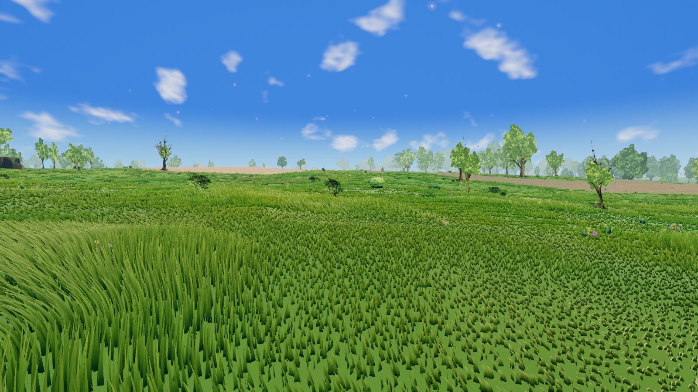
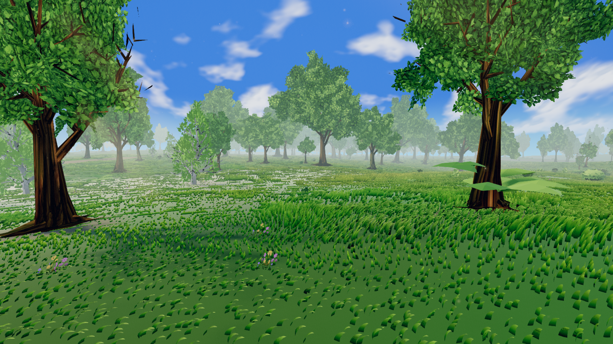
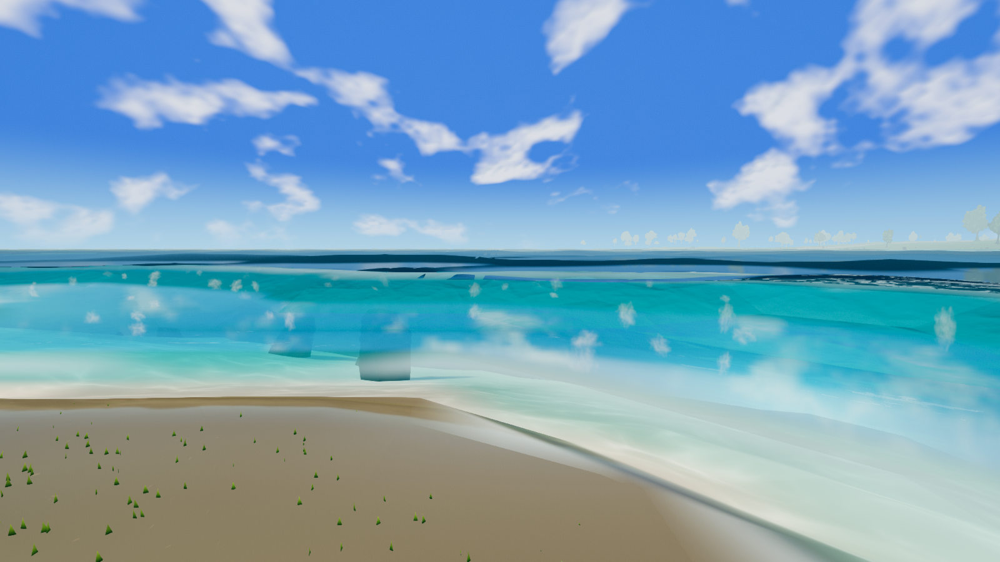

# AAA look and feel: fresh world review, October 15, 2026

Status: **visual review and proposed follow-up work**. No production rendering,
generation, assets, or gameplay settings were changed for this review.

The largest opportunity is to make the existing stylized fantasy world feel
coherent at player height: natural grass silhouettes, grounded vegetation and
rocks, readable shorelines, and more distinct habitats. Increasing density or
adding another post-processing effect should not be the starting point.

[Browse the screenshots, with a clean/HUD toggle](../qa/visual-audit-2026-10-15/index.html)
or open the [full contact sheet](../qa/visual-audit-2026-10-15/contact-sheet.jpg).
Every recommendation below is either tied to a new capture or explicitly marked
as prior evidence or a follow-up hypothesis.

## Scope and evidence

- Runtime: frozen `a0c9b11c0fdea6c14ea6c58e6e3951713c53c313` on `main`.
- Twelve **new random land locations**, one per canonical biome ID 1–12.
  LCG seed `20261015`, first encountered occurrence per biome among 3,776
  candidate cells in `[-8000,8000)` on each axis; yaw is also randomized.
  Generator seed `918273`, version 1, height scale 24 m. These are stratified
  samples, not an area-weighted survey or selected beauty shots.
- Two targeted coastal views supplement those samples. Four Eldara views are
  seeded choices among the existing imported forest, taiga, glacier and wetland
  fixtures; their coordinates are not newly randomized. The coastal camera
  remains on grassland ID 4, so this is not a camera-pose test of marine ID 0.
- Headed Windows Chromium, hardware NVIDIA Lovelace **WebGPU**, fallback false;
  1600 × 900, DPR 1. Player views use FOV 68°, pitch −0.08 radians. The aerial
  coast supplement uses its recorded fixture camera.
- Highfield preset at paused noon, manual weather off. Regional atmosphere,
  wind, foliage, ambient particles and biome snow remain active. Clean and HUD
  images are successive frames, not pixel-identical layer comparisons.
- Captures wait for full terrain, scenery and collision readiness, 60 ready
  frames, and stable static lighting. Metadata records actual biome, origin,
  camera, preparation and source/image hashes. See the
  [capture report](../qa/visual-audit-2026-10-15/report.json) and
  [reproduction instructions](../qa/visual-audit-2026-10-15/README.md).

**Capture result:** 18/18 views completed, all expected biome IDs matched, every
pose passed readiness, source snapshot remained fixed, and browser errors were
zero. The 36 full-resolution PNGs retain clean and HUD variants. These are
capture-validity results, not art-quality or performance passes.

This pass assesses still-image appearance. It does not establish frame pacing,
wind quality in motion, sound, input latency, building quality, every view of a
biome, or other quality tiers. No HUD FPS value is used as a benchmark. Biome
labels describe the camera's cell; neighboring biomes can be visible.

## What the new screenshots show

| Capture | Canonical X, Z (m) | Observation |
| --- | --- | --- |
| [01 · Hot desert](../qa/visual-audit-2026-10-15/random-01.png) | −5791, −27 | Broad pale sand with soft large patterns and little local relief. Dark upright rocks punctuate a low horizon. |
| [02 · Cold desert](../qa/visual-audit-2026-10-15/random-02.png) | −10593, −5347 | Similar pale substrate to hot desert; angular dark stones and the bright water edge dominate the right side. |
| [03 · Savanna](../qa/visual-audit-2026-10-15/random-03.png) | 10087, −4015 | Gold grass distinguishes the palette, but tall patches meet dense short wedges; the foreground has a crop-like rhythm. |
| [04 · Grassland](../qa/visual-audit-2026-10-15/random-04.png) | −1869, −4003 | Strong green meadow mass, with conspicuous low triangular stubble between taller patches and few quiet foreground areas. |
| [05 · Tropical seasonal forest](../qa/visual-audit-2026-10-15/random-05.png) | 15453, −45 | This direction is an open meadow with a pale distant tree belt. It does not communicate much seasonal-forest identity at player height. |
| [06 · Temperate deciduous forest](../qa/visual-audit-2026-10-15/random-06.png) | 3135, 7229 | Broad exposed green ground, tiny grass wedges and pale bare strips; trees have weak integration with the ground around them. |
| [07 · Tropical rainforest](../qa/visual-audit-2026-10-15/random-07.png) | 13051, −1427 | Close trunks and crowns provide useful depth. Under them, bright green turf, sparse short blades and an isolated broadleaf plant read as separate layers. |
| [08 · Temperate rainforest](../qa/visual-audit-2026-10-15/random-08.png) | −13937, −14851 | Large areas of short wedges on nearly uniform green ground; scattered slender trees, with little visible woodland-floor structure. |
| [09 · Taiga](../qa/visual-audit-2026-10-15/random-09.png) | −2847, −6683 | Full conifer silhouettes are a strength. Olive groundcover, an orange distant tree belt and bright turquoise water need a more unified local palette. |
| [10 · Tundra](../qa/visual-audit-2026-10-15/random-10.png) | −4117, −14839 | Sparse ochre growth and pale ground are distinct from meadow. Needle-thin crowns, black rocks and broad cyan/white water bands are prominent. |
| [11 · Glacier](../qa/visual-audit-2026-10-15/random-11.png) | −4279, 8429 | Continuous treeless snow with fine surface breakup. Large forms and value separation remain weak; snowfall supplies much of the visual activity. |
| [12 · Wetland](../qa/visual-audit-2026-10-15/random-12.png) | 11495, 9197 | A convincing leafy canopy, but the facing ground reads as green woodland rather than a damp habitat; no open water appears in this direction. |
| [Coast · eye level](../qa/visual-audit-2026-10-15/marine-coast.png) | −2077, 1731 | Broad dark bands, hard polygonal boundaries and repeated upright spray shapes are conspicuous in the water. The bright shoreline is visually thick. |
| [Coast · overview](../qa/visual-audit-2026-10-15/marine-coast-overview.png) | −2077, 1731 | Depth gradient, submerged rocks and wave shading read more coherently from above. The eye-level problems need their own acceptance view. |
| [Eldara · forest](../qa/visual-audit-2026-10-15/eldara-forest-reverse.png) | −7134127, 1081563 | Strong close crowns and a pale winding bare strip; repeated grass wedges and bright ground remain visible under the trees. |
| [Eldara · taiga](../qa/visual-audit-2026-10-15/eldara-taiga.png) | −982683, 371387 | A recognizable conifer horizon, but very sparse narrow foreground crowns and low grass repeat across an open, weakly layered floor. |
| [Eldara · glacier](../qa/visual-audit-2026-10-15/eldara-glacier.png) | −2747061, 316061 | Fine snow texture is visible, but this direction has little large-scale relief or middle-distance structure. No mountain panorama is established by this view. |
| [Eldara · wetland](../qa/visual-audit-2026-10-15/eldara-wetland-reverse.png) | 993673, 1701497 | Darker dense reeds and heavier cloud distinguish it from the procedural wetland; the growth still forms a broad uniform field. |

The desert shots no longer show the conspicuous white streaks documented in the
[October 13 review](world-visual-quality-plan-2026-10-13.md). This is a qualitative
comparison at different locations, not a controlled before/after test. The new
glacier point is genuinely classified as 11 and has a continuous snowy foreground;
the previous warm-glacier classification problem must not be presented as newly
rediscovered. Current conifers also have useful full crowns in the taiga view.

## Priority order

Priorities express proposed delivery order, not a claim that a root cause has
already been established. S/M/L indicate relative scope, not elapsed-time promises.

| ID | Priority / scope | Work | Evidence and success criterion |
| --- | --- | --- | --- |
| A0 | P0 / M | Close the existing motion and alpine-tree release blockers. | Prior QA below; retain the existing gates and publish passing reruns before calling the renderer release-ready. |
| A1 | P1 / M | Correct short grass silhouettes and patch transitions. | 03–08, 12: low growth must read as plants or exposed substrate, without a foreground carpet of disconnected triangular tips. |
| A2 | P1 / M | Connect terrain, trunks, stones and groundcover. | 01–02, 06–10: visible contact, appropriate substrate, and consistent scale at 2–20 m. |
| A3 | P1 / M | Integrate water with banks and local lighting. | 02, 09–10 and coastal supplements: coherent wet bank, shallows and deeper water; investigate conspicuous straight bands before color tuning. |
| A4 | P1 / M | Improve biome identity through composition and understory. | 05–08, 12: distinguish habitat structure using existing assets, soil and canopy response, not just hue. |
| A5 | P2 / M | Tune atmosphere, sky and ambient effects as one composition. | 03–08, 11: preserve depth without washing out whole tree belts; make bright motes and snowfall context-sensitive. |
| A6 | P2 / L | Add a later landscape-composition pass. | 01, 03–05, 11: stronger landform and landmark hierarchy in representative routes, while retaining intentional open spaces. |
| A7 | P2 / S | Refine exploration HUD hierarchy. | [04 with HUD](../qa/visual-audit-2026-10-15/random-04-hud.png): reduce the large mostly empty Highfield panel and competing control styles. |
| A8 | P2 / M | Validate feel while moving and listening. | Not assessed by these stills: record walk/sprint/turn/shore sequences and review sound, interaction and temporal continuity. |

## A0 — Finish the existing release work first

The [implementation report](../qa/world-visual-quality-implementation-2026-10-14.md)
already tracks unresolved acceptance. Keep its VQ task IDs and fixes authoritative;
this review adds new visual targets rather than replacing that specification.

- [Motion smoke evidence](../qa/world-visual-quality-2026-10-14/motion/smoke-v2/README.md)
  failed the two-second scenery recovery gate at the intermediate stop in both
  camera modes. New stationary screenshots cannot clear that failure.
- [Four-light tree evidence](../qa/world-visual-quality-2026-10-14/fixtures/trees-four-lights/README.md)
  failed alpine prototype 27 near-mesh/impostor luminance checks. Investigate the
  representation difference; do not brighten every tree or relax the ratio.
- Retain resource accounting and the final aggregate acceptance work. A complete
  capture run is not proof that either rendering quality or performance passes.

## A1 — Make groundcover look natural at player height

**Observed:** short, wide wedges repeat across many unrelated locations, alongside
taller bands. This is the strongest recurring visual defect in the new set.
**Unconfirmed:** whether growth-height scaling, wind/interaction deformation,
geometry selection, LOD, or several factors produce it.

Start with fixed-pose diagnostic pairs at 04, 06, 08 and 12: ordinary view, neutral
interaction, frozen wind, then forced near geometry. Inspect geometry before and
after the growth profile is applied. Keep these diagnostic toggles out of saved
world state. Do not assume that the earlier passing interaction fixture covers
every new location.

Then tune short plants as coherent silhouettes: proportional width, taper and
curvature; irregular gaps; small clumps; a less uniform transition into tall
growth. Exposed ground must carry the low-coverage areas. Reuse deterministic
candidate identities and the shared habitat field. Do not solve a silhouette
problem by adding more instances or scaling every plant upward.

Likely owners: [meadowBladeShape.js](../../src/editor/stylized/meadow/meadowBladeShape.js),
[meadowGrowthProfiles.js](../../src/editor/stylized/meadow/meadowGrowthProfiles.js),
[meadowGrowthMath.js](../../src/editor/stylized/meadow/meadowGrowthMath.js),
[meadowInteractionBend.js](../../src/editor/stylized/meadow/meadowInteractionBend.js).

**Acceptance:** review original-size images at 2, 10, 30 and 60 m, a low grazing
angle, and the moving camera. Low growth remains rooted and legible, density and
height handoffs do not form visible rings, and standing recovery restores the
same deterministic layout. Keep the established biome heights as a starting
constraint; any later art-direction change needs its own explicit config diff.

## A2 — Give surfaces scale and ground objects in them

Sand, snow and forest ground already have material detail. The issue is how weakly
their local form reads beside sharp grass and dark rocks, especially at noon.

1. Compare material-only, normal-only and lit views before changing exposure.
   Separate broad color variation, metre-scale structure and fine detail. Use
   restrained ripples/grain on sand, broken mineral surfaces in cold desert,
   litter under canopy, and wind-shaped snow structure. Keep distant appearance
   consistent with the near material rather than adding high-frequency noise.
2. Check root and rock contact at the existing shadow settings. Use the current
   canopy/contact fields for local darkening and substrate transitions. Avoid
   global AO that blackens every grass tuft, and avoid perfectly circular dirt
   halos around every object.
3. Diagnose the near-black rock faces in 01, 02, 09 and 10 with authored textures,
   material tint, lighting and weathering isolated. Preserve usable texture
   detail and facet separation. Vary burial, orientation and grouped size
   relationships before increasing rock count; upright slivers should be rare.

Likely owners: [terrain material configuration](../../config/terrain-material-bake.yaml),
[TerrainMaterialMicroDetailNodes.js](../../src/editor/materials/TerrainMaterialMicroDetailNodes.js),
[TerrainMaterialFeatureResponseNodes.js](../../src/editor/materials/TerrainMaterialFeatureResponseNodes.js),
[contactShade.js](../../src/editor/stylized/contactShade.js),
[StylizedRockView.js](../../src/editor/stylized/StylizedRockView.js),
[rockWeathering.js](../../src/editor/stylized/rockWeathering.js).

**Acceptance:** compare dry/wet and noon/low-sun/overcast/night at identical poses.
Ground detail remains visible without shimmer; lit rocks retain readable planes;
roots and stones meet the ground convincingly. Surface improvements must also
survive far-material handoff and floating-origin rebasing.

## A3 — Treat bank, shallows and water as one environment

Use coast ground/overview views and the taiga/tundra shores to isolate the broad
cyan, dark and white bands. Inspect depth, wave/surface geometry, foam, shoreline
mask and material handoffs independently before concluding that this is a palette
defect. Preserve the actual distinction between inland and marine water.
The elevated view is substantially more coherent than the eye-level view; fixing
only an overhead screenshot would miss the player-facing problem. Check the
repeated upright spray sprites separately for placement, scale, opacity and
variation, using a short clip to distinguish a transient wave phase from a seam.

Build the visible transition from dry substrate through a damp contact strip to
submerged material and deeper water. Vary foam coverage with the existing coast,
depth and current fields, so calm edges do not read as a continuous white outline.
Place existing shore plants and stones using habitat rules, with gaps and varied
group sizes. Keep water depth readable and land/water collision unchanged.

Likely owners: [water-visual.yaml](../../config/water-visual.yaml),
[StylizedWaterMaterial.js](../../src/editor/stylized/StylizedWaterMaterial.js),
[shoreHabitat.js](../../src/editor/stylized/shoreHabitat.js),
[riverbankRocks.js](../../src/editor/stylized/riverbankRocks.js).

**Acceptance:** no unexplained straight or rectangular water boundaries at either
camera height; no hovering water edge or luminous shore at night; continuous bank
material at 2–30 m. Repeat the water acceptance route and report the existing
scene-copy/refraction cost before proposing another screen-space pass.

## A4 — Make the biomes distinguishable beyond color

These are compositional targets to verify in several directions and at additional
locations, not claims that an entire biome lacks the following features.

| Biome | Direction for the next composition pass |
| --- | --- |
| Hot desert / cold desert | Warm wind-shaped sand versus cooler broken mineral ground; distinctive rock grouping and sparse accents, without filling all negative space. |
| Savanna / grassland | Dry grass islands and open corridors versus shorter meadow mosaics, flowers and occasional groves; avoid a uniform crop field. |
| Tropical seasonal forest | Readable canopy openings, dry litter and understory clusters; ensure an open sample still has a recognizable forest context. |
| Temperate deciduous forest | Litter, root transitions and shaded understory with deliberate clearings. |
| Tropical rainforest | Strong canopy/understory separation, broadleaf clusters and humid depth; keep close bark and leaf color readable. |
| Temperate rainforest | Cooler moss/litter response and layered vegetation around existing trees; avoid simply recoloring the meadow recipe. |
| Taiga | Preserve full conifer crowns; connect needle-like floor material, sparse shrubs and local shoreline color. |
| Tundra | Low irregular vegetation, exposed mineral ground and partial snow; keep sparse treeline character without needle-thin silhouettes becoming the only landmark. |
| Glacier | Continuous snow/ice identity, restrained blue-grey relief and exposed rock where slope allows; no meadow fill. |
| Wetland | Damp hollows, mud, reed groupings and coherent water margins where hydrology supports them; do not flood dry ground just to make a screenshot read as swamp. |

Use [ForestBiomeProfiles.js](../../src/editor/stylized/forest/ForestBiomeProfiles.js),
[ForestHabitatField.js](../../src/editor/stylized/forest/ForestHabitatField.js),
[BiomeAssetPalette.js](../../src/editor/stylized/BiomeAssetPalette.js), meadow
profiles and shared terrain masks. Recompose the current library within existing
resident and candidate budgets before commissioning new assets.

**Acceptance:** compare three separated locations and opposing directions for
each targeted biome, including edges. Review unlabeled contact sheets for
recognizable plant structure and substrate, then verify actual source IDs.
Near and far representations must tell the same ecological story.

## A5–A8 — Atmosphere, landscape composition and feel

**A5, atmosphere:** tune regional fog against foreground/midground/background
readability, retaining humid forest depth and crisp cold air. Soft cloud shapes
and bright star-like motes recur across the daytime shots; review their scale,
opacity and frequency in motion. Establish whether the points are ambient
particles before changing sky stars. Keep magical accents contextual. Owners:
[regionalSkyLook.js](../../src/editor/stylized/sky/regionalSkyLook.js),
[AmbientEffectsSystem.js](../../src/editor/stylized/ambient/AmbientEffectsSystem.js),
[ambient-effects.yaml](../../config/ambient-effects.yaml). Judge the same
four lighting conditions as A2; a sunset-only beauty shot is insufficient.

**A6, landscape composition:** a later, larger scope than the current VQ release.
The open random views often have a low continuous horizon and little middle-distance
structure. Prototype one short route per environment with coherent rises,
exposed rock groups, vegetation gaps and a recognizable destination. Reuse existing
placement systems first. New ridges, erosion, distant terrain or landmark systems
need a separate generator/residency design and save/edit compatibility review;
do not change the imported Azgaar heightfield to improve a screenshot. Validate
these ideas at a terrain overview and normal eye height before broad rollout.

**A7, HUD:** the current clean-capture mode works and exploration metrics are
already reduced. Refine the remaining [ordinary HUD](../qa/visual-audit-2026-10-15/random-04-hud.png):
collapse the mostly empty lower-left location panel, unify the visual language
of mode controls, Scenic tour and spell dock, and reserve strong contrast for
the active action. Preserve keyboard access, contrast on snow and sand, scale
settings and the editor's full controls. Owner:
[playerHud.css](../../src/editor/player/hud/playerHud.css) and its HUD controllers.

**A8, feel — follow-up, not established by stills:** review recorded first/third-person
walk, sprint, stop, turn, water entry and return routes. Check stable horizon,
wind consistency across plant sizes, grass recovery, audible surface changes,
water/forest ambience and abrupt audio transitions. Use existing input, character
and audio systems. Make camera bob, shake and motion effects optional if later
introduced; do not add them as a substitute for stable frame delivery.

## Delivery and validation

1. **Complete current VQ acceptance (A0).** Retain known failing reports, isolate
   causes, and rerun the existing tree and motion gates.
2. **Foreground slice (A1 + A2).** Use 04, 07 and 02 as meadow, forest and bare-ground
   anchors. Approve silhouettes, substrate and contact together; then revisit
   every random pose to catch cross-biome regressions.
3. **Coast and habitat slice (A3 + A4).** Add opposing views and extra wetland/forest
   samples. Reuse assets and maintain deterministic placement.
4. **Presentation pass (A5 + A7).** Tune atmosphere after surfaces and ecology;
   validate HUD on bright and dark scenes. Do not hide defects with fog or grading.
5. **Moving acceptance (A8), then later landscape expansion (A6).** Keep new
   generator/landmark work separate from finishing the existing visual release.

For any terrain, streaming, rendering or residency implementation, first follow
[the performance QA guide](../perf-qa.md) and the existing
[release acceptance contract](world-visual-quality-spec/04-presentation-and-acceptance.md).
Capture baseline and changed revisions with the same poses, viewport, weather,
quality and hardware; retain source/config hashes and raw results.

- Repeat all 18 retained views plus close-range diagnostics and the relevant
  existing biome, surface, LOD, lighting, interaction and water suites.
- Use headed hardware WebGPU for authoritative performance runs; exclude
  screenshot/video recording from frame-rate comparisons. Test WebGL fallback
  separately for appearance and functional compatibility.
- Preserve the current strict gates: three chunk-cross runs with zero post-warmup
  frames above 33.3 ms; matrix p95 ≤33.3 ms and hitch rate ≤2%; comparative median
  p95/p99 and tracked resource/upload bytes ≤1.10× the accepted baseline;
  terrain commit p95 <2 ms, stylized build p95 <4 ms; no missing eligible near
  tiles after warmup and post-stop scenery recovery ≤2 seconds. Missing resource
  baselines remain missing work, not implied passes.
- Preserve canonical Azgaar IDs **0–12**, deterministic persisted custom IDs
  **32–254**, authored edits and semantic workshop state. Rendering/habitat
  profiles are derived data, never replacement terrain IDs. No legacy remapping.
- Keep current quality tiers, texture sizes, shadow resolution and resident
  distances as the starting budget. Any increase needs isolated measurements.
  Avoid new full-screen depth/color copies and one scene object per tiny detail.

Completion means improved original-size images **and** stable moving routes with
passing checks. It does not mean that more effects were enabled or that one
carefully selected screenshot looks better.
