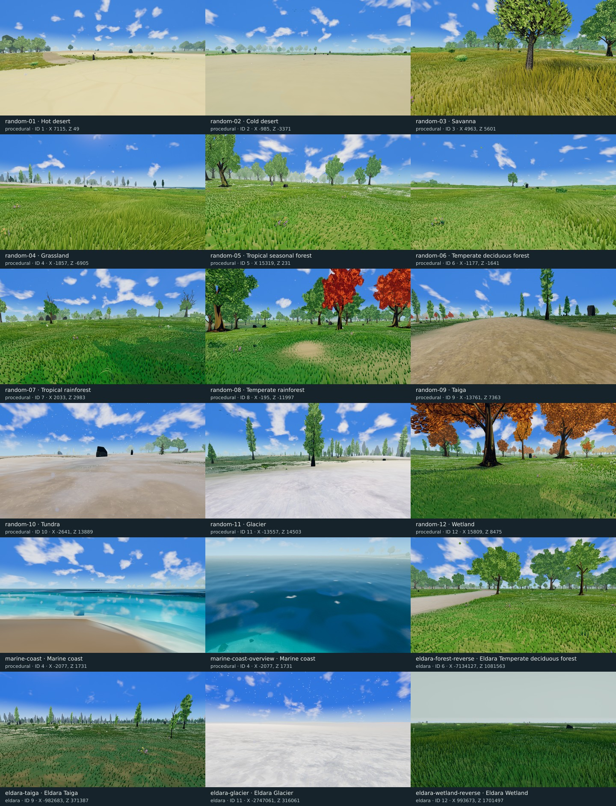

# AAA look and feel — random map review, October 16, 2026

Status: **review and implementation plan; no production changes in this task.**

The highest-value next step is to restore the intended tree representations,
then improve the relationships between ground, vegetation, water and distance.
The world already has substantial rendering machinery. The screenshots need
more consistent material scale, habitat structure and visual hierarchy.

[Screenshot gallery](../qa/visual-audit-2026-10-16/index.html) ·
[Contact sheet](../qa/visual-audit-2026-10-16/contact-sheet.jpg) ·
[Capture evidence and reproduction](../qa/visual-audit-2026-10-16/README.md)

## 1. Review method and limits

- Frozen runtime: `52914b1559ceda00526ca027b83a89775ced63a4` on `main`.
- Twelve **new random procedural positions**, one for each land biome, IDs
  1–12. LCG seed `20261016`; first occurrence of each ID among 13,438 candidate
  cell pairs in `[-8000,8000)` on each axis. Accepted points also consume a
  random yaw. This is biome-stratified sampling, not an area-weighted survey.
- Two existing coastal fixtures and four seeded choices of existing Eldara
  fixtures supplement those positions. These six are freshly rendered images
  at known coordinates, not six newly randomized locations. The coast camera
  stands on grassland ID 4; marine water is visible, but this is not an ID 0
  camera-cell test.
- Generator seed `918273`, version 1, height scale 24 m. Headed Windows
  Chromium, NVIDIA Lovelace hardware WebGPU, fallback false. Viewport 1600 × 900,
  DPR 1. Ordinary player views: 1.7 m eye height, FOV 68°, pitch −0.08 radians.
- Highfield at paused noon, manual weather off. Regional air, wind, particles
  and biome snow remain active. Each pose uses the production camera-cut path,
  at least 16 seconds of preparation, 60 consecutive completely ready frames,
  and a separate static-light convergence check.
- Clean canvas PNGs and HUD PNGs are original captures of successive frames.
  The contact sheet only resizes and labels copies. No image generation,
  retouching or extra color grading was used.

The [manifest](../qa/visual-audit-2026-10-16/manifest.json) retains requested
poses; the [report](../qa/visual-audit-2026-10-16/report.json) retains actual
biomes, canonical positions, floating origins, readiness, resources and PNG
hashes. The source server freezes its declared runtime/configuration/atlas
files; other asset paths still come from the checkout. See the evidence README
for the resulting reproducibility limits.

**Capture result:** 18/18 requested views completed, with all expected biome
IDs matched, complete readiness, stable frozen source and zero browser errors.
All 36 original PNG hashes are retained. **Asset quality did not pass:** the
tree atlas was rejected at startup. The separate
[runtime probe](../qa/visual-audit-2026-10-16/tree-atlas-probe.json) confirms zero
loaded tree atlases on both procedural and imported worlds. The screenshots
document the current degraded scene; they are not a release-quality baseline.

**Interpretation:** a biome label identifies the camera cell, not the entire
view. Trees, snow or grass across a boundary can be correct. An open view from a
forest cell does not prove every forest is empty. These stills do not establish
motion quality, audio, frame pacing, input latency, other quality tiers or
WebGL quality. Proposed artistic targets below are review criteria, not
measurements already achieved.

## 2. What is already implemented

Build on the [October 15 review](aaa-look-and-feel-plan-2026-10-15.md) and the
[world visual quality specification](world-visual-quality-plan-2026-10-13.md),
without treating their historical defect lists as the current baseline.

- Today's [sparse-grass implementation](../qa/sparse-grass-implementation-2026-10-16/README.md)
  already adds tuft structure, proportional short-blade widths, better root
  brightness and litter/moss/soil detail. Its G4 record covers motion, LOD and
  lighting on selected grassland/taiga routes. Preserve those gains. This plan
  extends composition and biome variety rather than reimplementing G1/G2.
- Terrain already has material families, feature responses, substrate roughness,
  canopy/contact information and near/far blending. There is no need to start
  another terrain material system.
- Regional atmosphere, shoreline swash, foam, underwater optics, forest habitat,
  ambient effects, a screenshot HUD mode and soundscape systems already exist.
  First establish why their combined result falls short in a particular view.
- Prior acceptance is still incomplete. Today's grass report records remaining
  grassland sprint/recovery trouble and construction hitch failures on both
  compared revisions. The earlier [visual implementation report](../qa/world-visual-quality-implementation-2026-10-14.md)
  records alpine near/impostor lighting failures. Fresh stills cannot clear
  these. Revalidate the alpine issue after restoring the atlas; do not assume
  the previous failure survives recent asset changes unchanged.

## 3. Screenshot observations



Use the linked native PNGs below for fine detail; the sheet is a browsing aid.

| View / canonical X, Z (m) | Visible result | Follow-up |
| --- | --- | --- |
| [01 · Hot desert](../qa/visual-audit-2026-10-16/random-01.png) · 7115, 49 | Pale, broad sand with faint large polygon-like lines; grass islands and dark upright stones; detailed near trees against faceted far crowns. | Q0, Q1, Q4. Separate surface pattern from terrain geometry before adding detail. |
| [02 · Cold desert](../qa/visual-audit-2026-10-16/random-02.png) · −985, −3371 | A similarly pale, smooth foreground and a very low horizon; broad faceted crowns beyond a narrow green/water belt. | Q0, Q1. Establish mineral character distinct from hot sand. |
| [03 · Savanna](../qa/visual-audit-2026-10-16/random-03.png) · 4963, 5601 | Strong gold grass and close tree framing. Tall and short swaths read clearly, but stem repetition and bright green broadleaf crowns compete with the dry palette. | Q1, Q2. Preserve the grass sweep while improving tuft/ground and canopy relationships. |
| [04 · Grassland](../qa/visual-audit-2026-10-16/random-04.png) · −1857, −6905 | Dense green foreground, flower accents and directional grass. A pale boundary and tall simplified tree silhouettes dominate the middle distance. | Q0, Q1. Revisit with restored atlases and boundary diagnostics. |
| [05 · Tropical seasonal forest](../qa/visual-audit-2026-10-16/random-05.png) · 15319, 231 | Useful tree groups, but the floor is a repeated bright broadleaf/grass carpet with pale strips; little visible litter or understory hierarchy. | Q1, Q2. Add seasonally coherent floor/clearing structure. |
| [06 · Temperate deciduous forest](../qa/visual-audit-2026-10-16/random-06.png) · −1177, −1641 | This heading is open grass with one prominent tree and stone, a nearly flat skyline and repeated short growth. | Q2, Q5. Check adjacent cells/headings before changing forest coverage. |
| [07 · Tropical rainforest](../qa/visual-audit-2026-10-16/random-07.png) · 2033, 2983 | Broad green groundcover, scattered tree shapes and substantial open sky; short curved stems repeat across exposed ground. | Q1, Q2. Diagnose clearing context; develop layered forest interiors elsewhere in the same habitat. |
| [08 · Temperate rainforest](../qa/visual-audit-2026-10-16/random-08.png) · −195, −11997 | Strong close trunks, green/orange canopy and depth. Smooth bare patches and meadow-like ground contrast with the detailed crowns. | Q1, Q2, Q6. Coordinate floor, understory and accent palette. |
| [09 · Taiga](../qa/visual-audit-2026-10-16/random-09.png) · −13761, 7363 | A broad textured bare strip fills the foreground; thin green crowns, warm distant trees and a very dark upright stone divide the scene. | Q2, Q4. Improve forest-floor margins and grouped rock/vegetation scale. |
| [10 · Tundra](../qa/visual-audit-2026-10-16/random-10.png) · −2641, 13889 | Sparse growth, patchy pale snow, blowing flakes and isolated dark rocks; distant broadleaf trees remain visible across the open ground. | Q1, Q4, Q6. Keep sparsity; strengthen cold substrate and rock integration. |
| [11 · Glacier](../qa/visual-audit-2026-10-16/random-11.png) · −13557, 14503 | Fine directional snow meets green ground and tall trees very near the camera. This is a mixed-edge view, not a treeless glacier interior. | Q1, Q5. Inspect neighborhood classification and placement footprints; do not relabel the camera cell from the picture. |
| [12 · Wetland](../qa/visual-audit-2026-10-16/random-12.png) · 15809, 8475 | Large orange/gold crowns and useful trunk framing over bright green short grass. No open water is visible in this heading. | Q2, Q3. Add damp-floor/hydrology cues where supported, with deliberate canopy palette. |
| [Coast · eye level](../qa/visual-audit-2026-10-16/marine-coast.png) · −2077, 1731 | Broad dark wave planes, angular shallow edges, very cyan water and a thick bright bank band; repeated upright spray puffs. | Q3. Resolve geometry/normal/foam/spray contributions individually. |
| [Coast · overview](../qa/visual-audit-2026-10-16/marine-coast-overview.png) · −2077, 1731 | More coherent depth and wave shading, visible submerged rocks and soft foam patches. Far shore trees are strongly washed out. | Q3, Q6. Preserve these strengths while fixing the eye-level failure. |
| [Eldara · forest](../qa/visual-audit-2026-10-16/eldara-forest-reverse.png) · −7134127, 1081563 | Strong broad crowns and a winding bare strip. Short grass dominates the floor; faceted distant crowns remain obvious between near trees. | Q0, Q1, Q2. Validate at large canonical coordinates. |
| [Eldara · taiga](../qa/visual-audit-2026-10-16/eldara-taiga.png) · −982683, 371387 | Sparse thin nearby crowns against a dense band of pointed proxy shapes; short grass and exposed ground repeat across a flat field. | Q0 first, then Q2. This is a strong near/far representation comparison. |
| [Eldara · glacier](../qa/visual-audit-2026-10-16/eldara-glacier.png) · −2747061, 316061 | Treeless snow, visible surface relief and active snowfall, but very little middle-distance or horizon structure in this direction. | Q5, Q6. Inspect actual surrounding relief before proposing landform changes. |
| [Eldara · wetland](../qa/visual-audit-2026-10-16/eldara-wetland-reverse.png) · 993673, 1701497 | Darker, taller growth under a distinct heavy gray sky. The scene remains a broad continuous sward with isolated stones and a pale bare strip. | Q2, Q3. Preserve mood; add habitat-shaped openings and damp-ground cues. |

The selection deliberately accepts the first matching cell, including edges.
Use these views to discover problems; add interior samples before claiming an
entire biome has the same appearance. The paired Eldara fixtures are useful
for revisiting older observations, but this task is not a controlled historical
A/B: runtime, assets and live wind/particle frames have changed.

## 4. Art direction and practical quality bar

Keep the readable, stylized fantasy direction: expressive tree silhouettes,
controlled color families, tactile surfaces and atmospheric depth. A convincing
scene should have a clear large shape, supporting medium forms and restrained
fine detail. More grass, darker AO or heavier post-processing cannot substitute
for those relationships.

Use three viewing scales in every review:

| Distance | Intended reading | Current investigation |
| --- | --- | --- |
| 0–10 m | Rooted plants, believable soil/litter/sand, readable rock planes. | Smooth gaps, regular short growth, abrupt trunk/ground relationships. |
| 10–80 m | Groves, clearings, banks, understory and useful routes. | Repeated tree/grass rhythms and weak differentiation between several habitats. |
| 80 m to horizon | Connected canopy masses, landform hierarchy and atmosphere. | Simplified crowns, pale belts and flat horizons in several sampled directions. |

These ranges are art-review bands, not proposed changes to residency or LOD
distances. Capture fixed poses at original resolution and thumbnail size. A
good result must work with the HUD visible during ordinary exploration.

## 5. Prioritized delivery sequence

Effort is relative: S = focused config/asset/UI work; M = several coordinated
modules or a small content kit; L = generation/streaming/content integration.
These are planning estimates, not calendar commitments.

| Work | Priority / effort | Depends on | Deliverable |
| --- | --- | --- | --- |
| Q0 | P0 / S–M | None | Restore verified tree atlas loading and expose degraded-asset state to QA. |
| Q1 | P1 / M | Q0 baseline | Coherent terrain/grass/ecotone scale at six representative poses. |
| Q2 | P1 / M–L | Q0, Q1 inputs | Biome-specific forest structure and a bounded understory kit. |
| Q3 | P1 / M | Q1 shore masks | Eye-level coastal water, bank and wetland integration. |
| Q4 | P1 / M | Q1 palette | Grounded rock groups and readable material response. |
| Q5 | P2 / L | Q0, Q2; geography review | Regional landform and landmark composition prototype. |
| Q6 | P2 / M | Q0–Q4 stable | Lighting, atmosphere and particle hierarchy across four conditions. |
| Q7 | P2 / S–M | Stable visuals | Compact exploration HUD and a separate feel/audio review. |
| Q8 | P0 gate / M | Per-package and final | Fixed-pose, temporal, streaming, memory and compatibility acceptance. |

Q8 starts with baseline capture and runs after each affected package. Q0 is the
first implementation slice: it changes the evidence used to judge almost every
wooded horizon. After that, complete a small vertical slice at grassland 04,
temperate rainforest 08 and the eye-level coast before widening the scope.

### Q0 — Make the intended trees reach the screen

**Evidence:** startup logged `Tree impostor manifest does not match the current
tree source assets.` The warning says runtime baking will be attempted, but
the captured configuration has `runtimeBake: false`. The loader's rejected
atlas therefore leaves the proxy fallback available. Several horizons visibly
contain large faceted crown volumes beside detailed near foliage.

The read-only probe reproduced this at the same frozen revision on both worlds:
runtime signature `tree-impostor-v7-ddf715ab`, manifest signature
`tree-impostor-v7-edb495ec`, 29 runtime and manifest prototypes, **0 loaded
atlases and 0 impostor batches**. Its warning log, settings and script hash
are in [tree-atlas-probe.json](../qa/visual-audit-2026-10-16/tree-atlas-probe.json).
This confirms the loading failure; it does not yet identify which input made
the signatures diverge, or prove that every visible tree issue has that cause.

**Implementation steps:**

1. Compare the runtime prototype signature and shipped manifest signature on
   both procedural and Eldara loads. Record prototype count, atlas count,
   compression/source, source/config hashes and any warnings. Separate an
   invalidated bake from asset-loader/configuration nondeterminism.
2. Fix the actual signature/input mismatch. If a valid asset change requires
   rebaking, regenerate atlases, foliage-aware mips and compressed derivatives
   together from the same frozen inputs. Keep their manifest and source inputs
   in one reviewable change. Do not disable signature checking or enable
   gameplay runtime baking as the repair.
3. Extend the production asset check so a stale manifest cannot pass merely
   because files exist and their dimensions are correct. The current
   `validate-impostors.mjs` call does not supply an expected runtime signature;
   a browser startup check must verify that the actual prototype set loaded
   the intended atlases.
4. Add warning/degradation reporting to visual QA. Keep readiness, asset
   integrity and artistic acceptance separate. A valid screenshot of a
   fallback scene is useful regression evidence but cannot approve a release.
5. Replay every retained pose, then exercise near/proxy/impostor transitions
   under noon, low sun, overcast and night. Preserve source placement identity.

**Owners:** [TreeImpostorManifest.js](../../src/editor/stylized/impostor/TreeImpostorManifest.js),
[TreeImpostorAssets.js](../../src/editor/stylized/impostor/TreeImpostorAssets.js),
[StylizedTreeView.js](../../src/editor/stylized/StylizedTreeView.js),
[bake-tree-impostors.mjs](../../scripts/bake-tree-impostors.mjs),
[validate-impostors.mjs](../../scripts/validate-impostors.mjs).

**Acceptance:** matching signatures on both worlds, all expected atlases loaded,
zero fallback warnings, and no missing atlas batches. Inspect silhouette,
coverage and luminance through transitions using the existing four-light tree
fixture. Runtime startup remains free of offline bake work. Cost is measured
against the restored intended scene; the cheaper degraded capture is not an
equivalent workload for a performance comparison.

### Q1 — Coordinate groundcover, exposed ground and biome edges

**Evidence:** 03–08 show substantial tall/short variation, but short growth still
forms repeated directional rows in places. The pale desert surfaces in 01/02
have little local structure. Near exposed patches in 08 are much smoother than
the surrounding detailed crowns. These are composition issues to isolate;
today's grass improvements should stay intact.

**Implementation steps:**

1. At 03, 04, 07 and 08, retain ordinary views and add downward, frozen-wind,
   interaction-neutral and grass-hidden diagnostic pairs. Record actual
   growth profile, geometry band, coverage and canopy inputs. Distinguish
   deterministic sampling rows from a temporarily aligned wind pose.
2. Inspect the existing tuft field before changing candidate count. Test small
   stable changes to within-tuft azimuth, rest lean and broadleaf curvature.
   Keep common gust direction while avoiding identical blade cross-sections
   and repeated little hooks. Hold population and habitat fixed for this A/B.
3. Establish three shared scales: quiet 8–30 m habitat masses, 0.25–2 m
   recognizable litter/soil/mineral patches, and filtered near microdetail.
   These are starting ranges for prototypes. Drive the ground and stems from
   the same canonical fields so dry gaps, moss hollows and plant roots agree.
4. Tune existing family/ground-detail contributions first. Grassland needs
   thatch and occasional soil; forest needs canopy-correlated litter and moss;
   hot desert needs directional sand structure; cold desert needs mineral
   breakup. If a small atlas extension is necessary, pack its channels and
   specify metre scale, normal convention, mip behavior and memory cost.
5. At visible green/pale/snow boundaries, collect a neighborhood map of source
   biome IDs, water, canopy and actual material weights. Blend presentation
   and ecological influence without changing canonical classification. Keep
   snow, exposed soil and grass acceptance coherent across the same edge.
6. Match the average value and coverage of near grass/ground to its mid/far
   representation. Test 6/14/30/50 m blade bands, card overlap and 14–34 m
   detail fade at eye level, grazing angle and low camera.

**Owners:** [meadowTuftField.js](../../src/editor/stylized/meadow/meadowTuftField.js),
[meadowBladeShape.js](../../src/editor/stylized/meadow/meadowBladeShape.js),
[meadowGroundDetail.js](../../src/editor/stylized/meadow/meadowGroundDetail.js),
[terrainMaterial.js](../../src/editor/terrainMaterial.js),
[TerrainMaterialFeatureResponseNodes.js](../../src/editor/materials/TerrainMaterialFeatureResponseNodes.js),
[terrain-material-bake.yaml](../../config/terrain-material-bake.yaml).

**Acceptance:** an unlabelled ground-only view distinguishes sand, mineral,
litter and meadow at player height; exposed gaps read as intentional surfaces;
ordinary views no longer show conspicuous rows or a contrast ring at the
handoff. Verify with isolated ground masks, original-size images and motion.
No extra grass population, residency radius or draw distance in the first
slice. The baked material documents a full 16-sampler budget; adding a sampler
requires explicit compiled-budget verification and a replacement strategy.

### Q2 — Give each forest a structure and a floor

**Evidence:** 06 is an open meadow-facing forest cell; 07 shows scattered trees
over broad green ground; 08 has stronger canopy framing but a grass-dominated
floor and very saturated orange crowns. These are particular directions,
not proof that the biome classifier or all forest coverage is wrong.

**Implementation steps:**

1. After Q0, inspect four headings and nearby cells at each sampled forest
   position. Log source biome mixtures, selected species/prototypes, habitat
   acceptance, canopy coverage, height/slope filters and representation counts.
   Establish whether the open result is a legitimate clearing or an overly
   restrictive/incorrect habitat condition.
2. Compose tree populations as connected stands with clearings and age groups.
   Reuse `RegionalCharacterField`, forest patch and habitat fields; do not add
   independent scatter noise for every new asset type. Avoid filling every
   clearing or adding trees merely to make one screenshot busy.
3. Make ground response follow canopy: deeper litter and restrained grasses
   under cover, brighter taller growth at margins, roots and fallen material
   around mature trees. Shape clearings with visible edges rather than a
   uniform tree distribution over meadow.
4. Prototype a small kit: fern group, sapling, dead branch/log, leaf/needle
   cluster, low shrub and wetland reed/sedge group. Reuse suitable assets first.
   Each addition needs real-world scale, palette, habitat rules, stable ID,
   bounds, LOD, collision policy and packed/instanced rendering. Add variety
   through relationships and spacing before increasing counts.
5. Give tropical forests larger crown groups and broad understory forms;
   temperate rainforest moss and cooler shade; taiga conifer cohorts and
   needle/moss openings. Derive exceptional orange/dry crowns from defined
   species/season/region rules rather than arbitrary per-tree hue noise.
6. Replay far-origin Eldara fixtures and eviction/revisit routes. Material
   features and placement identity must survive floating-origin changes.

**Owners:** [ForestBiomeProfiles.js](../../src/editor/stylized/forest/ForestBiomeProfiles.js),
[ForestHabitatField.js](../../src/editor/stylized/forest/ForestHabitatField.js),
[ForestPatchField.js](../../src/editor/stylized/forest/ForestPatchField.js),
[ForestFloor.js](../../src/editor/stylized/forest/ForestFloor.js),
[RegionalCharacterField.js](../../src/editor/stylized/RegionalCharacterField.js),
[StylizedGroundDetailView.js](../../src/editor/stylized/StylizedGroundDetailView.js).

**Acceptance:** review at least three locations and four headings per forest
family, with interior, edge and legitimate clearing represented. Each family
has at least three coherent cues beyond hue: canopy shape/spacing, floor type
and understory structure. Walkable openings remain. No visible prop grid,
uniform tree-age field, detached roots or new full-resident rebuild path.

### Q3 — Resolve water and its banks together

**Evidence:** the eye-level coast contains large dark surface planes, angular
nearshore contours, repeated pale spray puffs and a broad bright bank stripe.
The overview communicates depth and submerged rocks more successfully. Eldara
wetland has a stronger damp atmosphere than procedural 12, but both directions
need closer ground/hydrology inspection before prescribing new water features.

**Implementation steps:**

1. At the retained coast, capture eye-level and overview pairs with isolated
   swell displacement, interpolated/derived normal, reflection, foam, spray
   and seabed contributions. Use the production water field. An attractive
   aerial result cannot approve the eye-level result.
2. Diagnose broad dark water planes and abrupt edges separately: displaced
   surface normals, grid resolution, depth transitions, reflection and
   finishing. Change one contributor at a time. Increase mesh resolution
   only if a controlled silhouette/normal A/B establishes the need and budget.
3. Keep foam connected to breaking waves and shoreline contact. Break broad
   white bands into restrained discontinuous shapes with age/dissipation.
   Reuse the existing shared swash field; do not overlay unrelated noise or
   add another screen-wide copy/depth dependency without profiling it.
4. Give spray short, varied, wave-linked lifetimes and density. It should read
   as aerated water, not upright repeated flags. Test at low and high camera
   angles and against both dark water and bright sky.
5. Make a continuous bank sequence: dry ground → damp deposits → shallow water
   → deeper water. Waterline, wetness, reeds, rock algae and wrack must use the
   same local water level and distance. Raised lakes and rivers must not
   inherit the global ocean level.
6. For wetlands, compose reed/sedge islands, muddy gaps and shallow channels
   where canonical hydrology supports them. Humid forest floor is also valid
   wetland character; do not invent lakes purely from biome ID 12.

**Owners:** [StylizedWaterMaterial.js](../../src/editor/stylized/StylizedWaterMaterial.js),
[SeaSurfaceShading.js](../../src/editor/stylized/SeaSurfaceShading.js),
[SeaSurfNodes.js](../../src/editor/stylized/SeaSurfNodes.js),
[CoastSwashShading.js](../../src/editor/stylized/CoastSwashShading.js),
[shoreHabitat.js](../../src/editor/stylized/shoreHabitat.js),
[water-visual.yaml](../../config/water-visual.yaml).

**Acceptance:** coast, lake and river each pass eye-level and overview review;
no conspicuous polygon boundary, repeated spray motif or continuous painted
foam stripe dominates the image. Wet ground, vegetation and submerged rocks
share the waterline. Run the complete dry/swim/dive/surface/dry route and
origin-shift checks. Keep quality tiers and optional refraction costs explicit.

### Q4 — Ground the rocks and restore their material range

**Evidence:** 01, 02, 05–08 contain very dark isolated stones, sometimes narrow
upright pieces. Their silhouettes are much stronger than the pale terrain
detail, and some read as scattered markers rather than related geology.

**Implementation steps:**

1. Capture albedo, normal and lit rock views with weathering, moss, wetness
   and contact terms separately toggled. Audit color-space annotations and
   multiplicative tinting before lifting exposure or light intensity.
2. Establish dry, wet and snow-adjacent rock references under the same light
   as terrain. Lit planes must retain texture and roughness variation; retain
   deep occlusion only where the geometry/environment supports it.
3. Improve placement in groups: one dominant mass, a few related fragments,
   shared orientation and believable partial burial. Vary shape and scale
   with slope/geology. Reserve upright slabs for appropriate formations.
4. Couple litter, gravel, lichen and grass suppression to those groups using
   existing influence fields. Avoid identical circular dirt or black AO disks
   under every stone. Check terrain contact on uneven ground.

**Owners:** [StylizedRockView.js](../../src/editor/stylized/StylizedRockView.js),
[rockWeathering.js](../../src/editor/stylized/rockWeathering.js),
[stonePlacementSink.js](../../src/editor/stylized/stonePlacementSink.js),
[contactShade.js](../../src/editor/stylized/contactShade.js).

**Acceptance:** 01/02 and one wet/cold view retain distinct rock planes under
noon and overcast; groups read coherently in grayscale and color; no hovering,
regular stone spacing or mismatched shoreline stain. Do not change solid
collision or hide rocks with foliage occlusion to achieve the appearance.

### Q5 — Add regional composition and useful distant forms

**Evidence:** 01/02/04/06 have low, weakly differentiated horizons. The
procedural glacier sample is a snow edge among trees, not a mountain panorama.
This does not demonstrate absent mountains elsewhere. Macro shape needs its
own survey after Q0 so a broken tree horizon does not drive terrain changes.

**Implementation steps:**

1. Survey local height, slope, water and biome footprints around these poses
   and compare the imported map's actual relief. Classify flatness into camera
   orientation, local lowland geography, far-terrain representation and
   procedural height generation before changing anything.
2. Where the source geography already contains ridges, valleys or channels,
   make their silhouettes and material masses survive distance reduction.
   Compare near and macro terrain along the same rays and at the rebase
   boundary; check that fog is not erasing useful forms too early.
3. For a future procedural-world opt-in, prototype one coherent landform family
   at a time: rolling meadow valley, dry basin, eroded mineral ridge or snow
   ridge. Tie meso forms to drainage/slope and coarse geography. Do not add
   unrelated high-frequency displacement to every biome.
4. Compose navigation landmarks from existing canonical information: a river
   bend, distinctive grove, rock outcrop, route junction or existing ruin.
   Use sparse, stable regional anchors and generous quiet areas. A landmark
   should help orientation over a walk, not exist only at the capture angle.
5. Keep imported Azgaar geography authoritative. An aesthetic generation
   change needs explicit versioning/save behavior and a migration decision;
   do not silently rewrite existing worlds. Keep custom biome definitions
   persisted with deterministic IDs in 32–254 and standard IDs unchanged.

**Owners:** [ProceduralWorldGenerator.js](../../src/editor/world/ProceduralWorldGenerator.js),
[MacroFarTerrainView.js](../../src/editor/world/MacroFarTerrainView.js),
[RegionalCharacterField.js](../../src/editor/stylized/RegionalCharacterField.js),
[place-identity plan](place-identity-world-differentiation-plan-2026-10-05.md).

**Acceptance:** survey several kilometres and multiple headings; prominent
forms remain recognizable through LOD and origin shifts; landmarks agree with
the world/map. Collision, hydrology and saved edits remain consistent. This
is a separate generation project if existing geography cannot supply the
desired forms, not a prerequisite for shipping Q0–Q4.

### Q6 — Calibrate atmosphere and light after materials

**Evidence:** many warm-biome views share a strong blue sky and pale distant
tree belt. 10 has a stronger snow/air identity; 08/12 have very vivid crowns.
The contrast between crisp vegetation and soft clouds is conspicuous in
several frames. These are subjective art observations under one noon preset.

**Implementation steps:**

1. Verify a single scene finish, correct texture color spaces and consistent
   near/far material response before changing exposure. Check actual active
   render path and `finishApplications` in diagnostics; do not infer ownership
   merely from enabled settings.
2. For each reference habitat, define three value groups: readable foreground,
   softer but structured middle distance, and lower-contrast far forms.
   Tune local atmosphere against measured distance/depth masks. Avoid a
   uniformly white horizon or fog used to conceal faulty LOD assets.
3. Separate humid, arid, boreal and alpine atmosphere through existing regional
   weighting: haze color/height, cloud mass, sun/fill relationship and local
   mist. Preserve smooth boundary transitions. Keep near interaction targets
   and paths visible against the chosen background.
4. Audit tree transmission and contact under low sun and overcast. Correct
   individual material terms if only leaves/rocks fail; reserve global
   exposure changes for a demonstrated scene-wide issue.
5. Review cloud mass at thumbnail scale, then edge softness and detail at
   native resolution. Test fewer, more legible cloud groups and quieter
   particles where they compete with landscape forms. Snow, leaf motes and
   magical sparkles need explicit habitat/weather rules and bounded opacity.
6. Treat bloom, sharpening, grain, vignette and any optional depth of field as
   the final polish pass. Maintain gameplay clarity and reduced-motion
   preferences; do not blur a bad distant representation into acceptance.

**Owners:** [regionalSkyLook.js](../../src/editor/stylized/sky/regionalSkyLook.js),
[SkyRegionSampler.js](../../src/editor/stylized/sky/SkyRegionSampler.js),
[StylizedSkyView.js](../../src/editor/stylized/StylizedSkyView.js),
[WorldAmbience.js](../../src/editor/stylized/ambient/WorldAmbience.js),
[PostProcessingController.js](../../src/render/postprocessing/PostProcessingController.js).

**Acceptance:** noon, low sun, overcast/wet and night at identical poses;
vegetation/terrain remain compatible across all four; night remains night;
no emissive-looking soil, clipped leaf masses, haloing or duplicated finish.
Review temporal stability with wind frozen for diagnosis and active for play.
Any change to previously fixed finish values gets an explicit config diff and
its own A/B rather than being bundled into unrelated material changes.

### Q7 — Make ordinary exploration feel as polished as a clean capture

**Observed HUD issue:** the [grassland HUD view](../qa/visual-audit-2026-10-16/random-04-hud.png)
contains a wide, mostly empty bottom-left Highfield panel. The mode switch,
Scenic tour button, spell dock and minimap have different visual weights.
Performance counters are already absent by default; retain that behavior.

**HUD implementation:** make the scene label content-sized; use shared spacing,
surface, focus and typography tokens; keep the spell selection and minimap
legible while allowing scenery to dominate. Preserve the existing F8/Escape
capture behavior, status visibility, modal guards and keyboard access. Verify
1600 × 900, 1280 × 720 and 760 × 600 over snow, sand, forest and water. Require
no overlap and at least the existing 4.5:1 text contrast target against the
composited backing. This is a small presentation pass, not a HUD rewrite.

**Feel and audio are follow-up work, not findings from the screenshots:**

1. Record a repeatable walk → sprint → stop → 180° turn → return sequence in
   first and third person, then shore entry/dive/exit. Judge animation/ground
   contact, camera clipping, collision response and scenery arrival together.
2. Listen on headphones and speakers to the existing soundscape and footsteps:
   sand/stone/snow/mud distinction, local water direction, woodland versus open
   air, continuity at biome borders and volume under dialogue/spell cues.
   Log defects before adding new samples or synthesis.
3. Align wind-driven plant motion, particles and ambient sound with the same
   weather state. Apply consistent transition smoothing without delaying
   important interaction feedback. Prevent repeated one-shots and voice leaks.
4. Keep comfort settings for camera motion and effects. Add no mandatory camera
   bob, motion blur or FOV pumping as a shortcut to perceived production value.

**Owners:** [PlayerHud.js](../../src/editor/player/hud/PlayerHud.js),
[HudKeyHints.js](../../src/editor/player/hud/HudKeyHints.js),
[HudVisibilityController.js](../../src/editor/player/hud/HudVisibilityController.js),
[world_soundscape.js](../../src/editor/audio/world_soundscape.js),
[footstep_surface.js](../../src/editor/audio/footstep_surface.js),
player controller and camera modules for defects found by the motion review.

**Acceptance:** ordinary play has a clear information hierarchy, no concealed
critical status, stable control focus and coherent movement/audio transitions.
Keep a separate issue list for untested interaction, audio and comfort work.

### Q8 — Acceptance, performance and evidence

Follow [perf-qa.md](../perf-qa.md) before any implementation affecting terrain,
streaming, rendering or residency. This review changes none of those systems,
so it does not run or claim a new performance benchmark.

| Validation | Required evidence |
| --- | --- |
| Capture integrity | Frozen runtime/config/asset identity; actual pose/biome; 60 complete ready frames; settled static light; original PNG hashes; errors and degradation warnings. |
| Visual comparison | Same poses/FOV/viewport/light; wind/particles frozen for isolated A/B, then active for play; native PNGs plus ground/canopy/water masks. |
| Biome coverage | All 13 standard IDs in fixtures; random natural samples plus interior/edge supplements; representative persisted custom biomes. This audit itself covers camera IDs 1–12. |
| Representation | Near/proxy/impostor and grass/card handoffs forward/backward; low/grazing/aerial cameras; dry/wet and four lighting conditions. |
| Motion | Existing 20-second sequence, first and third person; frame/camera/coverage metadata; collision and input state; intermediate stops, not just final recovery. |
| Streaming | Standard, dense-forest, high-grass, dense-mixed, edited-world and construction corridor; cold/revisit/180° turn and far-origin cases. |
| Water | Dry → swim → dive → surface → dry, including origin shifts, current, raised lakes, caustic cost and material quality tiers. |
| Lifecycle | Repeated traversal/load/unload/eviction; stable placement IDs and bounded resources; canceled/stale workers cannot publish. |
| Compatibility | Hardware WebGPU for authoritative timing; WebGL and lower quality for functional/visual fallback; disclose unsupported effects. |

**Performance decision rules:**

- Use the shared browser lock and one rendering app tab, frozen sources, the
  same hardware, viewport, DPR and workload. Keep recording separate from
  performance runs. Capture at least three interleaved baseline/candidate
  rounds for any material cost claim, reporting spread and failed runs.
- Preserve current matrix limits: frame p95 ≤33.3 ms, hitch rate ≤2%, collision
  gates, complete requested density and full scenery recovery within two
  seconds after stopping. Grass-only readiness is not full readiness.
  Existing stricter per-scenario gates in the guide remain applicable.
- Judge arrival quality alongside frame time: missing or below-density tiles
  cannot make a cheaper scene qualify as a win. Keep terrain commits bounded
  and optional scenery within the existing shared allowance; no per-candidate
  procedural terrain sampling in commit work.
- Record CPU phases, GPU timings where supported, instance/texture uploads,
  queues, populated versus submitted instances, resident geometry/texture/
  placement bytes and first usable frame. Tracked scene bytes are not total
  GPU VRAM; disclose accounting exclusions and inspect growth over a route.
- Treat stable 60 FPS at the chosen release resolution/hardware tier as a
  **proposed product target**, separate from today's 33.3 ms matrix floor.
  Assign effect budgets from a measured restored baseline before adding new
  passes, draw-distance rings or large content sets.
- Keep a feature/config switch for each substantial experiment so a costly
  result can be reverted independently. Do not weaken gates, remove collision,
  reduce ecological density or shorten visibility to manufacture a pass.

Example implementation-time commands, with the snapshot server already running:

```bash
# On this WSL machine use native Windows headed Chromium.
npm run qa:perf:windows -- --url http://localhost:5182 --qa chunk-cross --warmup 8 --duration 12 --settle --gpuTimings 1 --out tmp/aaa-chunk-cross.json

# On native hardware-supported Windows/Linux, run the complete matrix.
npm run qa:perf:matrix -- --headed --url http://localhost:5182 --warmup 8 --duration 12

# Choose the fixtures affected by the actual patch, then the release checks.
npm run qa:environment:parity
npm run qa:biomes:appearance
npm run verify
```

Read individual runner options before setting output paths; save all A/B rounds
under distinct names. Add meaningful behavior tests for changed contracts,
not tests that merely repeat the chosen tuning constants.

## 6. Biome-specific art briefs

All names and IDs below retain Azgaar order. A shared renderer may share
materials and geometry without collapsing semantic biome identities.

| ID / biome | Preserve | Next composition target | Review trap |
| --- | --- | --- | --- |
| 0 Marine | Depth color and visible submerged forms in the coast overview. | Restrained cyan shallows, coherent swell/reflection, broken surf and a connected wet bank. | Aerial-only approval; this audit's coast camera is ID 4. |
| 1 Hot desert | Open dry ground and warm palette. | Sand direction, dry debris pockets, sparse related stone groups; larger quiet areas with readable relief. | Turning the desert into a grassland or covering flatness with noise. |
| 2 Cold desert | Sparse vegetation and mineral openness. | Cooler gravel/mineral character, fractured outcrops and restrained dust; distinct from golden sand. | Merely recoloring the hot-desert material. |
| 3 Savanna | Gold grass and open tree spacing in 03. | Irregular drifts, patches of exposed soil and grouped shade trees; plant silhouettes that survive wind. | Uniform crops or a tree on every empty patch. |
| 4 Grassland | Lush sweep, flowers and low horizon. | Flowing but non-row-like tuft masses, varied clearing shapes and occasional coherent copse/outcrop. | Excessive flower scatter or globally raised grass density. |
| 5 Tropical seasonal forest | Useful tree framing and variation in 05. | Seasonal litter/dry openings, understory groups and connected canopy patches. | The same meadow floor with a different tree tint. |
| 6 Temperate deciduous forest | Clearings as legitimate parts of woodland. | Forest interiors with leaf litter, saplings and visible canopy/ground coupling; retain open edges. | Treating the open direction in 06 as proof of a broken biome. |
| 7 Tropical rainforest | Strong green family and broadleaf potential. | Layered large/small crowns, humid darker floor, broad understory forms and local light gaps. | Uniform neon grass or fog replacing canopy depth. |
| 8 Temperate rainforest | Strong nearby trunks/crowns in 08. | Moss, litter, fallen material and cooler layered shade; deliberate use of warm accents. | Random orange crowns doing all the differentiation. |
| 9 Taiga | Slender/conifer silhouettes and open mineral/litter patches. | Conifer age groups, low moss/needle cover and anchored stones; coherent near/far crown color. | Bare pole-like trees repeated at regular intervals. |
| 10 Tundra | Low cover, snow/mineral mix and cold atmosphere. | Lichen, wind-scoured gaps, small sheltered shrubs and broken snow drifts. | Filling intentional sparse ground with meadow grass. |
| 11 Glacier | Bright snow and fine directional surface detail. | Readable blue shade, wind forms and exposed rock where source relief supports it; meaningful snow/vegetation edges. | Assuming a boundary sample must be treeless in every viewing direction. |
| 12 Wetland | Large canopy shapes and darker reed masses where present. | Damp litter/mud, sedge/reed islands and shallow water where hydrology permits. | Identical lawns under autumn trees, or invented water from biome ID alone. |

For each brief, author one small reference card containing palette, dominant
silhouette, ground scale, canopy/floor relationship, wet response and asset
limits. The palette is a constraint across materials, not a full-screen LUT.
Validate three natural locations before rolling a tuned habitat out globally.

## 7. Content, architecture and scope constraints

- Add each new asset with provenance/license, dimensions, palette/material
  assignments, normal/roughness conventions, bounds, LODs and fallback. Prefer
  a small reusable kit with convincing placement over many unrelated meshes.
- Separate canonical geography/authoring from derived appearance. Standard
  terrain IDs stay 0–12; custom definitions stay persisted and deterministic
  in 32–254. Do not add the retired five-terrain remapping.
- Keep habitat evaluation, deterministic placement, material response and QA
  separate. Extend the existing registries/configuration instead of adding
  biome branches across renderer classes. New modules should have one clear
  responsibility; avoid expanding large orchestrators with every feature.
- Canonical coordinate fields, bounded caches and existing worker queues own
  distribution. Preserve stable IDs, local invalidation and partial uploads.
  Detail meshes use batches/instances and deliberate near-only budgets.
- No settlement/building quality claim is made by these wilderness captures.
  If later landmark work adds architecture, first capture real settlement
  routes and follow the [workshop framework](../architecture/workshop-geometry-framework.md),
  [implementation plan](workshop-geometry-framework-plan-2026-08-19.md) and
  [public-behavior review](../research/tiny-glade-workshop-behavior-review-2026-08-19.md).
  Authored intent remains semantic, chemistry stays in the deterministic
  resolved layer, and known local edits stay local. Do not infer components
  from meshes or create one scene object per decorative brick/plant.

## 8. Review checkpoints and definition of done

1. **Baseline repaired:** Q0 has matching runtime/manifest identity on both
   worlds and a full replacement capture set. Keep this degraded baseline
   alongside it, with the reason for the visual difference documented.
2. **Representative slice approved:** grassland 04, rainforest 08, desert 01
   and the coast look coherent at player height and in motion. Each change
   has a matched A/B and measured cost; revise the remaining backlog from the
   resulting evidence before adding a large content kit.
3. **Biome rollout approved:** Q1–Q4 pass their per-biome interiors/edges and
   distant-origin fixtures, including cold and wet substrates. Distinctness
   comes from structure/materials as well as color. Custom-biome saves survive.
4. **Presentation approved:** Q6/Q7 pass lighting, HUD, ordinary movement and
   audio review. Keep untested feel/audio issues explicitly open.
5. **Release approved:** required tests/build/asset checks and hardware matrix
   pass, temporal/LOD defects are resolved, resource peaks are reported and
   bounded, and no known failed gate is described as passing. Q5's optional
   terrain-generation expansion can remain a separately scoped project.

Each implementation change should attach: the defect and affected capture IDs;
source/config/asset diff; before/after native PNGs; relevant short clips;
baseline/candidate timing and resource reports; compatibility results; and any
remaining limitations. Approval concerns the actual combined scene, not only
an isolated shader fixture.

## 9. Technical references used for the plan

These support specific engineering principles; they are not evidence of a
particular game's private implementation or proof that this project needs
another engine.

- Check color inputs, linear working space and display conversion before
  compensating with lighting. Incorrect color-space setup can affect one
  material or the entire image. [Three.js color management](https://threejs.org/manual/pages/color-management.html).
- WebGPU post-processing applies tone mapping/output conversion as part of its
  output path unless explicitly controlled. Audit the project's own finish
  ownership against its pinned library version before changing that path.
  [Three.js WebGPU post-processing](https://threejs.org/manual/pages/webgpu-postprocessing.html).
- Landscape layers can coordinate material blending and distance-dependent
  detail. Adapt that principle to the existing baked material families and
  sampler budget. [Epic landscape materials](https://dev.epicgames.com/documentation/en-us/unreal-engine/landscape-materials-in-unreal-engine).

The implementation steps and art targets above are project-specific proposals
inferred from the retained screenshots, source inspection and existing QA
records. The external references do not prescribe those targets.
