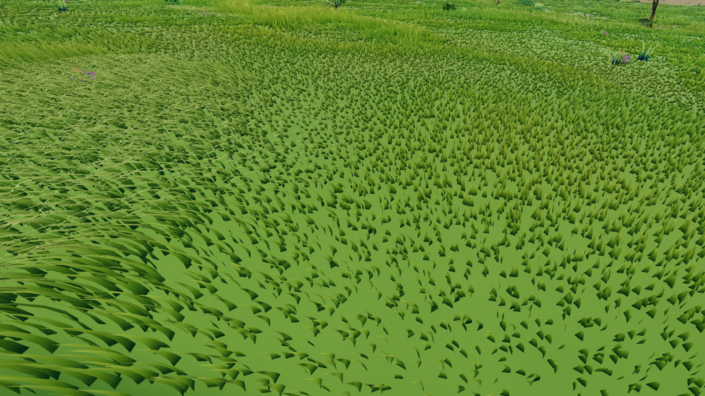
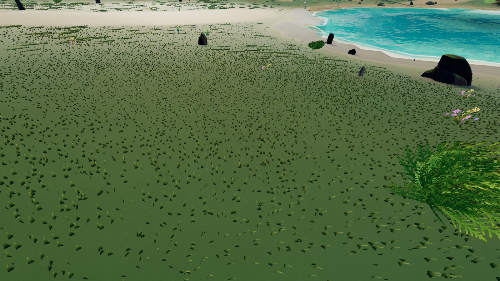

# Sparse grass: visual improvement plan

Date: October 16, 2026. Status: first slice (G1 ground detail and root contact,
G2 tufts and short-blade proportions) implemented as defaults — see the
[implementation A/B](../qa/sparse-grass-implementation-2026-10-16/README.md).
G0 diagnostics, G3 and G4 remain open.

**Make the ground between blades an attractive surface, and make the surviving
grass read as coherent plants.** The strongest improvement will come from richer
substrate, better short-blade proportions, and deliberate tuft structure. Keep
the world's stylized fantasy direction: readable masses, restrained material
detail, soft color variation, and convincing movement.

This work adds a plan and screenshot evidence. Production rendering, assets,
generation, and settings were not changed. It expands the grass work in the
[October 15 world review](aaa-look-and-feel-plan-2026-10-15.md).

## Evidence and limits

Six fresh views were retained: savanna, grassland, taiga, tundra, and downward
ground inspections in grassland and taiga. Every retained pose reached complete
terrain/scenery/collision readiness and matched its expected biome. Captures
used headed Windows Chromium, NVIDIA Lovelace hardware WebGPU, 1600 × 900,
DPR 1, FOV 68°, player eye height 1.7 m, and paused Highfield noon. Manual weather
was off; regional effects, wind, and particles remained active.

The runtime was frozen at `f75420e129f423f2aa279d67ffe9ca2a71ba020f`. Source integrity
held and the browser recorded zero errors. A seventh requested pose, the old
deciduous-forest location, now resolves to grassland ID 4. It was rejected before
capture; the original report correctly retains `captureValid: false` for the
whole requested set. The six accepted views remain useful evidence. This is
neither a complete biome audit nor a performance or motion acceptance pass.

Concurrent work subsequently added ground-color border blending (`b9faf60a`)
and equal-population LOD page reuse (`a1cab597`). These captures precede those
changes; preserve them and rebase implementation decisions on the latest main.

[Capture conditions, reproduction and report](../qa/sparse-grass-audit-2026-10-16/README.md)
· [Contact sheet](../qa/sparse-grass-audit-2026-10-16/contact-sheet.jpg)

| View | Observed issue | Implication |
| --- | --- | --- |
| [Savanna](../qa/sparse-grass-audit-2026-10-16/random-03.png) | Tall gold swath beside short, repeated wedges; smooth yellow-green ground between stems. | Preserve the successful tall silhouette while improving the shorter stand and its ground. |
| [Grassland](../qa/sparse-grass-audit-2026-10-16/random-04.png) | Plenty of blades, but repeated short silhouettes expose bright, nearly featureless turf. | Low visible coverage can be a height/shape problem even with substantial blade density. |
| [Grassland downward](../qa/sparse-grass-audit-2026-10-16/random-04-ground.png) | The close view makes the broad green gaps and similar curved wedges particularly obvious. | Ground detail and short-blade proportions should be the first visual prototype. |
| [Taiga](../qa/sparse-grass-audit-2026-10-16/random-09.png) | Isolated dark grass marks across a large smooth sage-colored foreground. | Sparse vegetation needs convincing needle litter, moss/mineral variation, and stronger local grouping. |
| [Taiga downward](../qa/sparse-grass-audit-2026-10-16/random-09-ground.png) | Individual dark bases remain conspicuous against the flat substrate. | Investigate blade/ground lighting and localized contact shading together. |
| [Tundra](../qa/sparse-grass-audit-2026-10-16/random-10.png) | Large exposed areas with a few low vegetation islands. | Keep the open landscape; improve the exposed material instead of filling it with meadow grass. |





## What the implementation already provides

The active system is `stylizedSurface.grass.system: meadow`. Its deterministic
candidate sequence, worker compaction, shared batches, biome growth profiles,
root/tip palettes, wind, interaction, and far cards are a strong foundation.
The older clump-system density advice does not describe this active path.

Relevant findings from the code:

- **Clustering exists, but is weak in several profiles.**
  [GrassPatchiness.js](../../src/editor/world/GrassPatchiness.js) supplies roughly
  11 m islands, 4 m secondary variation, and 1.15 m tussock noise. At the current
  biome densities, the theoretical minimum of `grassPatchCover` is about 0.812
  for savanna, 0.670 for taiga, and 0.006 for tundra. Grassland stays at 1.
  These are bounds on one function, not measured ground coverage or final
  survival rates. They explain why stronger island structure is more plausible
  in tundra than taiga. Extend this shared system instead of adding unrelated
  scatter noise.
- **Height has a broad short plateau.**
  [meadowGrowthNodes.js](../../src/editor/stylized/meadow/meadowGrowthNodes.js)
  maps noise through `smoothstep(.55, .75, noise)`. The retained
  [CPU diagnostic](../qa/sparse-grass-audit-2026-10-16/diagnostics.json) samples
  758,016 noise positions: 59.2% land at the short endpoint and 12.4% at the tall
  endpoint. This is a mathematical probe, not a rendered population measurement.
  Short-height variation deserves an isolated A/B.
- **Width does not follow local height.**
  [meadowBladeShape.js](../../src/editor/stylized/meadow/meadowBladeShape.js)
  uses profile width while local height varies and is further reduced by dirt,
  coverage and footprints. Short growth can therefore become a broad wedge.
  Wind, interaction and projection could contribute; the stills do not isolate
  their relative effects.
- **Matching pigment does not mean matching root brightness.**
  [meadowPigment.js](../../src/editor/stylized/meadow/meadowPigment.js) applies a
  soil factor of 0.75 and configured root brightness of 0.48 at the base: about
  0.36 before other variation and lighting. The shared
  [ground palette](../../src/editor/stylized/meadow/meadowGroundPalette.js)
  does not apply those factors. Blades use Lambert shading and terrain uses
  Standard shading. This is a concrete reason to test root contact under several
  lights, not proof of a single cause for every dark blade.
- **Terrain detail already exists.** The
  [terrain material](../../src/editor/terrainMaterial.js),
  [baked surface](../../src/editor/materials/TerrainMaterialBakedNodes.js),
  substrate, stochastic family atlas, microdetail, canopy litter and surface
  normals all contribute. Their visible result is too smooth in these gaps.
  Tune their composition before introducing another material stack. The baked
  surface code documents a full 16-sampler budget; check compiled usage before
  proposing additional sampled textures.

Separate three cases during implementation: intentional ecological sparsity;
short plants with low projected coverage; and missing/underfilled geometry from
LOD or streaming. A decorative ground layer cannot establish streaming readiness.

## Implementation order

Each stage needs a small, reviewable A/B before moving to the next. Scope is
relative effort, not a delivery estimate.

| Stage | Priority / scope | Deliverable | Exit criterion |
| --- | --- | --- | --- |
| G0 | P0 / S | Controlled diagnostics at the retained poses. | Identify which of height, width, lighting, wind and LOD actually produce the visible defects. |
| G1 | P1 / M | Exposed-ground detail and root-lighting prototype. | Grassland and taiga gaps read as groundcover/soil at player height, with coherent plant contact. |
| G2 | P1 / M | Short-plant proportions and stronger tuft structure. | Low-density areas read as irregular plants and gaps, without repeated wedges or regular dotted rows. |
| G3 | P2 / M | Restrained biome-specific secondary cover. | Sparse habitats have distinct ground character and useful small silhouettes within existing budgets. |
| G4 | P1 / M | LOD, wind, interaction and streaming acceptance. | Static improvements hold during traversal and representation changes; existing gates remain intact. |

### G0 — Establish controlled comparisons

At the two downward poses and the ordinary taiga view, capture separate pairs
with wind frozen, body/spell interaction neutralized, near blade geometry forced,
and grass hidden. Add albedo and normal diagnostics. Change one variable at a
time, restore production values, and keep these overrides out of world saves.

Record accepted stems, projected vegetation coverage over fixed image regions,
ground material weights, biome IDs, and in-view missing/below-density tiles.
Include the blade/card populations separately. Mask out sky, water, flowers and
trees when comparing grass coverage. A simple whole-image pixel difference is
insufficient while wind and particles move.

Add two independent sweeps: biological density and rendering quality. Test
roughly 10%, 25%, 50% and 100% of baseline accepted population on a fixed synthetic
habitat. Keep ecology fixed when testing quality reduction; keep quality fixed
when testing ecology. Meadow LOD density is **stems per metre along each side**:
halving that parameter roughly quarters its candidates. Record actual counts.

### G1 — Make exposed ground carry the composition

Give visible gaps three coordinated scales. Proposed starting ranges for A/B:

| Scale | Visual content | Implementation direction |
| --- | --- | --- |
| 3–12 m | Quiet dry/green/litter masses | Reuse canonical habitat and existing macro/patch fields. Keep contrast broad and subdued. |
| 0.2–1 m | Broken thatch, moss cushions, needle/leaf clusters, small soil pockets | Extend the existing material-family atlas/feature response with recognizable local structure. |
| 1–5 cm, near only | Restrained blade fragments, grain and normal/roughness relief | Use packed material data and distance filtering; fade before the pattern becomes unstable or subpixel. |

Start with grassland and taiga. Grassland gaps should contain flattened grass,
thatch and occasional soil; taiga should mix cool moss, needle litter and exposed
mineral soil. Tundra should retain mineral/lichen/snow character. Material variety
must follow canopy, wetness, slope and habitat rather than independent color noise.

First tune existing family/feature contribution and the near material blend.
If those cannot produce readable thatch or litter, author a small compatible
atlas extension with packed color/detail/roughness data. Specify texel scale and
normal convention, mipmaps, memory cost and asset provenance. Avoid adding a
texture sampler by default. Ground texture should remain convincing with grass
temporarily hidden in the diagnostic view.

For root contact, compare the current settings with a modest root-brightness
sweep, for example 0.48 / 0.60 / 0.70. These are test candidates, not new defaults.
Evaluate neutral, side-lit, backlit and overcast conditions. Relate local contact
darkening to tuft occupancy: dense interiors can stay deeper while isolated
stems should not create black punctuation. Use bounded shared contact/coverage
data; avoid per-blade shadow maps or circular decals around each stem. Keep
mid/far material color consistent with the resulting near surface.

**Acceptance:** the exposed area has readable material structure at 2–10 m;
contact is convincing without black dots; details do not become a noisy carpet
at 20–60 m. This stage adds no grass candidates, residency radius, draw distance,
or full-screen pass. Keep its performance delta measurable on its own.

### G2 — Improve short plants and organize them into tufts

Introduce bounded variation within the short growth range, and broaden the
transition into tall growth. Retain each biome's established height envelope as
the first constraint. Update the CPU and shader growth functions together.

Test width correlated with final plant height, with a lower bound that preserves
readability. Add modest variation in rest bend and orientation within a tuft;
keep sparse short plants legible from the side as well as above. Prototype with
existing blade geometry before considering extra crossed geometry. Do not apply
the same shape treatment to slender grass, broadleaf plants and wetland reeds.

Separate artistic patch contrast from the target mean population. Extend the
existing canonical patch/tussock field so tufts share height tendency, rest
direction and pigment, with softer irregular edges and some isolated stems.
Try approximately 0.25–0.8 m tuft cores inside the existing larger islands.
These are visual experiment ranges. Stronger clumps should redistribute the
available population rather than silently increasing it.

Keep blade, card and terrain interpretations aligned. The current surface mask
bakes patch coverage, and the per-stem sampler applies a related field again;
measure the combined acceptance before changing either curve. A 2 m terrain
cell cannot by itself resolve sub-metre tuft contact. Share a canonical fine
recipe or bounded derived data at the required scale, with explicit CPU/shader
parity and cache invalidation. Do not add a second unrelated ground noise.

Preserve stable candidate identity and prefix LODs. If root positions are moved
to improve grouping, apply that position before height, path, water, rock and
habitat tests; re-evaluate bounds and chunk ownership. Begin with acceptance and
shape changes, which avoid that additional complexity.

**Acceptance:** compare accepted populations and projected coverage explicitly;
no increased candidate budget in the initial prototype. Inspect several seeds,
slopes and distances. No obvious 8 m tile repetition, chunk seams, exposed
template rows, or clumps growing into exclusion zones.

### G3 — Add a small amount of secondary cover

Only after G1/G2, use the existing
[instanced ground-detail system](../../src/editor/stylized/StylizedGroundDetailView.js)
for selected silhouettes that the terrain material cannot provide.

| Habitat | Ground treatment | Restrained geometry accents |
| --- | --- | --- |
| Grassland, ID 4 | Thatch, worn turf, small soil openings | Low rosettes/clover-like plants, a few dry stems |
| Savanna, ID 3 | Dry litter and warm exposed earth | Distinct straw tufts, occasional seed heads |
| Taiga, ID 9 | Needle litter, moss, cool mineral patches | Low shrubs/rosettes at suitable canopy margins |
| Tundra, ID 10 | Mineral soil, lichen, existing snow variation | Small sedge-like cushions in sheltered pockets |
| Forests / wetland | Litter or damp ground selected by actual habitat | Existing appropriate understory/reeds; validate with new captures |

Use negative space deliberately. Put accents near tuft margins and suitable
objects, with quiet gaps between them. Reuse compatible assets first; retain
existing per-chunk limits and shared instancing. Avoid a new scene object for
each detail or a dense stack of alpha cards at ground level. Review angled views
for floating cards and overdraw.

### G4 — Preserve the improvement while moving

The existing blade bands reach nominally 6, 14, 30 and 50 m; cards begin filling
the first density reduction around 9.2–14 m, blades dissolve at 40–50 m, and cards
fade at 162–180 m. These are settings-derived ranges, not newly measured seams.

Review each range forward and backward, including low grazing angles and a
180° turn. Sparse cards must represent the same patch character and ground
value as the near plants. Check the current 2× maximum LOD widening in sparse
stands; a broad replacement blade can make a short silhouette worse. Evaluate
coverage, silhouette and brightness together before tuning widening or fades.

Reuse the world wind field. Give tuft members a coherent slow lean with small
individual tip variation; avoid every short stem oscillating independently at
the same apparent strength as tall grass. Preserve pinned roots and existing
body/spell interactions. Review a 10–15 second walk, sprint, stop and turn clip,
including pressed grass recovering to the same layout. If stronger clumping
changes phase/shape, verify that phase survives rebasing and LOD changes.

## Engineering and performance constraints

Keep modules focused: pure canonical patch math, growth/shape evaluation,
ground material response, and placement/streaming each retain a separate owner.
Extend the existing profile/configuration paths; avoid biome-specific branches
in the core renderer. Preserve Azgaar IDs 0–12 and deterministic persisted custom
IDs 32–254. No legacy terrain migration is needed.

Read and follow [perf-qa.md](../perf-qa.md) before implementation. Retain worker
compaction, local invalidation, bounded uploads, page reuse and stable publication.
No generator lookups or whole-resident rebuilds in the frame loop. Changes to
derived coverage require a recipe revision and appropriate halo/cache updates.

The [October 16 performance report](../performance-improvements-2026-10-16.md)
records an already-failing matrix at its measured revision: recovery is too slow
in diagonal cases, and construction exceeds the hitch-rate limit. That is prior
evidence, not a benchmark of this screenshot runtime. Establish a fresh baseline;
do not attribute missing streaming grass to artistic sparsity or relax those gates.

For each stage, compare identical source-frozen routes, settings and hardware.
Run the baseline twice to establish spread. Record frame p50/p95/p99, hitch rate,
GPU render time when available, worker/build time, uploads, resident memory,
draws and accepted blade/card populations. Small visual additions should fit
within baseline variability; investigate a repeatable >5% frame-p95 increase as
a proposed regression threshold, not an existing project gate.

Required implementation checks:

- Extend the relevant existing growth, habitat, ecotone, ground-palette and
  worker-parity tests when behavior changes. Check chunk edges, custom biomes,
  large canonical coordinates, rebasing, terrain edits and stale worker results.
- Exercise water/snow/road/rock exclusions, including stems repositioned by any
  future clumping work. Preserve eligible-root and habitat-fringe fixture gates.
- Reuse `scripts/run-world-visual-grass-qa.mjs` for grass, path, LOD and temporal
  fixtures. Its grass scene uses a simplified floor material, so it cannot
  establish production substrate quality; also recapture these world poses.
- Run hardware `chunk-cross` and `diagonal` routes with settle, recovery and
  grass diagnostics, then the required full density/construction/water matrix.
  Existing matrix gates include p95 ≤33.3 ms, hitch rate ≤2%, full scenery
  recovery ≤2 s, and no missing/below-density in-view grass at recovery end.
- Validate WebGL compatibility separately from authoritative WebGPU performance.
  Review noon, low sun, overcast and wet conditions, plus actual low-quality
  rendering. Stills, motion, correctness and performance have separate verdicts.

Example hardware route from WSL, with a frozen server already running:

```bash
npm run qa:perf:windows -- --url http://localhost:5178 --qa chunk-cross --warmup 8 --duration 12 --settle --drain-seconds 20 --grass-diagnostics --out tmp/sparse-grass-before.json
```

Repeat against the candidate into a different report, then use the full matrix
as documented in the QA guide. No performance route was run for this plan-only
change.

## First implementation slice

Start with G0 and a small G1/G2 prototype at the two downward poses: strengthen
existing near-ground structure, compare root brightness, and make short blades
proportionate. Deliver original-size before/after images, a movement clip and
the unchanged-population performance comparison. Choose the settings that improve
both grassland and taiga before extending to the remaining habitats.

Primary production references support the direction, not drop-in implementations:

- Eric Wohllaib's [Procedural Grass in Ghost of Tsushima](https://gdcvault.com/play/1027214/Advanced-Graphics-Summit-Procedural-Grass)
  addresses individually shaped/animated blades and natural fields within memory
  and performance limits. This project's existing blade system already provides
  the relevant foundation; a GPU-generation rewrite is outside this plan.
- Guerrilla's [GPU-Based Procedural Placement in Horizon Zero Dawn](https://www.guerrilla-games.com/read/gpu-based-procedural-placement-in-horizon-zero-dawn)
  describes artist-defined placement rules spanning the environment. The proposed
  habitat-coherent ground/tuft/detail composition is our application of that idea.
- Sucker Punch's [Ghost of Tsushima visual-effects breakdown](https://blog.playstation.com/2021/01/12/how-stunning-visual-effects-bring-ghost-of-tsushima-to-life/)
  describes shared environmental data and coordinated wind across vegetation and
  effects. Reuse this project's world wind rather than layering independent motion.
