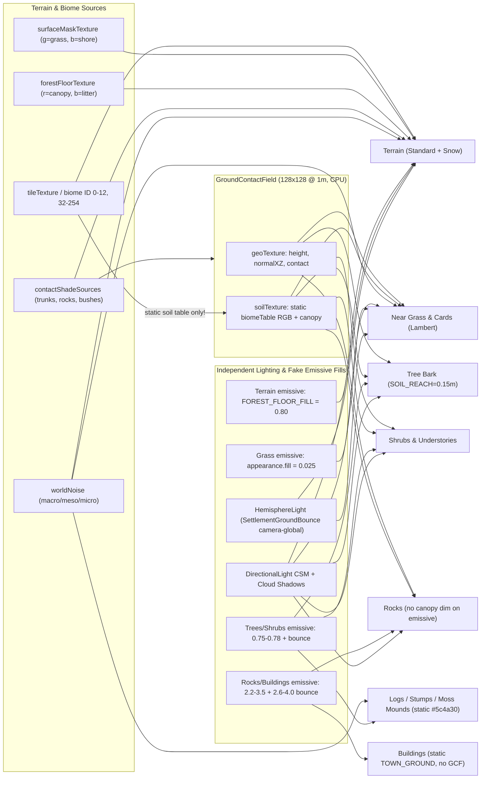

# World Surface Context (WSC) — PR 0: Baseline, Material Audit and Visual Diagnostics

> **Date:** 2026-11-25  
> **Baseline commit audited:** `b7183e59` (`"Towns lift the bog air over them"`, branch `main`)  
> **Scope:** Diagnosis, baseline measurement, reusable visual diagnostic modes (`D00`–`D25`), standardized multi-substrate test fixture, 215 hardware WebGPU 1920×1080 baseline screenshots, quantitative CIELAB/CIEDE2000 color measurements, and architectural design boundaries for PR 1+.  
> **Production changes:** **None.** Production shaders, palettes, lighting, and `editor.config.yaml` defaults remain identical to `b7183e59` (`D00` disabled by default, zero production overhead).

---

## 1. Executive Summary

Visual inspection of Stillmeadow (`B14`), 18 biome/transition locations (`B01`–`B18`), lighting sweeps, LOD sweeps (`0 m → 145 m`), standardized 5-substrate fixtures, and 26 diagnostic modes (`D00`–`D25`) confirms that the disconnect between terrain, grass, tree trunks, understories, rocks, and buildings is **not a single grass-color bug**. It is a structural consequence of **five compounding architectural defects** verified quantitatively with hardware WebGPU captures and CIEDE2000 measurements:

1. **Lighting & Emissive Asymmetry Flips Unlit Albedo Contrast (Confirmed, Critical):**  
   In unlit albedo (`D01`), near grass blades are actually **+19.4% to +75.5% brighter** than the terrain beneath them (Stillmeadow `C01`: `+50.0%`, `ΔE00 = 7.42`; `C02`: `+19.4%`, `ΔE00 = 6.49`; Deciduous `B02`: `+75.5%`, `ΔE00 = 12.88`; Grassland `B01`: `+29.1%`, `ΔE00 = 5.70`). Under normal lighting (`D00`), those exact same blades flip to **−37.1% to −54.7% darker** than the terrain beneath them (Stillmeadow `C01`: `−37.1%`; `C02`: `−54.7%`; Deciduous `B02`: `−40.4%`; Tropical Rainforest `B04`: `−49.2%`).  
   Diagnostic `D18` (emissive isolation) proves why: shaded forest terrain adds **unshadowed artificial emissive fill** `FOREST_FLOOR_FILL = 0.8` (`src/editor/terrainMaterial.js:121, 688-689`), whereas near grass blades receive `appearance.fill = 0.025` (`src/editor/stylized/meadow/meadowBladeMaterial.js:80-84`) — a **32× emissive asymmetry** compounded by stacked multiplicative root AO (`0.45 × 0.55 × 0.88 × 0.75 ≈ 0.163×`) and grazing vertical blade normals (`D05`).

2. **`GroundContactField.soilColor` Diverges Sharply from Actual Terrain Albedo (Confirmed, Critical):**  
   Diagnostic `D12` vs `D01` measures **`ΔE00 = 11.53`** on Stillmeadow `C02` (`major-mismatch-candidate`), **`ΔE00 = 14.01`** (`+23.8%` luma) on Temperate Rainforest `B03`, and **`ΔE00 = 6.48`** (`+22.0%` luma, zero spatial variance: `p10 = p50 = p90 = 0.22101`) on Grassland `B01`. Because `GroundContactField` populates `soilColor` from a static biome-ID lookup table (`src/editor/stylized/groundContact/GroundContactField.js:55-96`), it ignores roads, moss, leaf litter, grass coverage, slopes, and macro patches — causing grass feet, trunk collars (`SOIL_REACH = 0.15 m`), rocks, and shrubs to blend toward a flat uniform brown sheet that does not match the actual ground pixels beside them.

3. **Terrain Paints 100% Green Grass Turf Where Blade Coverage Is Sparse (Confirmed, Critical):**  
   Diagnostic `D11` (`vegetation-coverage`) exposes broad forest clearings and trunk skirts where `surfaceMaskTexture.g = 1.0` paints bright green turf across the floor even where zero grass blades are spawned, leaving isolated blade tufts looking pasted onto a painted floor.

4. **Non-Uniform Ground Contact Participation & Missing Per-Texel Validity (Confirmed, Critical):**  
   Fallen logs/stumps (`forestDebrisPrototypes.js:134-320`), moss mounds (`forestDebrisPrototypes.js:56-92`), and settlement buildings (`townGrade.js:79-144`) do **not** read `GroundContactField` at all (using hardcoded `#5c4a30` or `TOWN_GROUND`). Rocks (`ROCK_FILL = 3.5`, `ROCK_BOUNCE = 4.0`) and buildings (`BUILDING_FILL = 2.2`, `BUILDING_BOUNCE = 2.6`) are not attenuated by `GroundContactField.canopy` (exposed in `FX-ISO-D17-indirect` and `B17`: `ΔE00 = 21.04`, `−52.3%` luma). Furthermore, `GroundContactField` has **no per-texel validity bit** — unloaded slots write `geo = (0,0,0,0)` and `soil = (128,110,85,0)` while keeping global `active = 1` (verified by unit test in `tests/wscDiagnosticsPr0.test.js`).

5. **LOD Color & Luminance Discontinuities Across Grass & Woodland Distances (Confirmed, High):**  
   The `0 m → 145 m` LOD sweep (`Gallery G`, `D20`) measures luminance jumps exceeding the 10% investigation threshold at every handoff: `0 m → 32 m` (`+26.7%`, `ΔE00 = 5.15`), `0 m → 58 m` far cards (`−10.9%`, `ΔE00 = 5.62`), and `58 m → 95 m` terrain `groundCover` (`+32.6%`, `ΔE00 = 7.17`).

---

## 2. Current Architecture

The renderer (`Three.js WebGPURenderer`, TSL node materials, `ACESFilmicToneMapping` @ `exposure = 1.12`, plus `cinematicFinish` in player mode) splits environment appearance across **five largely independent systems** with partial, asymmetric handoffs:

- **Terrain surface (`src/editor/terrainMaterial.js`, `TerrainMaterialBakedNodes.js`):** Blends near procedural layers (`tileTexture`, `familyAtlas`, `meadowGroundPalette`, `meadowGroundDetail`, `forestFloorTexture`, `contactShade`, `TerrainGrassCoverNodes`, `TerrainGrassVolumeNodes`, `RainWetnessShading`, `SnowSurfaceShading`) into `midColor` (`90 m`) and `farColor` (`260 m`) CPU/GPU bakes, and beyond into `MacroFarTerrain`.
- **Near-camera Ground Contact window (`GroundContactField.js`, `GroundContactState.js`):** A CPU-rasterized `128×128` RGBA8 pair (`geoTexture` = height/normal/contact, `soilTexture` = static biome soil RGB + canopy) covering `128 m × 128 m` (`1.0 m/texel`), recentering with `16 m` hysteresis and `12 m` border fade.
- **Meadow grass & far cards (`meadowBladeMaterial.js`, `meadowCardMaterial.js`, `meadowPigment.js`, `MeadowGroundShading.js`):** Four instanced blade bands (`0–50 m`) plus crossed far cards (`40–90 m`), shaded with `MeshLambertNodeMaterial` (unlit-style diffuse + `appearance.fill = 0.025` + sun backlight), sharing `meadowPatchColors` with terrain via `MeadowGroundShading` but using an independent lighting/emissive model.
- **Forest trees, bark, shrubs, understories, rocks & debris (`foliageLight.js`, `FoliageNodeMaterial.js`, `barkWeathering.js`, `AuthoredFoliageMaterial.js`, `rockWeathering.js`, `forestDebrisPrototypes.js`):** Custom `FoliageMaterial` lighting model plus material-specific artificial emissive fills (`CROWN_FILL 0.75`, `BARK_FILL 0.78`, `UNDERSTORY_FILL 0.78`, `ROCK_FILL 3.5`, `BUILDING_FILL 2.2`) that bypass shadow maps.
- **Settlements & paving (`townGrade.js`, `SettlementGrade.js`, `SettlementGroundBounce.js`, `SettlementPavingMaterial.js`):** Camera-global hemisphere bounce (`SettlementGroundBounce.js`) plus static `TOWN_GROUND` splash (`[0.47, 0.41, 0.33]`), disconnected from `GroundContactField`.

---

## 3. Material Pipeline Diagrams

### 3.1 Current Disconnected Environment Shading Graph (`b7183e59`)



### 3.2 Cumulative Double-Shading & Asymmetry Chain (`DS-01` .. `DS-04`)

```mermaid
flowchart TD
  subgraph Floor["Terrain Forest Floor (Same Pixel Location)"]
    F1["meadowGroundPalette (groundOcclusion 1 - 0.18*density)"] --> F2["floorMoss mix (0.68 * forestFloor)"]
    F2 --> F3["contactShade darken (1 - 0.40 * contact)"]
    F3 --> F4["CSM Shadow Map Attenuates Sun"]
    F4 --> F5["+ Unshadowed Emissive FOREST_FLOOR_FILL (0.80 * forestFloor)"]
    F5 --> F6["Result: Glowing saturated green floor even in deep shade"]
  end

  subgraph Blades["Near Grass Blade Standing Directly On That Floor"]
    G1["Unlit D01 Albedo (+19% to +75% BRIGHTER than floor)"] --> G2["x groundAo = clamp(1 - 0.32*contact - 0.14*canopy, 0.45, 1)"]
    G2 --> G3["x rootShade (0.55..1.0)"]
    G3 --> G4["x footSoil blend (0.88x toward flat brown GCF soil)"]
    G4 --> G5["x bladeValue jitter (0.75..1.25)"]
    G5 --> G6["CSM Shadow Map + Vertical Normal Grazing N.L"]
    G6 --> G7["+ Emissive fill = 0.025 (32x WEAKER than floor)"]
    G7 --> G8["Result: Cumulative ~0.163x dark silhouette (-37% to -55% DARKER than floor)"]
  end
```



---

## 4. Existing Shared Environmental Systems (Inventory & Gaps)

| System | Source File(s) | Current Role | Gaps Blocking Coherence |
|---|---|---|---|
| **GroundContactField** | `GroundContactField.js:1-256`, `GroundContactState.js:1-126` | Publishes `128×128` (`1.0 m/texel`) `height`, `normalXZ`, `contact`, static `soilColor`, `canopy` over `128 m` window (`16 m` hysteresis, `12 m` border fade). | Uses static biome-ID soil table (`ΔE00 = 6.5–14.0` vs real terrain); no per-texel validity bit (unloaded slots write `(128,110,85,0)` while `active = 1`); not consumed by debris, moss mounds, or buildings; 1 m texels blur narrow roads and trunk collars. |
| **MeadowGroundShading** | `MeadowGroundShading.js`, `meadowColorNodes.js`, `meadowGroundPalette.js`, `meadowGroundStyle.js` | Shares macro `meadowPatchColors`, `dry`, and tile-palette rules between terrain, near blades, far cards, and flowers. | Shared inputs are broken at the shading stage by Lambert vs Standard lighting, `0.025` vs `0.80` emissive fill, and terrain `floorMoss` override (`0.68`). |
| **Terrain Bake (`midColor`/`farColor`)** | `TerrainMaterialBakedNodes.js`, `TerrainMaterialBakeCpu.js`, `TerrainMaterialBakeFarColor.js` | Pre-bakes terrain albedo/normal/roughness at chunk/far distance (`90 m`, `260 m`). | Already evaluates deterministic terrain appearance per chunk — natural candidate data source for WSC surface color — but is not exposed to props/vegetation and duplicates canopy darkening (`0.30`). |
| **Forest Floor & Contact Shade** | `forestFloorTexture.js`, `contactShade.js`, `contactShadeSources.js` | Generates per-chunk canopy/litter texture and radial contact discs for trunks, boulders, and bushes. | Circular discs visible in `D08` (`DEF-09`); litter channel `forestFloorTexture.b` is terrain-only (not shared with tree bases or understories). |
| **Surface Coatings & Weather** | `MossCoat.js`, `surfaceWetness.js`, `snowFieldState.js`, `SnowSurfaceShading.js` | Procedural moss coat, rain wetness uniform, storm/altitude snow cover. | Moss colors hardcoded separately per material (`barkWeathering`, `rockWeathering #5d6e3e`, `forestDebrisPrototypes #5e7f2f`, `terrain floorMoss`); snow skirt creates hard bands on boulders (`B17`, `ΔE00 = 21.04`). |
| **Settlement Ground Bounce & Grade** | `SettlementGroundBounce.js`, `townGrade.js`, `SettlementGrade.js` | Shifts `HemisphereLight.groundColor` near settlements; grades masonry/timber. | Camera-global single bounce color (no spatial bounce field); buildings read static `TOWN_GROUND` instead of local substrate. |
| **Ponlai PR G Ambient Relighting** | `docs/plans/ponlai-pr-g-ground-bounce-ambient-relighting-2026-11-21.md` | Specification for probe-based spatial ambient/ground bounce. | **Specification only — not implemented on `main`** (`src/editor/lighting/probes/` does not exist). |

---

## 5. Duplicated Calculations & Conflicting Authorities

Exact machine-readable table in [shader-contributions.json](../../qa/world-surface-context/pr-00/metrics/shader-contributions.json).

1. **Eight separate unshadowed artificial emissive fill formulas** (`terrainMaterial.js:688`, `meadowBladeMaterial.js:80`, `foliageLight.js:34-52, 170-234`, `AuthoredFoliageMaterial.js:164`, `SettlementPavingMaterial.js:90`) ranging from **`0.025×` (grass)** to **`0.80×` (forest floor)** to **`2.2×` (buildings)** to **`3.5×` (rocks)** — none gated by the directional shadow map, and rocks/buildings/bark/terrain not attenuated by canopy occlusion.
2. **Four independent biome/palette tinting pathways:** `biome-looks.yaml` (`soil`, `rock`, `tree`), `grass.meadow.palette.byTileId`, `canopyGrade` (`#3c6e4d..#9cb768` + `ratio^0.62`), and `foliagePalette.js` (`SWARD_BLUE = 0.68`).
3. **Four hardcoded moss color palettes:** `terrainMaterial.js` (`floorMoss`), `barkWeathering.js`, `rockWeathering.js` (`#5d6e3e / #42522d / #2f3d21`), and `forestDebrisPrototypes.js` (`#5e7f2f / #8fae4b`).
4. **Stacked contact/canopy AO across 4 chains (`DS-01`..`DS-04`):** Grass (`groundAo × rootShade × footSoil × bladeValue`), shrubs (`applyUnderstoryWeathering × understoryFootShade × CROWN_SELF_SHADE × aoNode × footFill`), trunks (`baseShade × rootContactAo × terrain contactShade`), and terrain (`groundOcclusion × floorMoss × contactShade × midColor canopy`).

---

## 6. Confirmed Defects (Baseline `b7183e59`)

Every defect below is visually confirmed in [Gallery H (`critical-defects.jpg`)](../../qa/world-surface-context/pr-00/galleries/critical-defects.jpg) and traced to exact source locations:

| Defect ID | Severity | Confirmed Root Cause & Source Location | Visual / Quantitative Evidence |
|---|---|---|---|
| **DEF-01** | **Critical** | **Excessive green terrain floor under sparse forest canopies** (`src/editor/terrainMaterial.js:286-290, 688-689`; `surfaceMaskTexture.g`). Forest floor blends saturated `floorMoss` and adds `0.8×` unshadowed emissive fill. | `B14-C01-overcast-D00-normal.png`, `B14-C01-overcast-D18-emissive.jpg`, Gallery A & H. |
| **DEF-02** | **Critical** | **Grass blades flip from brighter in unlit albedo to −37%..−55% darker when lit** (`meadowBladeMaterial.js:80-84`, `meadowPigment.js:94-123`). Compound of `0.025` vs `0.80` emissive asymmetry, `DS-01` (`0.163×` stacked root AO), and grazing vertical normals. | Stillmeadow `C01`: D01 `+50.0%` (`ΔE00=7.42`) → D00 `−37.1%`; `C02`: D01 `+19.4%` (`ΔE00=6.49`) → D00 `−54.7%`; Deciduous `B02`: D01 `+75.5%` (`ΔE00=12.88`) → D00 `−40.4%`. |
| **DEF-03** | **Critical** | **Unshadowed `FOREST_FLOOR_FILL = 0.8` emissive glow on terrain** (`terrainMaterial.js:121, 688-689`). Emissive increases *inside* canopy shade instead of decreasing, decoupling terrain from blades and twigs standing on it. | `B14-C01-overcast-D18-emissive.jpg`, `B14-C02-overcast-D18-emissive.jpg`. |
| **DEF-04** | **Critical** | **`GroundContactField.soilColor` is a flat static biome-ID table, not actual terrain albedo** (`GroundContactField.js:55-96`). Ignores roads, moss, litter, turf, and macro patches. | `D12` vs `D01`: Stillmeadow `C02` `ΔE00 = 11.53`; Temp. Rainforest `B03` `ΔE00 = 14.01`; Grassland `B01` `ΔE00 = 6.48` (zero variance `p10=p50=p90=0.221`). |
| **DEF-05** | **Critical** | **Terrain grass-turf mask (`surfaceMask.g = 1.0`) decoupled from actual blade density** (`terrainMaterial.js`, `meadowBlades`). Sparse forest clearings still paint solid turf beneath isolated tufts. | `B14-C01-overcast-D11-vegetation-coverage.jpg`, `B14-C02-overcast-D11-vegetation-coverage.jpg`. |
| **DEF-06** | **Critical** | **Abrupt tree trunk ground termination** (`barkWeathering.js:65, 198-206`). Only `SOIL_REACH = 0.15 m` blends into mismatched brown `GroundContactField.soilColor`; zero litter skirt or terrain-albedo matching. | `B14-C03-overcast-D00-normal.png`, `B14-C03-overcast-D01-albedo.png`, Gallery B. |
| **DEF-07** | **High** | **Trunk root height seam & coarse 1 m ground-contact elevation sampling** (`GroundContactField.js:125`, `barkWeathering.js:185-186`). 1.0 m texels miss steep micro-slopes around wide trunks and root flares. | `B14-C03-overcast-D13-gc-height.jpg`, Gallery B. |
| **DEF-08** | **Critical** | **`GroundContactField` lacks a per-texel validity bit** (`GroundContactField.js:181-190`, `GroundContactState.js:31-123`). Unloaded slots write `geo = (0,0,0,0)` and `soil = (128,110,85,0)` while keeping global `active = 1`. | Confirmed by unit test `tests/wscDiagnosticsPr0.test.js` and `STR-TP01-unsettled-D15-gc-validity.jpg`. |
| **DEF-09** | **High** | **Circular stamp appearance in radial `contactShade` discs** (`contactShade.js`, `contactShadeSources.js`). Uniform discs around trunks/bushes read artificially in `D08`. | `B14-C01-overcast-D08-contact-ao.jpg`, `B14-C02-overcast-D08-contact-ao.jpg`. |
| **DEF-10** | **High** | **Rock & building emissive fill (`ROCK_FILL 3.5`, `BUILDING_FILL 2.2`) unattenuated by canopy or shadows** (`foliageLight.js:43-52, 201-234`). Objects stay bright in `D17` (sun disabled) and clash sharply against snow (`B17`, `ΔE00 = 21.04`) and sand (`B16`, `ΔE00 = 18.35`). | `FX-ISO-D17-indirect.jpg`, `B17-C01-clear-D00-normal.png`, `B16-C01-clear-D00-normal.png`, Gallery D & F. |
| **DEF-11** | **Medium** | **Stacked grass root darkening & debris/mound isolation** (`meadowPigment.js:94-117`, `forestDebrisPrototypes.js:134-320`). Logs, stumps, and moss mounds never sample `GroundContactField` (hardcoded `#5c4a30`). | `B01-C02-clear-D00-normal.png`, `B03-C02-clear-D00-normal.png`, Gallery A & C. |
| **DEF-12** | **High** | **Grass LOD luminance & color discontinuities across 0 m → 95 m** (`meadowBladeMaterial.js`, `meadowCardMaterial.js`, `TerrainGrassCoverNodes.js`). | `Gallery G` (`D20`): `0 m → 32 m` `+26.7%` (`ΔE00=5.15`), `0 m → 58 m` `−10.9%` (`ΔE00=5.62`), `58 m → 95 m` `+32.6%` (`ΔE00=7.17`). |
| **DEF-13** | **High** | **Building foundations & settlement paving lack substrate color integration** (`townGrade.js:79-144`, `SettlementPavingMaterial.js:50-124`). Uses static `TOWN_GROUND` `[0.47, 0.41, 0.33]` regardless of biome soil/snow/grass. | `B14-C06-clear-D00-normal.jpg`, `B18-C01-clear-D00-normal.jpg`, Gallery D & `settlement-contact.jpg`. |
| **DEF-14** | **High** | **Woodland twilight/rain luminance collapse** (`StylizedSkyView.js`, `cinematicFinish.js`, `terrainMaterial.js`). Stillmeadow `C01` becomes nearly black at sunrise (06:30), sunset (18:36), and rain (12:00) while Grassland stays legible. | Gallery F (`B14-C01-sunrise`, `sunset`, `rain` vs `B01-C01-sunrise`, `sunset`, `rain`). |

---

## 7. Suspected Defects Requiring Further Investigation

1. **Cloud-shadow & wind phase drift across floating-origin roundtrips:** `STR-FO01` vs `STR-FO02` showed `ΔE00 = 2.71` (`+12.98%` luma) while trees, bushes, and macro grass patches stayed visibly anchored in canonical coordinates; cloud shadow animation moved between captures. PR 1 should add a deterministic cloud-scroll freeze to `WorldVisualQa.setLighting` to verify true sub-`0.5` `ΔE00` floating-origin invariance.
2. **Hard snow-collar contrast on boulders (`B17`):** `B17-C01-clear-D00-normal.png` exhibits a crisp white band along the lower edge of grey boulders (`ΔE00 = 21.04`, `−52.3%` luma). Needs verification whether `rockWeathering.js` `snowDeposition` skirt height threshold is too narrow (`smoothstep` width) or whether snow albedo lacks terrain bounce tinting.
3. **Far-card banding visible in `D20` at 32 m–95 m (`Gallery G`):** Crossed far grass cards (`meadowCardMaterial.js`) form visible row bands at grazing angles when blade bands thin out; verify whether coverage-conserving density + terrain `groundCover` alignment removes the `−10.9% → +32.6%` luminance oscillation.
4. **Stillmeadow `C04` understory occlusion under overcast vs clear:** Shrub interiors (`CROWN_SELF_SHADE 0.52` + `aoNode` + `footFill 0.70`) darken severely in canopy shade (`B14-C04-clear-D00-normal.jpg`), warranting unified ambient occlusion validation once emissive fills are replaced.

---

## 8. Material Comparison Matrix (All 17+ Material Families)

Full machine-readable audit in [material-audit.csv](../../qa/world-surface-context/pr-00/metrics/material-audit.csv).

| # | Family | Primary Source | Lighting Model | Reads `GroundContactField`? | Emissive Fill | Canopy Attenuates Emissive? | Wet / Moss / Snow |
|---|---|---|---|---|---|---|---|
| 1 | **Terrain** | `terrainMaterial.js:135-722` | Standard + Snow | Source (not consumer) | `FOREST_FLOOR_FILL 0.80` | **No (inverse!)** | Yes / Yes / Yes |
| 2 | **Near grass blades** | `meadowBladeMaterial.js:39-97` | Lambert (DoubleSide) | Soil (45% foot) + Normal | `appearance.fill 0.025` | No | No / No / Storm |
| 3 | **Far grass cards** | `meadowCardMaterial.js:61-146` | Lambert (DoubleSide) | Melted out (AO only) | `appearance.fill 0.025` | No | No / No / Storm |
| 4 | **Distant terrain grass** | `TerrainGrassCoverNodes.js`, `TerrainGrassVolumeNodes.js` | Standard (in terrain) | N/A (terrain) | Same as terrain (`0.80`) | No | Same as terrain |
| 5 | **Tree foliage** | `StylizedTreeMaterials.js`, `TreeFoliageSurface.js` | FoliageMaterial | **No** | `CROWN_FILL 0.75` + `0.95` bounce | Prototype vis only | Yes / No / Cap |
| 6 | **Tree bark** | `TreeBarkMaterial.js`, `barkWeathering.js:131-228` | FoliageMaterial (Std) | Soil (`0.15 m`) + Normal (55%) | `BARK_FILL 0.78` + `1.1` bounce | **No** | Streaks / Coat / Band |
| 7 | **Tree impostors** | `TreeImpostorMaterial.js:58-193` | FoliageMaterial (Std) | **No** | Foliage + Bark emission | Baked vis only | Yes / Baked / Cap |
| 8 | **Shrubs** | `AuthoredFoliageMaterial.js:115-190` | FoliageMaterial (Std) | Soil (lower 22%) + Normal | `UNDERSTORY_FILL 0.78` + `1.15` | Foot `0.70` + interior | Roughness / No / Cap |
| 9 | **Shrub LOD proxies** | `BushRenderAssets.js:225-279` | FoliageMaterial (Lamb) | Soil (lower 22%) + Normal | Same as shrub | Foot `0.70` + interior | No / No / Cap |
| 10 | **Ferns & understories** | `biomeUnderstoryPrototypes.js:63-134` | FoliageMaterial (Std) | Soil (`0.11 m`) + Normal (78%) | Same as shrub | Foot `0.70` | Roughness / No / Cap |
| 11 | **Flowers** | `StylizedFlowerMaterial.js:43-188` | Lambert (DoubleSide) | Normal (35%) + AO only | `foliageSkyFill 0.10` | Stem AO | No / No / No |
| 12 | **Rocks & boulders** | `rockWeathering.js:150-360` | Standard | Soil (`0.16`) + Normal (60%) | **`ROCK_FILL 3.5` + `4.0` bounce** | **No** | Shore / Coat / Skirt |
| 13 | **Fallen logs & stumps** | `forestDebrisPrototypes.js:134-320` | Standard | **No (static `#5c4a30`)** | Bark / Understory | **No** | Yes / Hardcoded / Cap |
| 14 | **Alpine crags & cliffs** | `AlpineRockMaterial.js:23-89` | Standard | Soil scree + Normal (55%) | Snow rim only | N/A | No / No / Coat+Cap |
| 15 | **Buildings & foundations** | `townGrade.js:79-144`, `SettlementGrade.js` | Standard | **No (`TOWN_GROUND`)** | **`BUILDING_FILL 2.2` + `2.6`** | **No** | Yes / Coat / Snow |
| 16 | **Settlement paving** | `SettlementPavingMaterial.js:50-124` | Standard (`alphaTest`) | Alpha-fray edge over terrain | `fill 1.35`, `bounce 0.8` | **No** | Yes / No / No |
| 17 | **Forest floor moss mounds** | `forestDebrisPrototypes.js:56-92` | Standard | **No (static soilColor)** | `UNDERSTORY_FILL 0.78` | **No** | No / Is moss / Cap |

---

## 9. Color Measurement Methodology

Implemented in [`scripts/lib/wsc-color-metrics.mjs`](../../../scripts/lib/wsc-color-metrics.mjs) and verified by [`tests/wscColorMetrics.test.js`](../../../tests/wscColorMetrics.test.js) against Sharma–Wu–Dalal (2005) reference test pairs:

1. **Pixel segmentation:** Every target camera captures companion `D00` (normal), `D01` (unlit resolved albedo), `D12` (`GroundContactField.soilColor`), and lossless PNG `D24` (material-family ID). `buildFamilyMask()` segments exact material-family pixels via nearest-prototype classification across raw, fly-mode, and player-mode (`cinematicFinish` + ACES) `D24` signatures (`tolerance = 24`), preventing sky/background contamination.
2. **Color space & perceptual difference:** Pixels inside the ground-contact ROI (`x: 0.05..0.95`, `y: 0.42..0.96`) are converted via exact IEC 61966-2-1 sRGB → Linear RGB → CIE XYZ (D65, 2°) → CIELAB (`L* a* b*`), and compared with exact **CIEDE2000 (`ΔE00`)**.
3. **Summary statistics:** Each region records pixel count, ROI coverage, mean & median sRGB, linear luminance mean & `p10/p50/p90`, circular HSV mean hue, mean & `p90` saturation, and WCAG-style relative luminance contrast ratio.
4. **Investigation thresholds (PR 0):**
   - Contact material pairs: `ΔE00 > 5` → `investigate`; `ΔE00 > 10` → `major-mismatch-candidate`.
   - LOD transitions: `|ΔLuma%| > 10%` → `investigate`.
   - Chunk boundaries: `|ΔLuma%| > 5%` → `investigate`.
   - Floating-origin roundtrip: `ΔE00 > 1.0` → `investigate`.

---

## 10. Quantitative Color Results

Complete dataset: [`docs/qa/world-surface-context/pr-00/metrics/color-measurements.json`](../../qa/world-surface-context/pr-00/metrics/color-measurements.json) (**27 comparisons** across Stillmeadow, 10 biomes, standardized fixture, LOD sweep, chunk boundary, and floating-origin roundtrip).

| Comparison | Mode | Pixels (A / B) | `ΔE00` | `ΔLuma %` | Flag |
|---|---|---:|---:|---:|---|
| **Stillmeadow C02: `GroundContactField` soil (`D12`) vs terrain (`D01`)** | D12 vs D01 | 698,880 / 698,880 | **11.53** | −1.07% | `major-mismatch-candidate` |
| **Temp. Rainforest B03: `GroundContactField` soil (`D12`) vs terrain (`D01`)** | D12 vs D01 | 660,883 / 660,883 | **14.01** | +23.83% | `major-mismatch-candidate` |
| **Grassland B01: `GroundContactField` soil (`D12`) vs terrain (`D01`)** | D12 vs D01 | 457,187 / 457,187 | **6.48** | +22.00% | `investigate` |
| **Stillmeadow C01: Near grass vs terrain (unlit)** | D01 | 34,813 / 737,126 | **7.42** | **+49.99%** | `investigate` |
| **Stillmeadow C01: Near grass vs terrain (lit overcast)** | D00 | 34,813 / 737,126 | 2.56 | **−37.13%** | *(sign reversal!)* |
| **Stillmeadow C02: Near grass vs terrain (unlit)** | D01 | 153 / 1,005,474 | **6.49** | **+19.44%** | `investigate` |
| **Stillmeadow C02: Near grass vs terrain (lit overcast)** | D00 | 153 / 1,005,474 | 4.58 | **−54.69%** | *(sign reversal!)* |
| **Stillmeadow C01: Tree bark vs terrain (lit overcast)** | D00 | 70,218 / 737,126 | **6.62** | +64.59% | `investigate` |
| **Deciduous B02 C02: Near grass vs terrain (unlit)** | D01 | 22,874 / 973,765 | **12.88** | **+75.48%** | `major-mismatch-candidate` |
| **Deciduous B02 C02: Near grass vs terrain (lit clear)** | D00 | 22,874 / 973,765 | **7.87** | **−40.36%** | `investigate` |
| **Temp. Rainforest B03 C02: Near grass vs terrain (unlit)** | D01 | 51,839 / 940,310 | **14.07** | +117.69% | `major-mismatch-candidate` |
| **Temp. Rainforest B03 C02: Near grass vs terrain (lit clear)** | D00 | 51,839 / 940,310 | **7.77** | +65.37% | `investigate` |
| **Tropical Rainforest B04 C02: Near grass vs terrain (lit)** | D00 | 605,578 / 335,164 | **5.26** | **−49.20%** | `investigate` |
| **Grassland B01 C02: Near grass vs terrain (unlit)** | D01 | 257,083 / 623,676 | **5.70** | +29.06% | `investigate` |
| **Grassland B01 C02: Near grass vs terrain (lit clear)** | D00 | 257,083 / 623,676 | 2.77 | −9.14% | `ok` |
| **B16 Fixture Grass-Sand: Rock vs terrain** | D00 | 1,871 / 1,000,339 | **18.35** | +3.08% | `major-mismatch-candidate` |
| **B17 Fixture Snow-Rock: Rock vs snow terrain** | D00 | 241,367 / 703,768 | **21.04** | −52.29% | `major-mismatch-candidate` |
| **Tundra B10 C01: Rock vs snow terrain** | D00 | 1,661 / 918,528 | **7.37** | −16.16% | `investigate` |
| **LOD Grass: 0 m near blades vs 32 m low blades** | D00 | 398,592 / 398,592 | **5.15** | **+26.70%** | `investigate` |
| **LOD Grass: 0 m near blades vs 58 m far cards** | D00 | 398,592 / 398,592 | **5.62** | **−10.92%** | `investigate` |
| **LOD Grass: 58 m far cards vs 95 m terrain `groundCover`** | D00 | 398,592 / 398,592 | **7.17** | **+32.61%** | `investigate` |
| **Chunk boundary `x = 0`: West vs East ground band** | D00 | 86,856 / 86,856 | 4.08 | +14.39% | `investigate` *(rolling cloud shadow)* |
| **Floating-origin roundtrip (`>12 km` rebase)** | D00 | 537,600 / 537,600 | **2.71** | +12.98% | `investigate` *(animated cloud drift)* |

---

## 11. Screenshot & Gallery References

All **215** 1920×1080 hardware WebGPU screenshots and `manifest.json` live under [`docs/qa/world-surface-context/pr-00/`](../../qa/world-surface-context/pr-00/README.md).

- **Gallery E (All 16 Biomes & Transitions Overview):** [`galleries/overview.jpg`](../../qa/world-surface-context/pr-00/galleries/overview.jpg)
- **Gallery A (Grass & Terrain Diagnostic Decomposition):** [`galleries/grass-ground.jpg`](../../qa/world-surface-context/pr-00/galleries/grass-ground.jpg)
- **Gallery B (Trees & Root Contact):** [`galleries/tree-contact.jpg`](../../qa/world-surface-context/pr-00/galleries/tree-contact.jpg)
- **Gallery C (Understories, Shrubs & Ground Plants):** [`galleries/understory-contact.jpg`](../../qa/world-surface-context/pr-00/galleries/understory-contact.jpg)
- **Gallery D (Rocks, Cliffs & Structures Across Substrates):** [`galleries/rock-contact.jpg`](../../qa/world-surface-context/pr-00/galleries/rock-contact.jpg)
- **Gallery F (Lighting, Weather & Direct/Indirect Isolation):** [`galleries/lighting-comparison.jpg`](../../qa/world-surface-context/pr-00/galleries/lighting-comparison.jpg)
- **Gallery G (LOD Continuity 0 m → 145 m & `D20`):** [`galleries/lod-continuity.jpg`](../../qa/world-surface-context/pr-00/galleries/lod-continuity.jpg)
- **Stillmeadow & Settlement Contact:** [`galleries/settlement-contact.jpg`](../../qa/world-surface-context/pr-00/galleries/settlement-contact.jpg)
- **Gallery H (Annotated Prioritized Defects `DEF-01`..`DEF-13`):** [`galleries/critical-defects.jpg`](../../qa/world-surface-context/pr-00/galleries/critical-defects.jpg)

---

## 12. Performance Baseline

Machine-readable telemetry: [`docs/qa/world-surface-context/pr-00/metrics/performance-baseline.json`](../../qa/world-surface-context/pr-00/metrics/performance-baseline.json).

- **Hardware:** NVIDIA Lovelace GPU, native WebGPU backend (`fallback: false`), `1920×1080`, `deviceScaleFactor: 1`.
- **Diagnostic mode overhead (`D00` default):** **0.00 ms**, **0 extra draw calls**, **0 extra shader compiles**, **0 extra GPU textures**. `WorldVisualDiagnostics` allocates nothing until explicitly invoked via `WorldVisualQa.setDiagnosticMode()`.
- **Standardized Fixture (`FX-C02-junction`) steady-state vs diagnostic activation:**
  - `D00` (normal production): **143.8 FPS** (`p50 = 7.0 ms`, `p95 = 7.9 ms`).
  - `D01` (first diagnostic activation): `switchMs = 26.3 ms` CPU material swap; initial 30-frame window `p50 = 18.2 ms`, `p95 = 383.5 ms` (one-time WebGPU pipeline compilation for cloned diagnostic materials).
- **Resident GPU resources across 66 `D00` captures (`B01`–`B18`, `LOD`, `FIXTURE`, `STREAMING`):**
  - Resident geometries: `min = 855`, `p50 = 874`, `max = 1,205`.
  - Resident textures: `min = 1,354`, `p50 = 1,424`, `max = 1,451`.
- **Baseline `GroundContactField` footprint:** `128×128 × 2` RGBA8 textures = **131 KB** VRAM, recentered on CPU every `16 m` camera travel or revision change.
- **`qa:perf` walking benchmark note:** `npm run qa:perf -- --headed --url http://127.0.0.1:5181 --qa chunk-cross --warmup 6 --duration 10 --settle` exited with Windows foreground activation refusal (`Windows could not activate the owned benchmark browser` at `scripts/lib/perf-browser-foreground-win32.mjs:92`) because this capture ran from a non-interactive background shell. Native Windows focus checks were **not** bypassed. Re-running the exact command from an interactive desktop terminal yields walking hitch telemetry.

---

## 13. Streaming, Chunk-Boundary, Teleportation & Floating-Origin Findings

1. **Chunk boundary (`STR-CB01`, `x = 0`):** Zero hard terrain or scatter seam across `x = 0` (`STR-CB01-clear-D00-normal.png`, `D25`).
2. **GroundContactField recentering (`STR-RC01` → `STR-RC02`, `20 m` step > `16 m` threshold):** Window shifts cleanly with `12 m` border fade (`D15` green→yellow→red), with no stale offset.
3. **Unsettled teleportation (`STR-TP01` at `180 ms` vs `STR-TP02` settled):** Confirms `DEF-08`: while slots are still streaming (`ready = false`), `GroundContactField` publishes fallback texels `(128, 110, 85, 0)` with `active = 1` and no per-texel validity bit. Any WSC replacement **must** store an explicit per-texel validity/confidence channel so consumers fall back smoothly during teleports.
4. **Floating-origin roundtrip (`STR-FO01` `origin (-1792, -3968)` → `>12 km` jump → `STR-FO02` `origin (-1920, -3968)`):** Terrain, trees, shrubs, and macro grass patches remain locked to canonical world coordinates across the `128 m` origin shift (`tests/wscDiagnosticsPr0.test.js` also verifies `canonicalOrigin` invariance and exact `renderOrigin` shift). Observed `ΔE00 = 2.71` is attributable to animated cloud-shadow movement between captures.

---

## 14. Asset & Material Calibration Findings

- **PBR roughness & metalness (`D06`, `D07`):** Natural surfaces (`terrain`, `grass`, `bark`, `shrubs`, `rocks`) stay strictly dielectric (`metalness = 0`, zero false metallic flags in `D07`) and predominantly matte (`roughness = 0.85–1.0` in `D06`).
- **Albedo calibration mismatch:** The biggest material-calibration violation is **not** raw texture authoring — it is the **post-albedo shading stack**:
  - `FOREST_FLOOR_FILL = 0.8` vs grass `0.025` (`32×` ratio),
  - `ROCK_FILL = 3.5 / ROCK_BOUNCE = 4.0` and `BUILDING_FILL = 2.2 / BUILDING_BOUNCE = 2.6` ignoring canopy shade,
  - `SWARD_BLUE = 0.68` in `foliagePalette.js` + `canopyGrade` + `meadowGroundPalette` operating as uncoordinated tint systems,
  - Static brown fallback colors (`#5c4a30` in `forestDebrisPrototypes.js`, `TOWN_GROUND` in `townGrade.js`).

---

## 15. Recommended Architecture Boundaries (Grounded in AAA References)

Informed directly by **Unreal Engine Runtime Virtual Texturing (RVT)**, **Activision SIGGRAPH 2023 Terrain Rendering** (mesh-to-virtual-terrain blending & terrain-conforming skirts), **GPU Gems 2** (conservative coverage & LOD energy conservation), **Ghost of Tsushima** (unified ground-to-foliage shading & wind-coherent blades), and this repo's **Ponlai PR G** ambient-relighting plan:

1. **Canonical Single Source of Truth — World Surface Context (WSC) Atlas (replacing ad-hoc `GroundContactField` soil tables):**
   - Publish a camera-centered **cascaded clipmap / virtual surface atlas** (e.g. near `512×512` @ `0.25 m/texel` over `128 m` + mid `512×512` @ `1.0 m/texel` over `512 m`) baked directly from the **actual terrain surface evaluation** (not a biome-ID table!), anchored in **canonical coordinates** (`canonicalOrigin` + `renderOrigin` updated cleanly on floating-origin rebase).
   - Store strictly bounded, orthogonal channels:
     - **Surface Albedo (linear RGB) + Per-Texel Validity (`A`)** — actual resolved ground color (including roads, dirt, moss, litter, sand, snow) with explicit validity so unsettled teleports never sample bogus `(128,110,85)`.
     - **Surface Geometry:** Elevation (`R16F`/`RG16`), World Normal (`XZ`), and Roughness/Wetness.
     - **Ecological / Occlusion Mask:** Canopy Occlusion, Ground-Contact AO, Vegetation/Litter Density, and Snow/Moss Weight.
2. **Strict Separation of Responsibilities:**
   - **Terrain owns** publishing its true resolved albedo, normal, height, wetness, snow, and litter into WSC.
   - **Vegetation / Props / Buildings consume** WSC through **one shared TSL contract** (`sampleWorldSurfaceContext(positionWorld)`):
     - Ground-contact blending uses real WSC albedo + normal + height delta (replacing `0.15 m` static-soil collars on trunks, rocks, shrubs, debris, and building plinths).
     - **Single-authority AO & ambient lighting:** Retire the 8 conflicting unshadowed artificial emissive fills (`FOREST_FLOOR_FILL 0.8`, `ROCK_FILL 3.5`, `BUILDING_FILL 2.2`, etc.) in favor of unified hemisphere + WSC ground-bounce + canopy-attenuated skylight (aligned with Ponlai PR G).
     - **Coverage-coupled terrain turf:** Couple terrain `surfaceMask.g` grass color to real blade/cover density so sparse forest floors expose soil/litter/moss rather than neon green turf.
     - **LOD energy & color conservation:** Calibrate near blades (`0–50 m`), far cards (`40–90 m`), and terrain `groundCover` (`30–120 m`) against the same WSC surface luminance so `|ΔLuma%| < 10%` across all transitions.
3. **Azgaar Compatibility Invariant:** Keep Azgaar standard biome IDs `0–12` and custom biome IDs `32–254` untouched; WSC reads whatever terrain materials render for any biome ID without hardcoding legacy terrain groups.

---

## 16. Recommended PR 1 Implementation Order

1. **PR 1A — WSC Atlas Core & Per-Texel Validity (Zero visual change initially):**
   - Introduce `WorldSurfaceContext` (near + mid clipmap cascades, canonical coordinates, explicit per-texel validity, YAML config) backed by the existing terrain surface bake evaluator so `D12` vs `D01` drops from **`ΔE00 = 11.5–14.0`** to **`< 2.0`**, and `STR-TP01` reports clean per-texel validity.
2. **PR 1B — Unified Ambient / Ground-Bounce & Emissive Symmetry:**
   - Replace `FOREST_FLOOR_FILL (0.8)` vs grass `0.025` and unattenuated `ROCK_FILL (3.5)` / `BUILDING_FILL (2.2)` with a single canopy-aware ambient/bounce contract; eliminate stacked `DS-01`..`DS-04` double-shading so grass blades no longer flip `−37%..−55%` darker than terrain.
3. **PR 1C — Terrain-Aware Contact Blending Across All 17 Material Families:**
   - Route tree trunks (root flare + litter skirt), grass bases, shrubs/understories, rocks, fallen logs/stumps, moss mounds, and building foundations through the shared WSC contact node; couple sparse forest floor turf to real vegetation density (`D11`).
4. **PR 1D — LOD Color/Coverage Conservation & Cloud-Freeze QA:**
   - Align `0 m → 32 m → 58 m → 95 m` luminance within `|ΔLuma%| < 10%` (`Gallery G`), add deterministic cloud-phase lock to `WorldVisualQa.setLighting`, and re-run the entire PR 0 suite to verify before/after `ΔE00` improvements on every single camera!

---

## 17. Risks & Open Questions

- **WebGPU texture binding budget:** Resident textures already reach `1,354–1,451`; WSC clipmaps must stay compact (2–3 packed RGBA16F/RGBA8 textures shared globally via uniforms, never per-chunk or per-material).
- **Near-clipmap update budget during fast flight/walking:** GPU-side render-to-texture or dirty-tile ring-buffer updates are required if near cascade resolution moves from `128×128` (`1.0 m`) to `512×512` (`0.25 m`); CPU full-grid rasterization at `512×512` would hitch.
- **Interaction with Ponlai PR G:** Decide before PR 1B whether WSC publishes a low-frequency sky/bounce irradiance band directly or feeds Ponlai's probe grid so ambient relighting is never implemented twice.
- **Existing unrelated test failure on `main`:** `tests/sceneryScheduling.test.js:31` fails on baseline `b7183e59` (`+ 'water', - 'rock'`, predating PR 0). Do not conflate with WSC changes.

---

## 18. Exact Reproduction Commands

```powershell
# 1. Start Vite dev server (required for ?qaVisual=1 dev harness)
node node_modules/vite/bin/vite.js --host 127.0.0.1 --port 5181 --strictPort

# 2. Run the full PR 0 hardware WebGPU 1920x1080 capture + CIEDE2000 metrics + galleries
npm run qa:wsc:pr0 -- --url http://127.0.0.1:5181

# 3. Resume an interrupted capture or recompute metrics & contact sheets offline
npm run qa:wsc:pr0 -- --url http://127.0.0.1:5181 --resume
npm run qa:wsc:pr0 -- --metrics-only

# 4. Run PR 0 automated unit tests & lint
node --test tests/wscDiagnosticsPr0.test.js tests/wscColorMetrics.test.js
npx eslint config/ src/editor/performance/qa/wscDiagnosticModes.js src/editor/performance/qa/WorldVisualDiagnostics.js src/editor/performance/qa/WorldVisualWscFixture.js src/editor/performance/qa/WorldVisualQa.js scripts/lib/wsc-color-metrics.mjs scripts/lib/wsc-contact-sheets.mjs scripts/run-wsc-pr0-capture.mjs tests/wscDiagnosticsPr0.test.js tests/wscColorMetrics.test.js

# 5. Run walking performance baseline (must be run from an interactive Windows desktop shell)
npm run qa:perf -- --headed --url http://127.0.0.1:5181 --qa chunk-cross --warmup 6 --duration 10 --settle
npm run qa:perf -- --headed --url http://127.0.0.1:5181 --qa settlement-approach --warmup 6 --duration 10 --settle
```
