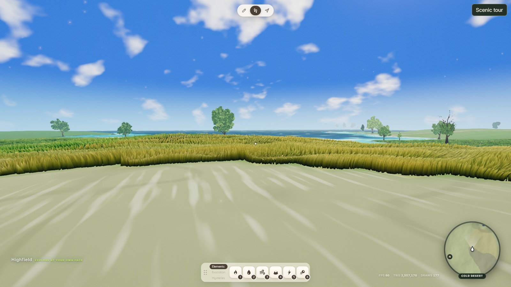
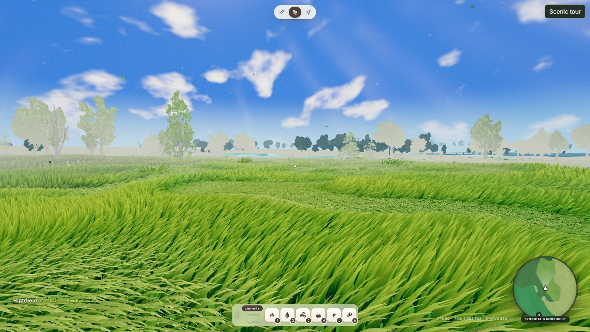
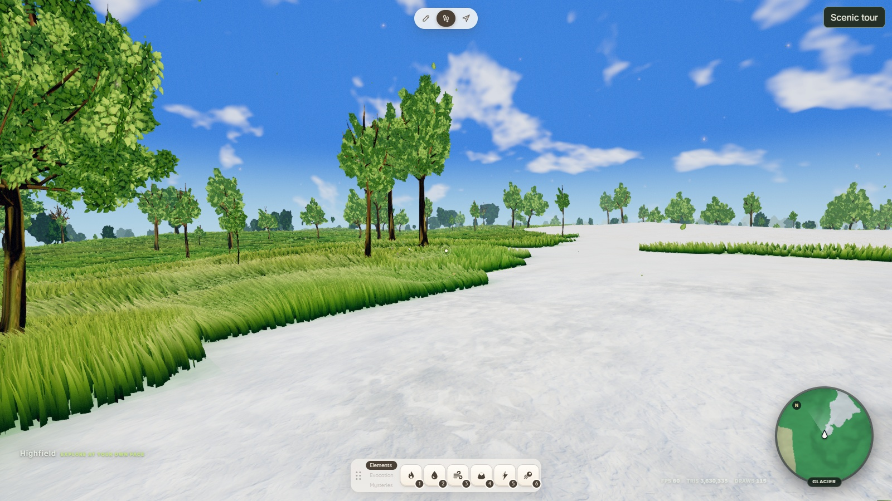

# World visual quality plan — 2026-10-13

Status: **implementation specification, expanded October 14, 2026**. The screenshot
review is retained below. The linked specification fixes the implementation
order, algorithms, configuration values, tests, and delivery gates. This document
change does not implement production rendering, generation, configuration, or assets.

Start with the [authoritative implementation specification](#authoritative-implementation-specification)
and its four ordered chapters. The original screenshot evidence remains below.

The target is a polished stylized fantasy world: convincing materials, coherent
plant scale, distinct habitats, readable landscape silhouettes, and consistent
detail while moving. Keep the current art direction. More grass, stronger bloom,
or higher texture resolution alone will not deliver that result.

## Capture method and limits

Review started on **October 13** and completed on **October 14, 2026**. The
original twelve land-biome images were captured on October 13 at revision
`9fb5ba6b`, using the default procedural world, seed **918273**, and unchanged
`editor.config.yaml`. The existing in-progress screenshots were subsequently
committed in `209f89d1`; this document completes their review.

Locations were selected reproducibly: LCG seed **20261013**, 250,000 random cell
pairs in `[-8000, 8000)` on each axis, retaining the first occurrence of each
biome. A random yaw was drawn when a biome was first encountered. Cells are
2 metres wide; the conversion is `X = (cellX + 0.5) * 2`,
`Z = -(cellZ + 0.5) * 2`. This is deliberately broad, stratified sampling, not
an area-weighted assessment or a search for the best views.

The captures use headed Windows Chromium, **hardware WebGPU on NVIDIA Lovelace**,
1600 × 900 CSS pixels at device scale 1, first-person FOV 68°, pitch −0.08 radians,
and the **Highfield** day preset with the clock paused at 12:00. Manual weather
is off. Regional atmosphere, snow particles, wind and foliage animation remain
live, so these are qualitative observations, not deterministic pixel comparisons.
The HUD is retained as evidence of the current exploration presentation.

**Readiness limitation:** all twelve images have 49 resident terrain chunks,
zero pending terrain loads/commits, ready player collision, and zero pending
material/field/meadow/draw/variant tasks. However, **none passed the complete
scenery settle gate**: one build-queue entry remained pending. Spot checks
identified `bushBuildQueue`. The harness waited 16 seconds after entering each
pose, then up to 30 seconds for 60 consecutive ready frames. An earlier desert
inspection also retained that queue entry after a longer wait. Keep the images
for visible material and composition findings, but treat exact vegetation
population and absence claims as provisional. Browser page/console errors were
zero during the retained procedural capture run. These are not accepted
performance baselines; the HUD FPS numbers are not benchmark results.

An initial Eldara jump failed with `Object spatial operation exceeds 262144
buckets`; those failed attempts are excluded from the image set. Subsequent
capture navigation resets the terrain predictor and requests the destination
resident set before allowing a frame at the new pose. This is a capture-harness
workaround, not an engine fix or evidence that ordinary teleporting is correct.

Full coordinates, camera state, biome verification, resolved sky values and
readiness snapshots are in
[procedural-captures.json](../qa/visual-audit-2026-10-13/procedural-captures.json).
The [provenance record](../qa/visual-audit-2026-10-13/provenance.json) includes
the source revision, sampling counts, configuration hash and image hashes.
An additional marine/imported-world capture attempt after resuming the review
was interrupted by a live application reload and shader initialization. No
loading-screen images are retained. Marine, imported mountain and settlement
views remain explicit follow-up coverage; the twelve linked images are the
evidence for this pass.
The review does not establish animation quality, audio quality, settlement or
workshop appearance, or coverage at other quality tiers.

## Screenshot inventory and observations

Each link opens the original **1600 × 900** browser capture. The ID is the
canonical biome at the camera, not a claim that the whole frame contains only
one biome. Border cases are retained rather than replaced with beauty shots.

| ID / screenshot | Canonical X, Z (metres) | What is visible |
| --- | --- | --- |
| [01 · Hot desert](../qa/visual-audit-2026-10-13/procedural-01.jpg) | -5,667, 93 | Broad white streaks and pale, low-contrast sand dominate; little foreground or horizon structure. |
| [02 · Cold desert](../qa/visual-audit-2026-10-13/procedural-02.jpg) | 501, -2,833 | Bright streaks on bare ground; a dense grass wall creates a hard habitat edge; cyan water beyond. |
| [03 · Savanna](../qa/visual-audit-2026-10-13/procedural-03.jpg) | -14,373, -3,467 | Gold palette reads as dry grassland, but nearly uniform tall blades resemble a crop; little foreground variation. |
| [04 · Grassland](../qa/visual-audit-2026-10-13/procedural-04.jpg) | -8,957, 7,737 | Greener than savanna, with similar blade height and rhythm; repeated broadleaf silhouettes along the horizon. |
| [05 · Tropical seasonal forest](../qa/visual-audit-2026-10-13/procedural-05.jpg) | -15,817, -3,703 | Useful close bark and root silhouette; bright turf reaches the trunk; cyan shallows and a dark water band need integration. |
| [06 · Temperate deciduous forest](../qa/visual-audit-2026-10-13/procedural-06.jpg) | -1,945, 7,795 | Strong tree/grass shapes, but the woodland floor stays meadow-like; little visible litter or shaded understory. |
| [07 · Tropical rainforest](../qa/visual-audit-2026-10-13/procedural-07.jpg) | 2,005, 2,941 | Nearby trees become pale cutouts in front of a darker distant tree line; inconsistent depth and vegetation appearance. |
| [08 · Temperate rainforest](../qa/visual-audit-2026-10-13/procedural-08.jpg) | -1,997, -2,889 | Bare foreground patch contains triangular grass remnants; investigate deformation/coverage before altering density. |
| [09 · Taiga](../qa/visual-audit-2026-10-13/procedural-09.jpg) | -15,631, -11,255 | Cooler grass palette, but sparse, nearly bare conifers provide weak taiga identity; sharp snow boundary at right. |
| [10 · Tundra](../qa/visual-audit-2026-10-13/procedural-10.jpg) | -4,803, 14,351 | Snow surface has some relief, but broad white coverage and sparse conifers leave little tundra-specific structure. |
| [11 · Glacier](../qa/visual-audit-2026-10-13/procedural-11.jpg) | 75, -7,561 | Thin white glacier patch meets lush turf and broadleaf forest abruptly; a procedural biome-classification issue as well as a blend issue. |
| [12 · Wetland](../qa/visual-audit-2026-10-13/procedural-12.jpg) | 9,647, 1,483 | This direction reads much like meadow/woodland; wetland identity is weak in the facing view, with water only on the minimap. |

Representative evidence:

## Highest-impact findings

| Priority | Evidence | Improvement to pursue |
| --- | --- | --- |
| P0 | Bare-ground captures 01 and 02 have long, very bright streaks and little readable surface relief. | Diagnose emission versus surface shading; restore sand/soil value range and texture scale. |
| P0 | Capture 02 shows dense grass ending at a hard, dark-edged boundary. | Blend coverage, height and ground color across the habitat edge; verify it is not incomplete preparation. |
| P0 | Capture 07 has pale, almost white tree silhouettes in front of a darker distant tree line. | Diagnose inconsistent atmosphere or lighting between tree representations; keep depth ordering coherent. |
| P1 | Captures 03–05 are dominated by closely packed, similarly tall blades. Savanna and grassland already differ in color, but share a crop-like structure. | Improve plant height hierarchy, patch size, gaps and species silhouettes before increasing density. |
| P1 | Capture 05 places bright turf right up to a large trunk and a saturated cyan shore. | Connect forest floor, roots, bank material, shallows and vegetation through local habitat rules. |
| P2 | The HUD competes with the terrain at the bottom of every shot; pale labels lose contrast against pale ground. | Separate exploration and editing presentation, improve contrast, and provide clean capture mode. |

Capture 08 also exposes a bare patch filled with small triangular grass remnants;
identify whether interaction deformation, placement or a detail transition owns
it before changing density. Captures 09–10 have unusually sparse conifer crowns;
check crown assets, alpha coverage and LOD before adding more trees. In capture 12,
the wetland's facing view reads much like meadow. Check its shore-facing view and
habitat weights before concluding that water or wetland assets are absent.

**Another P0 boundary issue:** capture 11 shows a narrow white glacier patch next
to lush green grass and broadleaf trees. This is a procedural low-elevation
sample, not an alpine panorama. `ProceduralWorldGenerator.sampleBaseTile` assigns
glacier above `heightScale * 0.9`, or **21.6 m** at the captured default, before
its climate tests. Revisit that classification and its neighborhood continuity;
adding snow detail alone cannot fix the resulting landscape transition.

The current renderer already has useful foundations: biome-dependent palettes,
authored tree silhouettes, detailed bark, dense groundcover, water depth color,
and atmospheric separation of distant trees. Preserve those systems and improve
how they combine. A single random viewpoint does not establish the average
quality of its whole biome.

## Authoritative implementation specification

Read and execute these chapters in order. Together with the evidence above,
they replace the earlier six exploratory stages and A–E delivery suggestions.
The task IDs below are the implementation checklist; the screenshot findings
are context, not permission to choose a different solution.

| Order | Required chapter | Tasks / result |
| --- | --- | --- |
| 1 | [Runtime reliability and capture contract](world-visual-quality-spec/01-runtime-and-capture.md) | VQ-01–03: bounded camera cuts, complete scenery preparation, repeatable evidence |
| 2 | [Surfaces and atmosphere](world-visual-quality-spec/02-surfaces-and-atmosphere.md) | VQ-04–06: non-emissive drift, readable materials, consistent mist and vegetation representations |
| 3 | [Biome composition](world-visual-quality-spec/03-biome-composition.md) | VQ-07–10: climate-safe snow, soft habitat edges, vegetation height hierarchy, valid interaction bending |
| 4 | [Presentation and release acceptance](world-visual-quality-spec/04-presentation-and-acceptance.md) | VQ-11–13: HUD, motion coverage, full automated verification and evidence package |

### Fixed product decisions

- Keep the existing stylized fantasy direction and authored asset library.
  The target is coherent scale, grounded materials, readable habitats and stable
  movement. Do not convert this into a photorealistic asset replacement project.
- Implement **all thirteen tasks**. Values in the specification are selected
  design targets, not measurements or claims that they have already passed QA.
- Preserve all thirteen canonical Azgaar biome IDs `0–12`. Custom definitions
  remain persisted with deterministic IDs `32–254`. A material class or a meadow
  look index is derived rendering data, never a replacement terrain ID.
- Keep the current renderer backend, quality tiers, residency distances,
  scattering candidate budgets, tree counts, grass LOD densities, texture sizes,
  shadow resolution, camera FOV and player speeds unless a task explicitly
  changes the named setting. No global density or exposure increase.
- Do not buy, generate or download assets. Reuse the checked-in tree, plant,
  rock, water and terrain resources. No new full-screen depth/color-copy pass.
- This release changes procedural **biome classification**, not continental
  heights, rivers, imported Azgaar IDs, mountain geometry or settlement geometry.
  Existing rock groups, shoreline forms and imported mountain silhouettes are
  regression fixtures. New ridges, landmarks, caves, fallen-log systems,
  settlement art, workshop geometry and new audio assets are excluded.
- Audio and general locomotion are regression checks only. The motion change
  authorized by this specification is the grass interaction correction in
  VQ-10. Do not add camera bob, sprint FOV changes or a new audio engine.

### Implementation discipline

Source inspection for this expansion used `118d3479` on `main`. Pull first and
record the actual starting SHA. If a symbol has moved, locate its current owner
with `rg`, keep the specified public behavior, and record the path change. Do not
restore an old implementation over another session's improvements.

Follow [player movement performance QA](../perf-qa.md) before runtime work.
Work and commit only on `main`; push each completed task after its required
checks. Do not create a worktree or feature branch. Stage only this task's files.
Use focused modules and existing config resolvers; keep `main.js` limited to
composition and wiring. New feature modules have a 300 nonblank-line limit;
split math, configuration and browser adapters before crossing that limit.

Each task finishes with: implementation, specified regression tests, test output,
before/after captures where required, and a short task record in the final QA
report. Tests must exercise behavior; source-text substring checks alone do not
prove a rendering or scheduling fix. Preserve original audit JPEGs and metadata.
New captures must not overwrite them or relabel an unsettled shot as settled.

**Failure rule:** repair code that violates the specified formulas, contracts or
tests. Do not relax thresholds, change the chosen palette, choose another asset,
raise budgets or replace a failing pose to obtain a pass. If the specified design
itself fails after its implementation is verified, stop that dependent stage,
commit the reproducible failing fixture and report the precise unmet gate. This
is a failed implementation gate, not an open-ended invitation to redesign.
Unrelated tasks may continue only when their stated prerequisites have passed.

**Definition of complete:** VQ-01 through VQ-13 pass, the evidence manifest links
every required artifact, all browser runs identify their real adapter and render
path, and the changes and QA report are committed and pushed to `main`. A plan,
a set of attractive stills, or a passing unit suite alone does not complete the
future implementation task.

## Related work

Execution status and retained pass/failure evidence are maintained in the
[implementation report](../qa/world-visual-quality-implementation-2026-10-14.md)
and [evidence index](../qa/world-visual-quality-2026-10-14/README.md).
The thirteen-task release is not complete; the valid motion rerun misses the
two-second requested-scenery recovery gate and the current four-light tree run
fails alpine impostor luminance. The October 15 ocean follow-up is
implemented and independently verified in the [ocean review](../qa/world-visual-quality-2026-10-14/ocean/README.md).

The [biome appearance review](../reviews/biome-reference-review-2026-10-07.md)
already records palette parity and preparation limitations. The
[snow review](../qa/snow-biome-review-2026-10-06.md) describes existing snow
shading and remaining lighting/rock work. [Regional skies](../sky-regions.md)
already provide climate-dependent atmosphere. Use these as implementation
context; their earlier performance numbers are not measurements of this capture.
