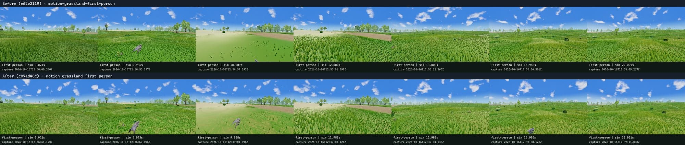
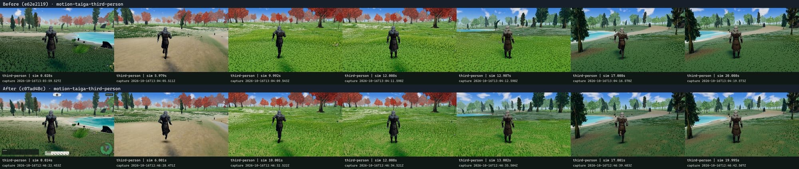
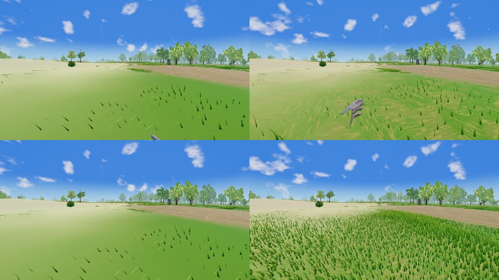
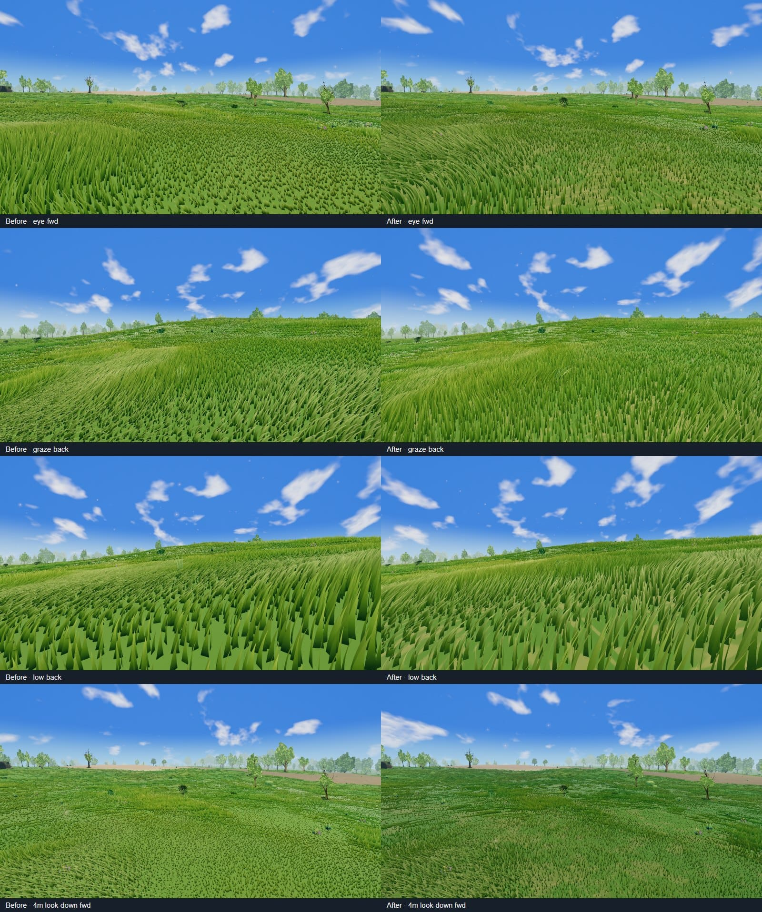
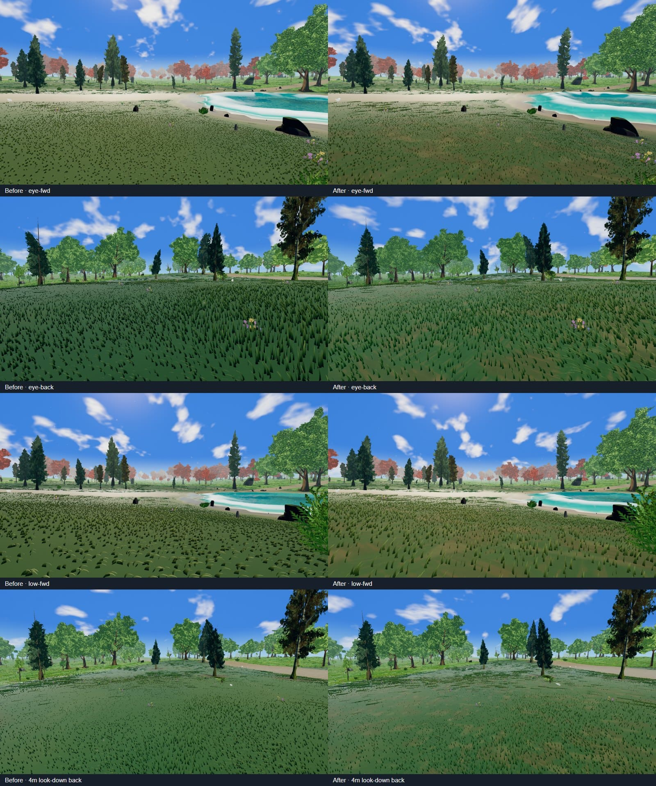
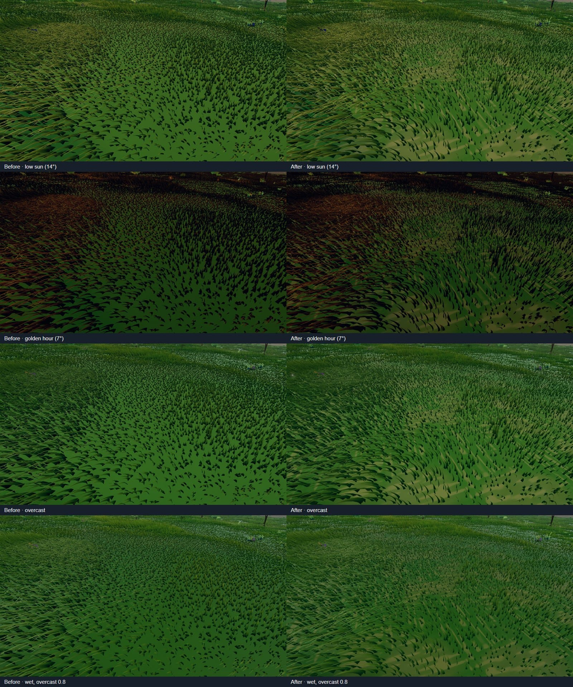
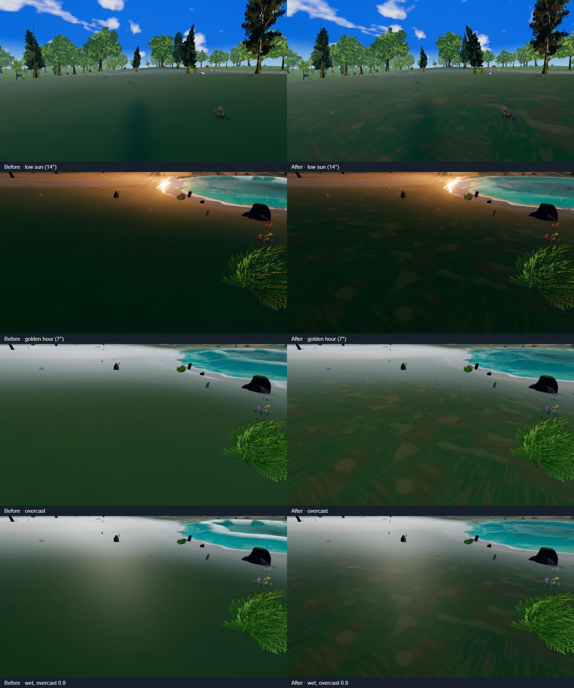

# Sparse grass — first implementation slice, October 16, 2026

[Plan](../../plans/sparse-grass-look-and-feel-plan-2026-10-16.md)
· [Audit evidence](../sparse-grass-audit-2026-10-16/README.md)

This is the plan's first slice (G1 + G2 prototype), shipped as defaults:

- **Tuft field** ([meadowTuftField.js](../../../src/editor/stylized/meadow/meadowTuftField.js),
  [meadowTuftNodes.js](../../../src/editor/stylized/meadow/meadowTuftNodes.js)):
  0.55 m plant cores grouped into 1.45 m drifts. Tuft members share a height
  tendency, a resting lean and a ±7 % value. Isolated stems lie further over.
  Stems are reshaped only. Acceptance, population, LOD prefixes and page bounds
  are unchanged.
- **Height**: the patch ramp broadened from `smoothstep(.55,.75)` to `.4,.8`, and
  the tuft field decides 32 % of the envelope. A tall patch gives up most of that
  share, so tall swaths keep their silhouette. Stragglers may stand at 0.85 ×
  `shortHeight`; `tallHeight` is still the maximum. On the audit's CPU probe
  grid, the share pinned at the short endpoint fell from 58 % to 8 %.
- **Width follows height**: `max(0.5, (height / tallHeight)^0.6)`. Short growth and
  worn ground read as slender blades instead of broad wedges.
- **Wind**: the shortest stems swing at 0.6 × the tall stand's compliance.
- **Root contact**: `rootBrightness` 0.48 → 0.6 and soil share 0.75 → 0.88.
  Isolated stems lift their root floor by up to 0.28 more, while tuft cores keep
  the depth. Occupancy rides the root varying's fourth lane, so no vertex output
  was added.
- **Ground between stems** ([meadowGroundDetail.js](../../../src/editor/stylized/meadow/meadowGroundDetail.js)):
  litter drifts, moss hollows, crumb-edged soil pockets, and anisotropic
  centimetre fallen-blade streaks out to 10 m. The layer fades to plain turf over
  14–34 m. Per-biome litter colour and amounts live in
  `grass.meadow.groundDetail.byTileId`, packed into the existing nearest-filtered
  meadow pigment map (rows 2–3). That adds no sampler and no biome branch. The
  noise uses the slot's `fine` transition lattice, so it is exact at planet scale
  and seamless across chunks. The cost is five value-noise octaves (20 integer
  hashes) per near pixel.

A/B switches: `grass.meadow.tufts.enabled: false` and
`grass.meadow.groundDetail.enabled: false`.

## Visual A/B

Both sides were served as immutable snapshots
(`scripts/serve-world-visual-snapshot.mjs`) and captured by
[capture-sparse-grass-ab.mjs](capture-sparse-grass-ab.mjs). That script is the
audit's script, parameterised by URL and output directory, without the rejected
forest pose. The baseline is `e62e2119`. Conditions match the audit: headed
Windows Chromium, NVIDIA Lovelace WebGPU, 1600 × 900, paused Highfield noon.
Both runs reported `captureValid: true`, with 6/6 poses and zero browser errors.
Wind and particles stay live, so the frames are not pixel-identical.

The full-size after frames are `*-after.png`. The tundra pose's foreground has
no meadow coverage, so it is unchanged, as the plan intends: the open landscape
is kept.

## Performance

`qa:perf --headed --qa chunk-cross --warmup 8 --duration 12 --settle --gpuTimings 1`,
three interleaved rounds per side on the same machine and snapshot servers.

| Side | FPS | dt p50 / p95 / p99 (ms) | GPU total p50 (ms) | Hitches |
| --- | --- | --- | --- | --- |
| Baseline `e62e2119` | 125.2 / 108.6 / 126.7 | 7.6–7.8 / 10.6–18 / 15.9–33.3 | 1.79 / 1.89 / 1.83 | 3 / 14 / 1 |
| Candidate | 119.3 / 124.3 / 126.4 | 7.5–7.7 / 10.6–12.7 / 16.4–17.6 | 1.85 / 1.90 / 1.81 | 1 / 0 / 2 |
| Candidate, ground detail off | 127.8 / 107.6 / 127.3 | 7.4–8.2 / 10.2–15.8 / 15.3–32.2 | 1.92 / 2.10 / 1.88 | 1 / 10 / 1 |

The differences are inside the run-to-run spread. One baseline round and one
no-detail round each caught an unrelated stall on this shared machine. An
earlier ground-detail draft spent about 40 hashes per pixel. It measured slower
in noisy runs that had no GPU timings, so it was cut to the 20-hash form
measured here. This was a chunk-cross A/B only; the full density, construction
and water matrix has not been rerun for this change.

## Not covered

- G0's controlled diagnostics: albedo/normal views and projected-coverage masks.
- WebGL and low quality.
- G3 secondary cover.

Motion, LOD ranges, lighting and the full matrix are covered by the G4
acceptance below.

## G4 acceptance and lighting sweep

**Verdict: accepted, with no fixes needed.** Motion, LOD ranges and the
low-sun/overcast/wet sweep all hold. Neither run compiled anything away, and
`c07ad48c` was not changed. The candidate passes every movement and water gate
of the full matrix in two clean runs. Construction fails its hitch gate on both
sides in every run, so that failure predates this change.

**Method.** Both sides ran as immutable snapshots on the same machine: the
candidate `c07ad48c` on :5181 and the baseline `e62e2119` on :5182 (served with
`scripts/serve-world-visual-snapshot.mjs`). The setup was headed Windows
Chromium on an NVIDIA Lovelace with WebGPU, at 1600 × 900. Captures were
recorded by
[acceptance-sparse-grass.mjs](acceptance-sparse-grass.mjs) at the audit's
grassland (−1869, −4003) and taiga (−2847, −6683) poses. Every run reported
`captureValid: true` with zero browser errors.

- **motion**: the engine's own `walk-sprint-turn-v1` sequence in first and
  third person, as a screencast. It is idle until 2 s, walks to 6 s, sprints
  to 10 s, then stops, turns 180° over 12–13 s, walks 13–17 s and idles until
  20 s.
- **wind**: an 8 s stationary look-down plus an eye-level view.
- **lod**: eye-level, grazing (pitch −0.015), a 0.55 m low camera and a 4 m
  look-down, each forward and back.
- **light**: highfield noon, `lowsway` (14° sun), `emberfall` (7°), overcast 1,
  and wet. Wet means overcast 0.8 with wetness pinned at 1, without rain
  particles.
- **lightfrozen**: the light sweep repeated with the meadow sway clock and the
  world wind pinned to one instant, so both sides show identical blade poses.
  Live gusts flatten different swaths between captures and swing ground
  luminance by about ±20 %, so only the frozen pairs are quoted for lighting.

[analyse-sparse-grass.mjs](analyse-sparse-grass.mjs) scores flicker as
high-temporal-frequency luma energy per screen band,
`mean |f(t) − (f(t−1) + f(t+1))/2|`. Smooth sway scores low, while aliasing
and shimmer score high. Screencast cadence varied between runs (about 12 vs
20 fps), so the candidate frames were resampled to the baseline's cadence
before comparing.

### 1. Motion — pass

- **Tuft rest lean.** The lean holds through walk, sprint, stop and the turn.
  Tufts lean as groups, and no stem changes its resting direction as the
  camera passes.
- **Short-stem wind.** Short stems ride the same gusts as the tall stand with
  less swing. None oscillates on its own. In the stationary clips the
  candidate's flicker energy is at or below the baseline in every band. Down
  view, bottom four bands: 5.03 / 4.35 / 4.05 / 2.99 against 5.44 / 4.43 /
  3.48 / 2.83. Mid view: 6.63 / 5.38 / 4.59 against 7.11 / 6.11 / 4.99. All
  values are luma at 1600 px.
- **Streak fade.** The ground detail's centimetre streaks do not shimmer while
  they fade (`fineEnd` 10 m, `fadeEnd` 34 m). Walking at 2–6 s and 13–17 s,
  the candidate's flicker energy is 10–15 % *below* the baseline in every
  ground band, in both camera modes. First person, 2–6 s, bottom bands:
  21.3 / 24.3 / 24.5 / 24.0 against 24.6 / 28.4 / 28.7 / 27.9. Consecutive
  full-resolution frames show the streaks stable from frame to frame. The
  slender blades flicker less than the broad wedges did.
- **Pressed grass.** Third-person grass parts around the body and closes
  behind it. After the 180° turn the trail has already recovered to the same
  layout, with no stuck or re-seeded patches.

**Pre-existing, not caused by this change:** at the end of the grassland
sprint, the near tiles show lower-density publications for about 0.3 s before
they fill. The baseline does the same, and is slower to fill and barer
underneath:

The candidate's ground detail makes that gap read as litter instead of a flat
green bake. On both sides, the grassland route also fails the motion runner's
"scenery settles within two seconds after stopping" check (queue depth 40–58,
with 0–5 near tiles missing during the sprint). Taiga passes on both sides.

### 2. LOD ranges — pass

- **Seams.** None appear forward or backward across the 6/14/30/50 m blade
  bands or the 9.2–14 m card fill. That holds at grazing pitch and from the
  0.55 m camera. The far cards inherit the new heights without a silhouette
  step at the card start.
- **Brightness at the ground-detail fade.** Row-mean luminance on the 4 m
  look-down and eye-level views falls monotonically through 14–34 m on both
  sides, with no step against the mid-distance bake. In taiga, rows in the
  fade band stay within ±5 luma of the baseline. The candidate is warmer only
  in the near field, where the litter lives (R − G higher by 3–7). Grassland
  differences between captures follow the live gust swaths, not distance.
- **LOD widening.** The 2× maximum LOD widening reads as small dark wedges in
  sparse taiga stands, finer than the baseline's broad tufts. It needs no
  change for this slice.

### 3. Lighting — pass

The table compares wind-frozen ground-inspection frames, lower 45 % of the
screen. "Black" is the share of pixels with luma under 12.

| Lighting | Grassland, base → cand: mean luma / black % | Taiga, base → cand: mean luma / black % |
| --- | --- | --- |
| Noon | 117.1 → 128.3 / 0 → 0 | 85.4 → 87.7 / 0 → 0 |
| Low sun 14° | 69.6 → 76.5 / 3.46 → 0.06 | 40.8 → 41.3 / 0.02 → 0.02 |
| Golden 7° | 35.6 → 39.5 / 24.4 → 22.0 | 22.5 → 22.8 / 0.42 → 0.41 |
| Overcast | 69.5 → 76.1 / 2.65 → 0.02 | 51.8 → 50.9 / 0.01 → 0.01 |
| Wet | 64.4 → 69.5 / 0.54 → 0.01 | 48.0 → 45.8 / 0.01 → 0.01 |

- **Root contact never goes black.** The black share is equal or lower in every
  condition. The baseline's black root punctuation under low sun and overcast
  (2.7–3.5 %) is gone. At 7° golden hour the backlit blade bodies are dark on
  both sides; that is blade shading, not root contact.
- **Litter and soil do not glow.** In grassland the candidate is a steady 8–11 %
  brighter in every condition, because more ground shows between the slender
  blades. The ratio does not grow under overcast or wet, and in taiga the
  candidate is level or darker. Wet darkens the ground below overcast on both
  sides (grassland 76.1 → 69.5). The ground detail is applied before
  `RainWetnessShading` in `terrainMaterial.js`, so it soaks like the rest of
  the turf.

### 4. Performance — `qa:perf:matrix --headed` (standard gates)

These are A/B runs on the same machine and snapshot servers, with default
`--warmup 8 --duration 10`. Cells show FPS / p95 ms / hitch rate.

| Case | Base run 2 | Base run 3 | Cand run 1 | Cand run 2 | Cand run 3 |
| --- | --- | --- | --- | --- | --- |
| standard | 94 / 16.0 / 0.4 % | 73 / 30.6 / 3.0 % | 94 / 14.1 / 0.0 % | 78 / 26.5 / 0.9 % | 106 / 12.4 / 0.0 % |
| dense-forest | 114 / 12.5 / 0.0 % | 108 / 12.2 / 0.0 % | 92 / 13.8 / 0.0 % | 87 / 15.4 / 0.1 % | 111 / 11.5 / 0.0 % |
| high-grass | 83 / 17.9 / 0.7 % | 87 / 16.9 / 0.5 % | 75 / 26.7 / 1.9 % | 75 / 22.6 / 1.6 % | 107 / 11.6 / 0.0 % |
| dense-mixed | 98 / 14.6 / 0.1 % | 103 / 12.5 / 0.0 % | 63 / 31.8 / **3.3 %** | 84 / 16.6 / 0.6 % | 101 / 12.7 / 0.0 % |
| construction-ring | 60 / 33.1 / **4.9 %** | 60 / 32.8 / **4.3 %** | 62 / 32.3 / **4.0 %** | 65 / 30.7 / **2.02 %** | 57 / **33.6** / **6.0 %** |
| water route | pass | pass | runner failed | pass | pass |
| Matrix gate | fail: construction hitches + recovery | fail: standard hitches, construction hitches | fail: dense-mixed hitches, construction hitches, water | fail: construction hitches only | fail: construction p95 + hitches |

- **Construction corridor.** It fails the 2 % hitch gate on both sides in
  every run, at 2.0–6.0 %. That is the already-failing gate recorded in the
  [October 16 performance report](../../performance-improvements-2026-10-16.md),
  not a regression from this change. The gates were not relaxed.
- **Movement cases.** Every movement case and the water route pass in
  candidate runs 2 and 3. Run-to-run spread is large on this shared machine.
  The same baseline snapshot measured standard at 94 and then 73 FPS, and
  candidate run 3 is level with or faster than both baseline runs in every
  case. The candidate-1 dense-mixed hitch rate (3.3 %) and its water-runner
  timeout were not reproduced. That timeout happened while the runner waited
  for focus at the route start (`run-water-acceptance-qa.mjs:374`), before any
  measurement.
- **Excluded run.** One more baseline run measured standard at 34 FPS, about
  a third of the usual rate. Its construction-ring report was missing, and
  the runner reused the previous run's file. It overlapped another session's
  dev-server activity and is excluded. Later runs logged GPU use and client
  connections to that server every 10 s and saw none.
- **Earlier GPU timings.** The chunk-cross A/B above already showed equal GPU
  time with three GPU-timed rounds. This matrix adds no evidence of a frame
  cost.

### Follow-ups (not in this slice)

- Sprint density lag in grassland: sparse publications for about 0.3 s at
  sprint end, and the motion runner's two-second settle failure on that
  route. Both predate this change and belong to streaming, not look.
- The construction corridor hitch gate keeps failing on both revisions.
- A WebGL / low-quality pass, and G0's albedo and coverage diagnostics.
