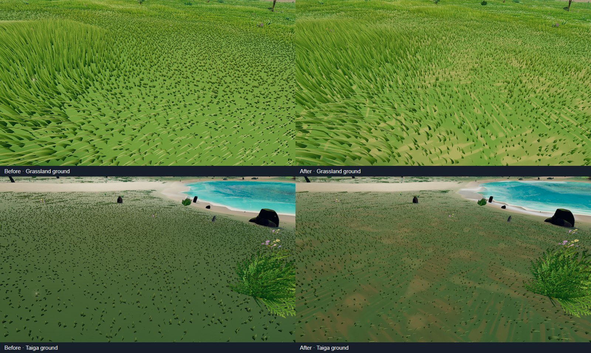
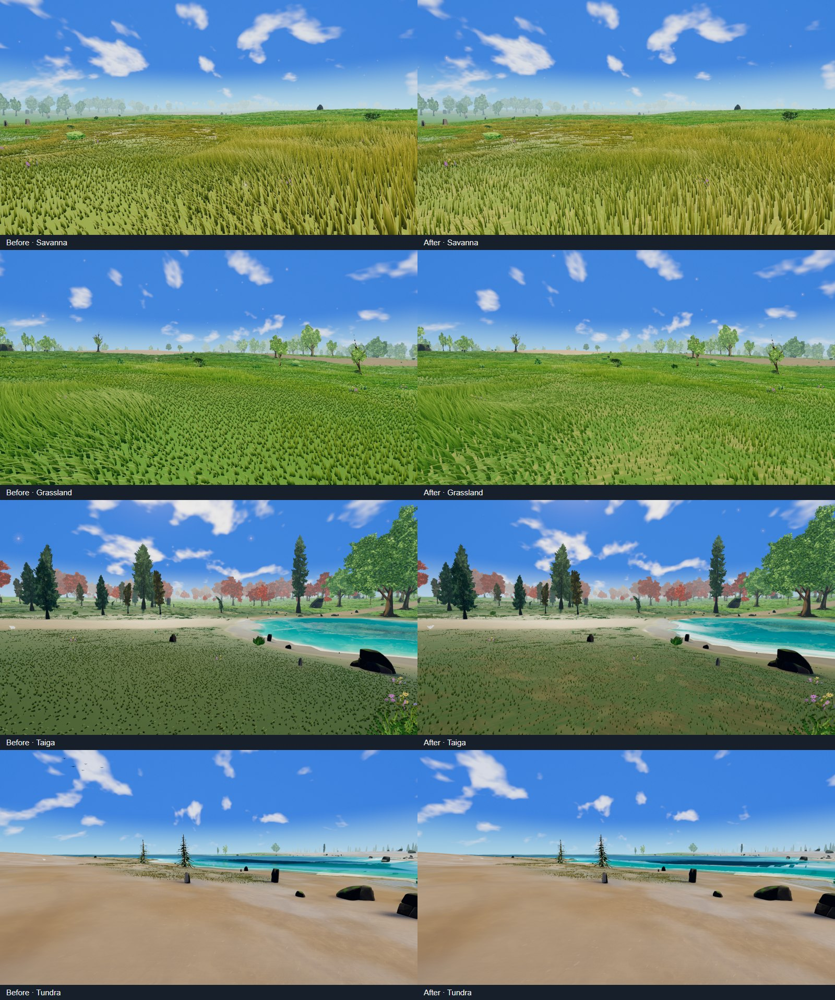

# Sparse grass — first implementation slice, October 16, 2026

[Plan](../../plans/sparse-grass-look-and-feel-plan-2026-10-16.md)
· [Audit evidence](../sparse-grass-audit-2026-10-16/README.md)

This is the plan's first slice (G1 + G2 prototype), shipped as defaults:

- **Tuft field** ([meadowTuftField.js](../../../src/editor/stylized/meadow/meadowTuftField.js),
  [meadowTuftNodes.js](../../../src/editor/stylized/meadow/meadowTuftNodes.js)):
  0.55 m plant cores grouped into 1.45 m drifts. Tuft members share a height
  tendency, a resting lean and a ±7 % value. Isolated stems lie further over.
  Stems are reshaped only. Acceptance, population, LOD prefixes and page bounds
  are unchanged.
- **Height**: the patch ramp broadened from `smoothstep(.55,.75)` to `.4,.8`, and
  the tuft field decides 32 % of the envelope. A tall patch gives up most of that
  share, so tall swaths keep their silhouette. Stragglers may stand at 0.85 ×
  `shortHeight`; `tallHeight` is still the maximum. On the audit's CPU probe
  grid, the share pinned at the short endpoint fell from 58 % to 8 %.
- **Width follows height**: `max(0.5, (height / tallHeight)^0.6)`. Short growth and
  worn ground read as slender blades instead of broad wedges.
- **Wind**: the shortest stems swing at 0.6 × the tall stand's compliance.
- **Root contact**: `rootBrightness` 0.48 → 0.6 and soil share 0.75 → 0.88.
  Isolated stems lift their root floor by up to 0.28 more, while tuft cores keep
  the depth. Occupancy rides the root varying's fourth lane, so no vertex output
  was added.
- **Ground between stems** ([meadowGroundDetail.js](../../../src/editor/stylized/meadow/meadowGroundDetail.js)):
  litter drifts, moss hollows, crumb-edged soil pockets, and anisotropic
  centimetre fallen-blade streaks out to 10 m. The layer fades to plain turf over
  14–34 m. Per-biome litter colour and amounts live in
  `grass.meadow.groundDetail.byTileId`, packed into the existing nearest-filtered
  meadow pigment map (rows 2–3). That adds no sampler and no biome branch. The
  noise uses the slot's `fine` transition lattice, so it is exact at planet scale
  and seamless across chunks. The cost is five value-noise octaves (20 integer
  hashes) per near pixel.

A/B switches: `grass.meadow.tufts.enabled: false` and
`grass.meadow.groundDetail.enabled: false`.

## Visual A/B

Both sides were served as immutable snapshots
(`scripts/serve-world-visual-snapshot.mjs`) and captured by
[capture-sparse-grass-ab.mjs](capture-sparse-grass-ab.mjs). That script is the
audit's script, parameterised by URL and output directory, without the rejected
forest pose. The baseline is `e62e2119`. Conditions match the audit: headed
Windows Chromium, NVIDIA Lovelace WebGPU, 1600 × 900, paused Highfield noon.
Both runs reported `captureValid: true`, with 6/6 poses and zero browser errors.
Wind and particles stay live, so the frames are not pixel-identical.

The full-size after frames are `*-after.png`. The tundra pose's foreground has
no meadow coverage, so it is unchanged, as the plan intends: the open landscape
is kept.

## Performance

`qa:perf --headed --qa chunk-cross --warmup 8 --duration 12 --settle --gpuTimings 1`,
three interleaved rounds per side on the same machine and snapshot servers.

| Side | FPS | dt p50 / p95 / p99 (ms) | GPU total p50 (ms) | Hitches |
| --- | --- | --- | --- | --- |
| Baseline `e62e2119` | 125.2 / 108.6 / 126.7 | 7.6–7.8 / 10.6–18 / 15.9–33.3 | 1.79 / 1.89 / 1.83 | 3 / 14 / 1 |
| Candidate | 119.3 / 124.3 / 126.4 | 7.5–7.7 / 10.6–12.7 / 16.4–17.6 | 1.85 / 1.90 / 1.81 | 1 / 0 / 2 |
| Candidate, ground detail off | 127.8 / 107.6 / 127.3 | 7.4–8.2 / 10.2–15.8 / 15.3–32.2 | 1.92 / 2.10 / 1.88 | 1 / 10 / 1 |

The differences are inside the run-to-run spread. One baseline round and one
no-detail round each caught an unrelated stall on this shared machine. An
earlier ground-detail draft spent about 40 hashes per pixel. It measured slower
in noisy runs that had no GPU timings, so it was cut to the 20-hash form
measured here. This was a chunk-cross A/B only; the full density, construction
and water matrix has not been rerun for this change.

## Not covered

- G0's controlled diagnostics: frozen wind, albedo/normal views and
  projected-coverage masks.
- Lighting sweeps (low sun, overcast, wet).
- WebGL and low quality.
- The motion clip.
- G3 secondary cover and G4 LOD-range acceptance.

The far cards share the growth function, so they inherit the new heights. Their
seam behaviour was not separately reviewed.
