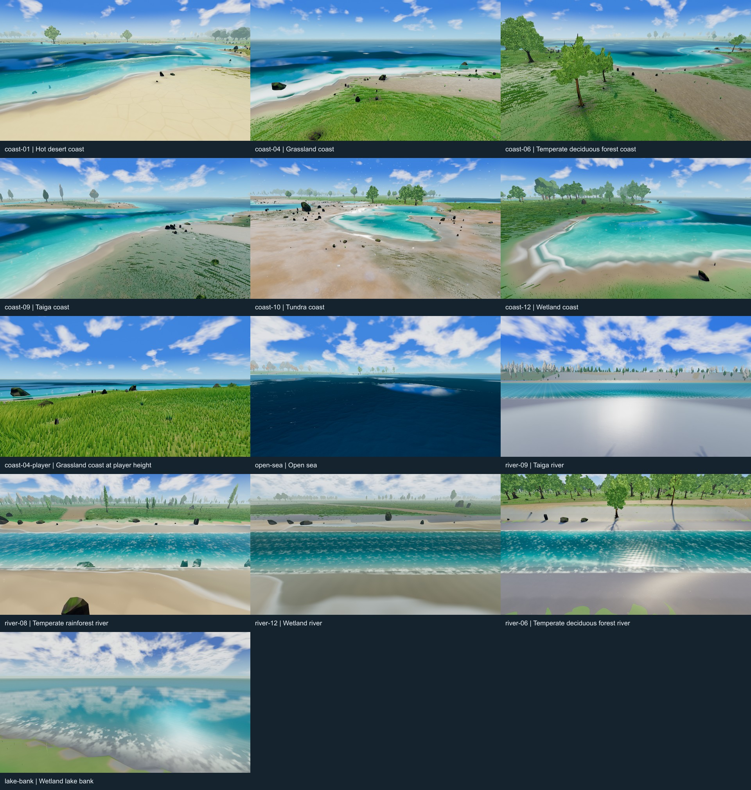

# Water, rivers and sea: randomized visual audit

**13 accepted views, 26 original PNGs, zero browser errors.** Captured October 16, 2026; review completed October 17. The set covers six coastal biomes, a player-height coast companion, deep sea, four river biomes and a lake bank. Every accepted pose passed terrain/scenery/collision readiness, expected biome and canonical water-kind checks.

[Detailed AAA improvement plan](../../plans/water-aaa-look-and-feel-plan-2026-10-16.md) · [Full-size contact sheet](contact-sheet.jpg) · [Exact poses](manifest.json) · [Capture report](report.json) · [Source snapshot](source-snapshot.json)



## Accepted gallery

Coordinates are canonical camera X/Z in meters, rounded for display; use the manifest for full precision, orientation and height. Biomes are the camera's actual Azgaar terrain ID, not a classification of every visible tree or distant bank. Depth is sampled at the recorded water target during capture and can differ from the selector's still-water depth because the surface is animated. Water kinds are canonical: ocean `1`, lake `2`, river `3`.

| View | Camera biome | Camera X, Z (m) | Target kind / depth (m) | Original images |
| --- | --- | --- | --- | --- |
| Desert coast | Hot desert `1` | 9453, -4353 | Ocean / 0.827 | [Clean](coast-01.png) · [HUD](coast-01-hud.png) |
| Grassland coast | Grassland `4` | -1313, 6119 | Ocean / 1.977 | [Clean](coast-04.png) · [HUD](coast-04-hud.png) |
| Forest coast | Temperate deciduous forest `6` | 9767, 9179 | Ocean / 1.786 | [Clean](coast-06.png) · [HUD](coast-06-hud.png) |
| Taiga coast | Taiga `9` | -5441, 13581 | Ocean / 0.913 | [Clean](coast-09.png) · [HUD](coast-09-hud.png) |
| Tundra coast | Tundra `10` | -6947, -12037 | Ocean / 1.122 | [Clean](coast-10.png) · [HUD](coast-10-hud.png) |
| Wetland coast | Wetland `12` | 9131, -3875 | Ocean / 0.698 | [Clean](coast-12.png) · [HUD](coast-12-hud.png) |
| Grassland, player height | Grassland `4` | -1313, 6119 | Ocean / 1.415 | [Clean](coast-04-player.png) · [HUD](coast-04-player-hud.png) |
| Deep sea | Marine `0` | 14509, -11641 | Ocean / 24.174 | [Clean](open-sea.png) · [HUD](open-sea-hud.png) |
| Taiga river | Taiga `9` | 6362854.2, -1019611.2 | River / 7.899 | [Clean](river-09.png) · [HUD](river-09-hud.png) |
| Rainforest river | Temperate rainforest `8` | -4269925.3, 2359551.9 | River / 5.902 | [Clean](river-08.png) · [HUD](river-08-hud.png) |
| Wetland river | Wetland `12` | 4265001.5, -2345997.7 | River / 7.294 | [Clean](river-12.png) · [HUD](river-12-hud.png) |
| Forest river | Temperate deciduous forest `6` | -6524344.3, 1768763.1 | River / 6.012 | [Clean](river-06.png) · [HUD](river-06-hud.png) |
| Lake bank | Wetland `12` | -228759.5, 629070.2 | Lake / 1.672 | [Clean](lake-bank.png) · [HUD](lake-bank-hud.png) |

The first eight views use the procedural world; the last five use `maps/Eldara Full 2026-07-23-20-37.json`. Several procedural ocean inlets look like ponds in these compositions. They remain ocean-kind water; the imported captures provide actual rivers and a lake. Distant land is visible in the deep-sea view.

## What to improve first

| Visible evidence | Review finding | Plan item |
| --- | --- | --- |
| Wetland coast, grassland coast, taiga crest | Stepped contact bands, hard shoreline corners and a visibly serrated wave silhouette. | WQ-01: isolate geometry, displacement and wetness/foam ownership before selecting a fix. |
| Forest river, taiga river, lake | Repeated bright motifs; a strong crosshatched central highlight in the forest river. | WQ-02: isolate detail normals, glint and foam, then remove the responsible repetition. |
| Grassland coast, rainforest river, wetland river, lake bank | Broad bright coverage reduces clear-water gaps and local variation. A pale pixel is not necessarily foam. | WQ-00/WQ-02: layer controls, then tune generation, breakup and lifespan. |
| Desert coast | Rounded gray contact rim and large dry ground cracks close to the wash. | WQ-01/WQ-06: thin contact and coherent wet substrate. |
| Forest/tundra/wetland shores and imported river banks | Similar saturated cyan water, broad smooth bank strips and little local shore character. | WQ-03/WQ-06: water profiles, substrate, rooted vegetation and selective grouped detail. |
| Deep sea and coast overviews | Large smooth swells and soft cloud-reflection patches dominate over intermediate surface structure. | WQ-05/WQ-07: reflection/roughness calibration and a clearer wave-scale hierarchy. |

The [plan's per-view findings](../../plans/water-aaa-look-and-feel-plan-2026-10-16.md#3-visual-findings) distinguish observed defects from possible causes and give implementation steps, code ownership, dependencies, acceptance criteria and performance gates. The player-height coast is useful for gameplay composition, but foreground grass hides much of its waterline; it should not be the only contact comparison.

## Sampling and capture conditions

- **Coast selection:** seeded random candidates (`20261016`) in a 16000 × 16000 cell search area, retaining the first qualifying land camera for IDs `1, 4, 6, 9, 10, 12`. For each candidate, the selector searches eight directions at radii 8, 16 and 24 cells for ocean deeper than 0.6 m. Six biomes were found after 20,165 candidate cells. The generator seed is separately recorded as `918273`; tile size is 2 m.
- **Deep sea:** continues the random sequence to an independent marine point deeper than 10 m, with randomized yaw. The player-height grassland pose is a deliberate companion, not a second independent random sample.
- **Rivers:** seed `20261017`; randomly sampled imported segments and positions, retaining the first four qualifying distinct bank biomes. The filter uses nominal channel radius 4–150 m and a usable cross-channel view. Four accepted river poses were found in 15 trials. This does not represent every river width or landform.
- **Lake:** randomly sampled imported lake outline segment, then searched a perpendicular transect in 2 m steps to locate the resolved shoreline. One bank view is included; waterfalls, confluences, river mouths and underwater views are not covered.
- **Renderer:** native Windows, headed Chromium, hardware NVIDIA Lovelace WebGPU, fallback adapter false; 1600 × 900, DPR 1, FOV 68°. Adapter details and water configuration are in the report.
- **Lighting:** Highfield, paused noon, manual weather off. Regional snow/particles, wind and water animation remain active. Snowflakes in the tundra view do not mean the manual weather override failed.
- **Preparation:** production camera cuts, ground/collision preparation for fly poses, then at least 16 seconds and 60 consecutive ready frames through the shared helper; lighting settles before capture. Browser background/occlusion throttling is disabled and the page reloads between poses. The shared browser QA lock is held throughout.
- **Source:** frozen runtime/configuration at `52914b1559ceda00526ca027b83a89775ced63a4`; snapshot digest `cdda35cb1e611b17b247584cd6f26d7feb45ac309dd311978db41ac4d0447c10`. The snapshot records the exact files it freezes. Other public assets are shared checkout assets, not a fully immutable asset archive. The imported map has its own recorded SHA-256. Changes committed after the frozen revision are not represented by these runtime captures.
- **Run:** `2026-10-16T17:14:30.876Z` to `2026-10-16T17:35:59.662Z`. All 13 poses passed, no failed poses and no browser errors; the source stayed fixed.

The server console did emit warnings during this run: the tree-impostor manifest did not match the tree source assets, so the loader announced a runtime-bake fallback; Three.js also warned that `Source` was renamed to `TextureSource`. These are warnings, not entries in the capture error monitor's zero-error count. Readiness passed, but this audit does not certify the pre-baked tree-impostor asset path. Resolve or explicitly retain that fallback when preparing authoritative performance comparisons.

The clean PNGs are captured from the production world canvas without retouching. HUD PNGs are adjacent frames, so moving waves and particles differ. The contact sheet only resizes and labels the clean images. It is a browsing aid; assess thin outlines and repeated patterns in the original PNGs.

This is a visual investigation, not an FPS benchmark, exhaustive biome certification or animation/audio acceptance run. Static views cannot prove flow direction, temporal shimmer, phase resets, reflection latency or sound quality. The plan specifies motion and performance follow-up before implementation can be accepted.

## Rejected initial attempt

The [initial report](initial-attempt/report.json) is retained separately. Its first desert view passed, then the grassland, forest and taiga destination preparations timed out. The run was intentionally interrupted while the next pose was pending; the report records the resulting browser-closed failure. It is **not a valid baseline suite**.

[Grassland failure](initial-attempt/failed-coast-04.png) · [Forest failure](initial-attempt/failed-coast-06.png) · [Taiga failure](initial-attempt/failed-coast-09.png)

The root `failed-coast-*.png` files are retained duplicates from this first attempt and are not artifacts of the accepted report. The successful retry used browser throttling controls and per-pose reloads without lowering readiness requirements. This establishes a successful capture procedure; it does not isolate the cause of the earlier timeouts.

The [earlier desert frame](initial-attempt/coast-01.png) shows broader opaque white coverage at a different live wave phase. It and the accepted desert frame use the same frozen rendering source. They are phase observations, **not before/after images of a rendering change**. Initial scripts/manifests/source records are archived for provenance; the archived script's relative imports assume its former parent-directory location.

## Reproduce and validate

From the repository root, start a frozen source server in one terminal. This does not change the checkout or create a branch:

```powershell
rtk proxy node scripts/serve-world-visual-snapshot.mjs 52914b1559ceda00526ca027b83a89775ced63a4 5189
```

In another terminal, replay the saved poses into a **new output directory**. Local dependencies, the imported map and shared public assets must be available:

```powershell
rtk proxy node docs/qa/water-aaa-audit-2026-10-16/capture.mjs --url http://localhost:5189 --out tmp/water-aaa-replay --manifest docs/qa/water-aaa-audit-2026-10-16/manifest.json
```

Omit `--manifest` only to rerun seeded selection. The capture runner's default output is this evidence directory, so always provide `--out` for new captures. Live animation is not frozen; replay reproduces geography and conditions, not identical pixels. For future candidate work, use a separately frozen candidate server and record both revisions. The runner imports repository QA helpers; compare their versions with the source snapshot when replaying later.

To verify the saved evidence and rebuild the derived gallery:

```powershell
rtk proxy node docs/qa/water-aaa-audit-2026-10-16/build-gallery.mjs
rtk proxy node docs/qa/water-aaa-audit-2026-10-16/verify-evidence.mjs
rtk proxy node node_modules/eslint/bin/eslint.js docs/qa/water-aaa-audit-2026-10-16
rtk git diff --check
```

The verifier checks capture/selector/map and PNG hashes, dimensions, pose readiness, canonical positions, biome/water-kind coverage, frozen-source identity, current QA-helper identity and local documentation links. It writes `validation.json`; `gallery-index.json` is the concise machine-readable gallery. A later helper or map mismatch means the local replay environment has changed, not that the stored PNGs automatically changed.
