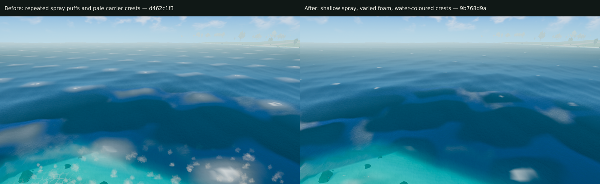

# Ocean repetition review — October 15

The three visible causes are implemented and tested. This is a focused ocean
follow-up; the full thirteen-task release is still blocked by the movement
recovery gate recorded in the [implementation report](../../world-visual-quality-implementation-2026-10-14.md).

[Original capture](before/default.png) · [Final aerial capture](final/marine-coast-overview-default.png)
· [Final player-height capture](final/marine-coast-default.png).

## Confirmed causes and exact changes

| Visible problem | Evidence that isolates it | Implemented correction |
| --- | --- | --- |
| Repeated white puff shapes across open water | [Puffs remain with water meshes removed](layer-isolation/water-off.png), and [disappear when coastal spray is hidden](spray-isolation/surf-spray-off.png) | `6f5f8985`: per-particle depth envelope `[0.25,0.7,2.4,4.5]` m; zero emission on dry ground and beyond 4.5 m; stable random rotation and area-preserving aspect variation for puff billboards |
| Spray forms a wall of mist at player height | [Intermediate player view](crest-candidate-player/default.png) | `9b768d9a`: sizes `[0.24,0.72]` m, height `[0.02,0.72]` m, rise `0.55` m/s, base soft fade `0.12` m; count remains 420, with the same texture, colour and opacity |
| Broad pale patches repeated on every large crest | [Crest-light control](spray-depth-candidate/crest-light-off.png); the patches survive foam/reflection controls | `59548db6`: replace the blend toward a near-white colour with `shadedWater * (1 + crest * crestLift)`; keep `crestLift=0.12` and all existing sea palettes |
| Short repeated foam lace and regular vertex breakup | The old foam sampled the normal texture's wave-height channel at scale 0.19: exact 5.263 m UV repeat; breakup had wavelengths below the 2 m vertex grid | `1eb2203b`: shared two-octave integer-hash field, bounded chunk origins and independent phase warps; evaluate breakup per fragment |

The new foam field is periodic over the engine's 512-cell noise domain. It
removes the short texture repeat; this is not a claim of an infinite aperiodic
field. Water displacement, swimming heights and carrier wavelengths retain their
existing formulas. No texture, draw call, geometry density or screen pass was
added. Ambient particle shape construction was extracted to its own module so
the field remains focused on placement and motion.

## Verification

All browser evidence below identifies hardware NVIDIA Lovelace, fallback false.
The final application source/config is `9b768d9a`. Node capture harness revisions
are recorded independently in each newer raw report.

| Check | Result | Evidence |
| --- | --- | --- |
| Focused sea, origins, ambient and depth tests | 27 passed | Included in the complete repository run |
| Complete repository verification | Lint, UI generation check, production asset validators, **6,742 tests**, zero skipped, production build passed | [Verification record](verify.json); complete local log path/hash recorded there |
| Production foam and crest shader | **30 checks per backend**, zero errors | [Raw GPU report](foam-shader-current/report.json) |
| Production spray depth/visibility | **7 checks per backend**, zero errors; shallow spray remains visible after scaling | [Raw GPU report](spray-small/report.json) |
| Existing environment parity | **78 checks passed**, WebGPU and WebGL, zero errors | [Raw report](environment-parity-current/report.json) and [source provenance](environment-parity-current/source.json) |
| Final world review | Four captures: aerial/player height, default/foam disabled; all fully prepared, zero errors | [Raw report](final/report.json) |

Foam tests cover range and non-flat variation, shifts by the old tile spacing
and twice that spacing in both axes, adjacent chunks at three canonical origins,
an 8,000,000 m render-origin shift, and animation. Maximum absolute correlation
at the former repeat offsets is 0.209. Maximum seam error is 0.000112 against
the fixed 0.001 limit; origin shifts produce zero error. Crest swatches verify
black stays black and coloured water brightens by exactly 1.12 at a peak, with
maximum absolute RGB error below 0.000001.

The first crest swatch attempt was invalid: it placed the sample at height 0
while the engine's sea level was -1.5, so the sea mask correctly rejected it.
Its [failed report](foam-fixture-invalid/report.json) and captures are preserved.
`474bba7c` binds the sample to the actual sea-level uniform, with the same
expected values and tolerance. The final source passes that corrected fixture.

## Capture controls and limits

Canonical marine point: `(-2077,1731)`. The aerial pose is the unchanged
`marine-coast-overview` manifest pose, 30 m above terrain, FOV 60. Lighting uses
Highfield at paused noon and weather off. Water animation is held at **123.4 s**
through the real shared material binding. Sky/ambient animation continues, so
the comparison is not a claim of matching cloud or spray positions pixel for
pixel. Complete pose data, preparation, actual material bindings and image
hashes are in the raw reports.

The runner prepares destination collision through the ordinary player path
before entering free flight. It records that preparation; it does not ignore
collision readiness or change the aerial pose. All captures require 60 ready
frames. The final player and aerial views were visually inspected, not accepted
only because their browser runner exited successfully.

## Remaining observations

- The low shoreline view still exposes faceted water/shore transitions. The
  supplied image's repeated spray and pale-crest causes are resolved; a smooth
  shoreline silhouette is not claimed. The intermediate and final views retain
  the evidence for a separate contour diagnosis.
- Distant trees remain strongly attenuated by the configured haze. Global fog,
  exposure, sun/fill and cloud settings were fixed by the original plan and were
  preserved. The outstanding four-light tree/atmosphere acceptance must decide
  whether attenuation is correct before any change to those systems.
- Valid first/third-person motion still fails full requested-scenery recovery
  within two seconds after the sprint. [Failure evidence](../motion/smoke-v2/README.md)
  is retained. This prevents a release-complete claim.
- A fresh authoritative performance comparison is pending the performance
  guide's requirement that other rendering tabs be closed. Shader/visibility
  checks do not establish frame-time acceptance.
