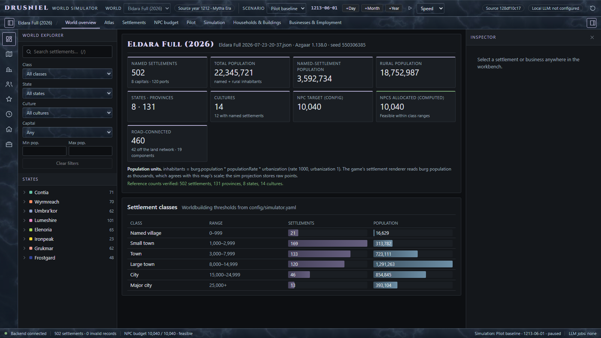

# Drusniel World Simulator

A standalone, offline workbench for the Drusniel world. It reads the imported Azgaar
map straight from the parent repository, audits it (settlements, population, roads,
a persistent-NPC budget, a three-settlement pilot) and runs deterministic, snapshotable
simulation scenarios over it. It runs without the game or its renderer.

Findings, method and pilot ids: [docs/01-azgaar-audit-and-npc-budget-2026-11-22.md](docs/01-azgaar-audit-and-npc-budget-2026-11-22.md).
Scenarios, clock, snapshots and the state contract: [docs/02-scenarios-and-baseline-state-2026-11-22.md](docs/02-scenarios-and-baseline-state-2026-11-22.md).
Households, housing, businesses, employment and hardening: [docs/03-households-businesses-employment-2026-11-22.md](docs/03-households-businesses-employment-2026-11-22.md).



## Requirements

- Node.js 22+ (frontend tooling) and [uv](https://docs.astral.sh/uv/) (Python 3.12 backend).
- Run every command from `world-simulator/`.

```bash
npm install        # also runs `uv sync --project backend`
npm run dev        # Python backend + Vite frontend; Ctrl+C stops both
```

| Command | What it does |
|---|---|
| `npm run dev` | uvicorn (auto-reload) on 127.0.0.1:3100 and Vite on 127.0.0.1:5180 |
| `npm run dev:backend` / `npm run dev:frontend` | one of the two |
| `npm run audit` | writes the JSON reports to `data/generated/` |
| `npm test` | pytest (backend), then Vitest + jsdom (frontend) |
| `npm run lint` | ruff (backend), ESLint and `tsc` (frontend) |
| `npm run build` | type-check and build the frontend into `frontend/dist/` |
| `npm start` | backend that also serves `frontend/dist/` on port 3100 |
| `node scripts/capture-screenshots.js` | 1600×900 + phone screenshots into `docs/screenshots/` (needs `npm run dev`; uses the parent repo's Playwright) |

Open http://127.0.0.1:5180 during development, or http://127.0.0.1:3100 after
`npm run build && npm start`. Interactive API docs: http://127.0.0.1:3100/api/docs.

The frontend port is 5180, not 5174, because 5174 is the main game's dev port.

## Architecture

The backend is Python and owns all world and simulation logic. The frontend is a
TypeScript React app that only talks to the backend's JSON API. Saved scenarios from
another source map open read-only.

```text
config/                 simulator.yaml, npc-population.yaml, pilot-selection.yaml
backend/                Python package (pyproject.toml, uv.lock)
  src/world_sim/
    world/              loader (manifest, path guard, validation, fingerprint),
                        audit, population, classifier, model (built once, shared)
    geography/          connectivity (cell-based route graph, components, Dijkstra)
    npc/                budget (NPC allocator)
    pilot/              selector
    simulation/         contracts (Pydantic state v2), engine, demography, calendar, scope,
                        households, housing, businesses, employment, needs, society,
                        migrations, store (atomic bundles), manager (run loop, snapshots)
    reports/            builder, writer
    api/                app (FastAPI), scenario_routes, settlement_query, errors
    cli/audit.py        canonical.py ids.py config.py log.py server.py
  tests/                pytest
frontend/               TypeScript + React + Vite
  src/shell/            app bar, workspace bar, icon rail, explorer, inspector, status bar
  src/components/       WorldSummary, PopulationChart, SettlementTable, SettlementDetails,
                        BudgetComparison, WorldMap, PilotSettlements
  src/simulation/       useSimulation, SimulationControls, SimulationWorkspace,
                        ScenarioExplorer, PopulationTrend
  src/society/          HouseholdsWorkspace, BusinessesWorkspace, BusinessDetails
  src/api/              types.ts (API contracts), worldApi.ts (fetch + useApi hook)
  src/styles/           tokens.css (theme variables), shell.css, components.css,
                        marble.css (textured navigation chrome)
  tests/                Vitest
scripts/                dev.js (process launcher), capture-screenshots.js
```

Settlement ids (`ids.py`) and the config checksum (`canonical.py`) reproduce the
game's `src/sim/model/ids.js` and `src/sim/persistence/canonicalSerialize.js`, and a
test pins the checksum to values computed by the JS version, so ids stay joinable
with the game. The world model is built once at startup and never mutated, so
concurrent requests all read the same data.

## API

Loopback-only JSON. The world endpoints are read-only. Every response is
`{ apiVersion, world: { mapId, sourceFingerprint }, data, meta? }`; errors are
`{ apiVersion, error: { code, message, details? } }` with status 400, 404, 405 or 500.

| Endpoint | Returns |
|---|---|
| `GET /api/health` | `{ status: "ok" }` |
| `GET /api/world` | identity, config fingerprint, map size, a light marker per settlement |
| `GET /api/world/summary` | counts, reference check, population, classes, states, cultures, budget totals |
| `GET /api/world/settlements` | paged list (see below) |
| `GET /api/world/settlements/:id` | detail with connectivity and NPC allocation; `:id` is a stable id or Azgaar source id |
| `GET /api/world/connectivity` | summary, components, routes (with points), unresolved routes |
| `GET /api/world/npc-budget` | comparison scenarios with distributions |
| `GET /api/world/pilot` | pilot roles, evidence, road distances, settlement details |

`/api/world/settlements` parameters: `page`, `pageSize` (≤ 200), `q` (name search),
`class`, `state`, `culture` (comma-separated ids), `minPopulation`, `maxPopulation`,
`capital`, `pilot` (`true`/`false`), `sort` (`sourceId`, `name`, `population`, `npcs`,
`stateName`, `cultureName`, `class`), `order` (`asc`/`desc`). Unknown or invalid
parameters return 400 naming the parameter.

There are no endpoints that take a file path. Static files are served only from
`frontend/dist/`, and only with `npm start`.

## Scenario API

Writes (`POST`) must send `application/json`. Full table in
[docs/02](docs/02-scenarios-and-baseline-state-2026-11-22.md#api).

| Endpoint | Purpose |
|---|---|
| `GET /api/simulation` | clock and limit settings |
| `GET · POST /api/scenarios` | list · create or branch |
| `GET /api/scenarios/{id}` · `/state` · `/events` | status · canonical state · event log |
| `POST /api/scenarios/{id}/step` · `/run` · `/pause` · `/restore` | clock control |
| `GET · POST /api/scenarios/{id}/snapshots` | list · save |
| `GET /api/scenarios/{id}/businesses` · `/businesses/{businessId}` | paged business list · one business |

## Configuration

- `config/simulator.yaml` — host and ports, map id, reference counts, settlement
  classes, connectivity tolerances, page sizes, output directory.
- `config/npc-population.yaml` — target, comparison scenarios, per-class ranges,
  importance weights.
- `config/pilot-selection.yaml` — role evidence rules, constraints, pinned ids.
- `config/simulation.yaml` — scenario storage, calendar, step sizes, speeds, limits,
  baseline scenario, demography rates.
- `config/society.yaml` — household shares, housing types and mix, labour participation
  and sector shares, business templates, need thresholds (all authored assumptions).

Environment overrides: `WS_BACKEND_HOST`, `WS_BACKEND_PORT`, `WS_FRONTEND_PORT`,
`WS_MAP_ID`, `WS_SCENARIO_STORAGE`. Another Azgaar Full JSON is added by listing it in `../maps/manifest.json`
and setting `world.mapId`. Map files must resolve inside `../maps/`.

## Generated data

See [data/README.md](data/README.md). Reports are deterministic and git-ignored.

## The workbench

One shell for every future workspace: app bar (world, mode, source fingerprint, model
status), workspace tabs, icon rail, collapsible explorer with filters and a
State › Settlement tree, the central workspace, a resizable shared inspector, and a
status bar. Selecting a settlement anywhere (table, map, tree, pilot, inspector links)
updates the same inspector. Inspector fields are marked `src` (imported Azgaar fact)
or `calc` (computed from config).

Shortcuts: `1`–`8` switch workspace, `[` and `]` toggle the side panels, `/` focuses
search. Panel layout is remembered per browser.

## Relationship to the game

The simulator only reads `../maps/`. It does not import or change the game's
settlement rendering, terrain or NPC code, and never writes the map or game saves.
Settlement ids match the game's sim projection (`settlement:azgaar-burg:<i>`), so
later exports can join on them.

## Current limitations

- Simulated monthly: cohort demography, then households, housing occupancy, employment
  and needs. No construction, business turnover, production or trade yet (PR4), and no
  persistent NPCs (PR5). All rates are authored assumptions.
- Pilot roles are hypotheses from Azgaar production records, not specialisations.
- The atlas draws settlements and routes, not coastlines or terrain.
- The game's renderer and sim projection read population differently (documented in
  the audit doc); PR1 leaves them as they are.
- No authentication; the server binds to 127.0.0.1 and must stay local.
