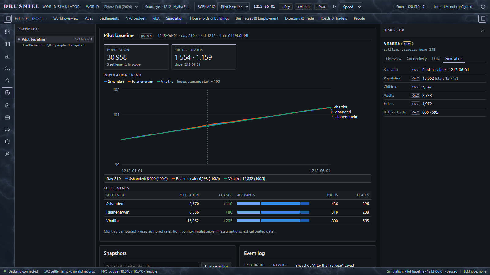

# 02 — Scenarios, clock and baseline settlement state

PR2 of the World Simulator. The Python backend now owns canonical simulation state:
scenarios with a deterministic day clock, step / run / pause, snapshots, restore and
branching, over a versioned state contract. The UI gains a Simulation workspace and
global clock controls in the app bar.

Before PR2 the backend moved from Node to Python (FastAPI, Pydantic, uv) and the
frontend to TypeScript. The audit numbers and API contract did not change (see
[01](01-azgaar-audit-and-npc-budget-2026-11-23.md)).

## What a scenario is

> Updated by PR3 ([03](03-households-businesses-employment-2026-11-23.md)): the three files below are now one
> atomic `scenario.json` bundle, state is schema v2, and scenarios from another source map are read-only.

| Piece | Where |
|---|---|
| Metadata: name, scope, seed, parent snapshot | `data/scenarios/<id>/scenario.json` |
| Canonical state (schema v1) | `data/scenarios/<id>/state.json` |
| Event log (capped at `limits.maxEvents`) | `data/scenarios/<id>/events.json` |
| Snapshots: state plus its checksum | `data/scenarios/<id>/snapshots/snap-NNN.json` |

`data/scenarios/` is local working data and git-ignored. On first start, the backend
creates `baseline-pilot` from `config/simulation.yaml`: the three pilot settlements,
seed 1212, starting 1212-01-01 (the Azgaar map's year).

**Scopes:**
- `pilot`
- `state` (by state id)
- `province` (by province id)
- `settlements` (explicit ids)

All are capped at `limits.maxScopeSettlements` (120).

## State contract (v1)

`backend/src/world_sim/simulation/contracts.py`, Pydantic models with extra fields
forbidden:

```text
ScenarioState
  schemaVersion, scenarioId, world {mapId, sourceFingerprint}, seed, startYear
  date      {day, year, month, dayOfMonth, label}       day 0 = start-year 1 Jan
  settlements[] {settlementId, sourceId, name, population,
                 cohorts {children, adults, elders}, births, deaths}
  history[] {day, population {settlementId: inhabitants}}   one point per month close
```

Settlement ids are the audit's stable ids, so state joins with the world API and the
game. The state checksum is FNV-1a over canonical JSON, the same function as the
game's `src/sim/persistence/canonicalSerialize.js`.

## Clock and determinism

- Calendar: 30-day months and 12-month years (configurable).
- Steps: day, week, month, year (360 days), or any number of days up to `maxStepDays`.
- **Run** advances on the server every `runner.tickSeconds` at 1, 7, 30 or 120 simulated
  days per second. Speed changes only how fast time passes, never the rules.
- Every state change happens on the backend's event loop, so a step never interleaves
  with another.

Each month close runs demography once per settlement, using a random generator seeded
from `(scenario seed, month index, settlement id)`. So:

- stepping 100 days at once equals 100 single-day steps (tested);
- restoring a snapshot and replaying gives the same state as an uninterrupted run
  (tested);
- the same seed reproduces a run exactly, and a different seed diverges.

## The one system in PR2: monthly demography

**Initial cohorts:** the imported population split 33 / 55 / 12 % into
children / adults / elders. Largest-remainder rounding keeps the split summing exactly.

**Monthly rates** (from `config/simulation.yaml`). These are authored assumptions, not
calibrated data:

| Rate | Value |
|---|---|
| Births per adult per year | 0.065 |
| Deaths per year (children / adults / elders) | 3.5 % / 1.2 % / 7 % |
| Ageing | out of each band over 15 and 45 years |

**Accounting:** every month asserts `population = previous + births − deaths`.

**Effect:** about +0.8 % a year on the pilot. A decade stays within a plausible band
(tested).

Households, jobs and the economy replace these aggregates in PR3 and PR4.

## API

All write requests must send `application/json`. Browsers cannot send that cross-site
without a CORS preflight, which the API never grants, so a web page cannot drive the
local simulator.

| Endpoint | Purpose |
|---|---|
| `GET /api/simulation` | step sizes, speeds, calendar, limits, demography parameters |
| `GET /api/scenarios` | every scenario's status |
| `POST /api/scenarios` | create `{name, scope?, seed?}` or branch `{name, fromScenarioId, fromSnapshotId}` |
| `GET /api/scenarios/{id}` | status: date, running, speed, population, checksum |
| `GET /api/scenarios/{id}/state` | the canonical state |
| `POST /api/scenarios/{id}/step` | `{unit}` or `{days}`; 409 while running |
| `POST /api/scenarios/{id}/run` · `/pause` | `{speed}` · `{}` |
| `GET /api/scenarios/{id}/events?limit=` | newest first |
| `GET · POST /api/scenarios/{id}/snapshots` | list · save `{label}` |
| `POST /api/scenarios/{id}/restore` | `{snapshotId}`; checksum verified; 409 while running |

## UI

- **App bar:** scenario selector, date, +Day / +Month / +Year, run/pause and speed.
  These are available from every workspace.
- **Simulation workspace:**
  - left panel lists the scenarios;
  - population tiles;
  - an indexed population trend (start = 100, one line per settlement, crosshair
    tooltip);
  - a settlement table with age-band bars;
  - snapshots with restore and branch;
  - the event log;
  - a new-scenario form (pilot or any state).
- **Inspector:** a Simulation tab for settlements in the active scenario.
- **Status bar:** scenario, date and run state.

Navigation chrome uses frosted glass (`frontend/src/styles/glass.css`):

- translucent blur with soft blue reflections and thin highlights;
- a glow on active icons;
- a sticky glass navigation strip on mobile;
- solid fallbacks without `backdrop-filter` or under `prefers-reduced-transparency`.

Native dropdown option lists are drawn by the OS and stay unfrosted.



## Limits and next steps

- Runs use the server process's event loop. That is fine at pilot scale; large scopes
  would need a worker process.
- There is no delete or rename for scenarios yet, and no scheduled interventions.
- **Next — PR3:** households, buildings, businesses and jobs for the pilot, replacing
  cohort aggregates with accounted households.
