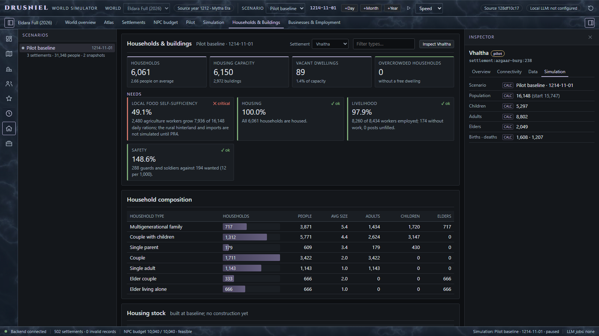
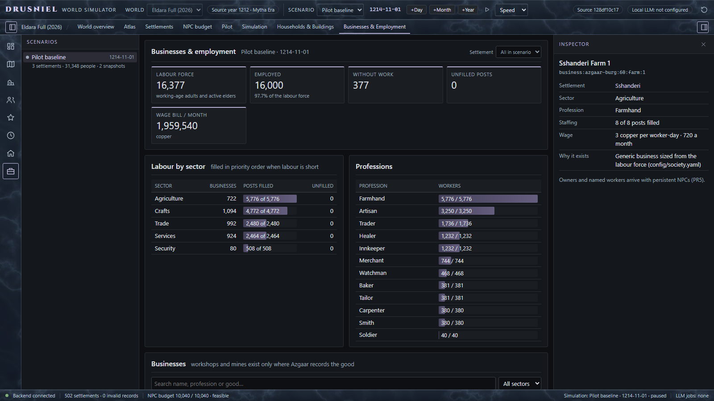

# 03 — Households, buildings, businesses and employment

PR3 gives the three pilot settlements a social and working structure that accounts for
every imported inhabitant. It does so without creating an entity per person. Those
structures are what the 86 persistent NPCs will later belong to (PR5).

It also lands three hardening changes: scenarios from a different source map become
read-only, saves are a single atomic file with versioned state, and history is bounded.

## Hardening

| Issue | Change |
|---|---|
| A scenario saved against another source map only logged a warning | Loaded **read-only**: step, run, snapshot, restore and branch return `409 read_only` and the files are never rewritten. Status carries `readOnly` with the reason, and the UI locks its controls. A state with a newer schema than the code is listed as `unloadable` and left on disk |
| Metadata, state and events were three separate files | One bundle, `scenario.json` = `{formatVersion: 2, meta, state, events}`, written by a single atomic replace. PR2's three files are read once, rewritten as the bundle, then removed |
| State had no migration path | `schemaVersion` is now 2. `simulation/migrations.py` upgrades v1 states (and v1 snapshots) by deriving society from their cohorts, and logs a `migrated` event |
| Population history grew without limit | `limits.maxHistoryPoints` (1,201 = baseline + 100 years) keeps the baseline and the newest month closes |

**Performance.** The state grew to about 1 MB, mostly businesses. Two changes follow:

- Scenario files and state checksums now use the C JSON encoder with a SHA-256 digest:
  8 ms instead of about 170 ms for the pure-Python FNV.
- The digest is cached per state.

PR2 snapshots keep their FNV checksum and still verify. The JS-compatible FNV remains
for the audit reports.

## Model

Everything is derived from the settlement's age cohorts and its Azgaar record, with
rates from `config/society.yaml`. **All of these rates are authored assumptions, not
calibrated data.**

**Households** (`simulation/households.py`). These are aggregate groups of identical
composition:

- multigenerational families;
- couples with children;
- single parents;
- couples;
- single adults;
- elder couples;
- elders living alone.

Every child, adult and elder lands in exactly one group. Children only live with an
adult; a `communal` household exists only when a settlement has no adult at all. On the
pilot this gives 2.6–2.7 people per household.

**Housing** (`simulation/housing.py`). Cottages, farmstead, townhouses and tenements,
mixed by settlement class, are built once at baseline with 4% spare capacity. PR3 has no
construction. Each month households re-occupy the stock in proportion to capacity; any
that do not fit are counted as overcrowded.

**Businesses** (`simulation/businesses.py`). They are sized from the baseline labour
force by sector shares per class. A business kind exists only where its requirement
holds:

| Kind | Requirement |
|---|---|
| Fisheries | port |
| Merchant houses | Azgaar market centre |
| Temples | temple feature |
| Garrisons | walls or citadel |
| Mines, woodcutters, clay pits | Azgaar records extracting the good |
| Workshops | one per good Azgaar records the settlement crafting |

None of the pilot settlements extracts ore, so no mine is generated. A sector with no
possible business gives its labour share to agriculture rather than inventing one.
Business ids are stable: `business:azgaar-burg:<sourceId>:<kind>[-<good>]:<n>`.

**Employment** (`simulation/employment.py`):

- **Labour supply:** 90% of adults plus 25% of elders.
- **Fill order:** sectors fill in priority order (agriculture, security, services,
  extraction, crafts, trade) and businesses in id order. Filled posts never exceed the
  supply.
- **Wages:** copper per worker-day; a monthly wage bill is reported.

**Needs** (`simulation/needs.py`). Each need is a ratio with a status (ok, strained or
critical) and a written reason:

- **Food:** local food self-sufficiency, from agriculture workers × rations per worker
  against the population.
- **Housing:** households that have a dwelling.
- **Livelihood:** employed workers against the labour force.
- **Safety:** guards and soldiers per 1,000 inhabitants.

Food reads *critical* in the towns and city on purpose: the rural hinterland and imports
are not simulated until PR4.

**Each month** (`simulation/society.py`), after demography:

1. households regroup from the new cohorts;
2. homes re-occupy;
3. jobs refill;
4. needs re-assess.

Then `check_invariants` must pass, or the step fails loudly.

## Pilot baseline (1212-01-01)

| | Falanenerwin | Sshanderi | Vhaltha |
|---|---:|---:|---:|
| Population | 6,256 | 8,560 | 15,747 |
| Households | 2,348 | 3,211 | 5,907 |
| Businesses | 732 | 1,106 | 1,974 |
| Labour force / employed | 3,284 / 3,262 | 4,493 / 4,478 | 8,267 / 8,260 |
| Evidence businesses | Arms, Boots, Coal, Preserved food, Tools, Vinegar workshops; garrison (walls) | Boots, Liquor, Preserved food, Vinegar workshops | Barrels, Beer, Cloth, Sails workshops; merchant houses (market 15) |
| Food self-sufficiency | strained (79%) | critical (66%) | critical (50%) |
| Safety (guards vs 12 per 1,000) | ok (117%) | ok (128%) | ok (152%) |

**Over time:** growth fills the spare housing and starts unemployment, because PR3 opens
no new businesses. After three simulated years the pilot has 377 people without work
and no unfilled posts.

## Acceptance

| Requirement | Evidence |
|---|---|
| Pilot initialises consistently with imported populations | `test_baseline_society_accounts_for_every_imported_person` |
| Housing and labour derived without creating population | `test_households_never_create_or_lose_people` (edge cohorts including 0 and no adults) |
| Each business references its settlement and has staffing | `test_businesses_follow_settlement_and_source_evidence` |
| Aggregate households account for the population | the same baseline test, plus invariants every month |
| Jobs never exceed eligible labour | `test_jobs_never_exceed_eligible_labour_and_fill_by_priority` |
| Consistency after steps | `test_society_stays_consistent_over_a_decade_and_reproduces` |
| Snapshot, restore and branching on the new schema | PR2 lifecycle tests on v2, plus `test_v1_scenarios_and_snapshots_migrate_to_one_atomic_bundle` |
| UI shows real results | Households & Buildings and Businesses & Employment workspaces (screenshots 10, 11) |
| Same configuration and seed reproduce | decade test compares digests |

## API additions

| Endpoint | Purpose |
|---|---|
| `GET /api/scenarios/{id}/businesses?settlement=&sector=&q=&page=&pageSize=` | paged, filtered business list |
| `GET /api/scenarios/{id}/businesses/{businessId}` | one business, with its settlement name |

Status gains `readOnly` and `schemaVersion`. `GET /api/scenarios` reports unloadable
scenarios in `meta.unloadable`.

## UI

- **Households & Buildings:**
  - settlement picker and type filter;
  - household, capacity, vacancy and overcrowding tiles;
  - the four needs with status icon, label and reason;
  - household composition and housing occupancy tables;
  - a cross-settlement comparison.
- **Businesses & Employment:**
  - labour force, employed, without-work, unfilled and wage-bill tiles;
  - labour by sector and by profession;
  - a searchable, paged business table. Selecting a row opens the business in the
    shared inspector, which links back to its settlement.
- **Read-only scenarios:** a read-only chip in the app bar, with clock, snapshot and
  branch controls locked.

## Not in PR3

- Construction, business openings and closures. The economy (production, inventories,
  prices, trade) is PR4.
- Owners and named workers. Persistent NPCs are PR5; they will attach to the household
  groups and business ids above.
- NumPy, SciPy and OR-Tools were not needed. Derivation is exact integer arithmetic, and
  the priority fill already satisfies the labour constraint.
