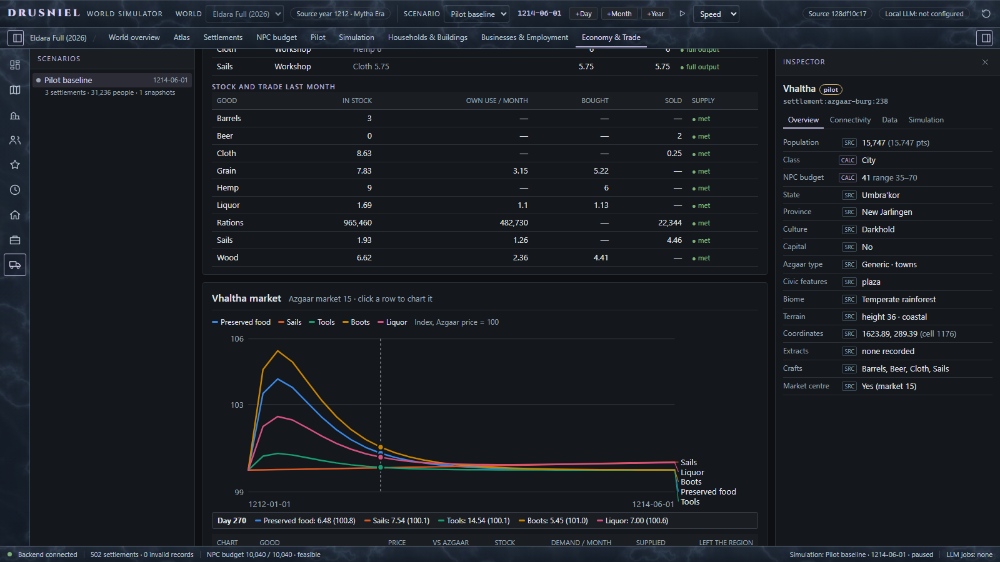

# 04 — Economy and trade

PR4 gives the pilot an economy built from what the Azgaar map records:
- what each burg produces and from what;
- what it buys;
- which market it trades in;
- the trade of that market's other members.

On top of that sit a food supply with a rural hinterland, stock in every settlement and
market, monthly market clearing with prices, and caravans that carry every sale and
purchase over the road network.

State is now schema v3. v1 and v2 scenarios and snapshots migrate on load, as in PR3.

## Sources

Read once at baseline (`simulation/economy/sources.py`), from the map's `burgs[].production`,
`deals`, `markets` and `goods`:

| Piece | From Azgaar |
|---|---|
| Production lines | each `production` entry: good, units, recipe. Entries for the same good merge, and the map's order is kept, so inputs come before their products (Hemp → Cloth → Sails) |
| Line source | a recipe makes it a **workshop**; an extracted good with a PR3 business (woodcutters, hunting lodge…) is **extraction**; one with none (Falanenerwin's Amber, Sshanderi's Grain) is credited to the **hinterland** |
| Own use | what the market sold the burg beyond its recipe inputs |
| Market | the burg's `market`, located at its centre burg |
| Outside trade | the market's deals with members outside the scope and with other markets |
| Prices and stock | the market's recorded price and stock per good |

Azgaar fills markets with rural output that no deal records. So whatever a market sold
beyond what it bought counts as outside supply, and whatever it bought beyond what it
sold counts as outside demand. With the scoped members trading as recorded, every good
balances. Without this the market had no wood at all, and every workshop downstream
stopped.

One Azgaar turn is read as one month of flow (`azgaar.turnDays`).

## Food

Food is a staple diet counted in **rations** (one per person per day). It is not an
Azgaar good, because Azgaar's food units are far too small to feed a town. Food comes
from three places:

- **The town's agriculture:** filled agriculture posts × 3.2 rations a day, as in PR3.
- **The hinterland:** populated land cells within 30 px whose nearest settlement on the
  whole map is this one. Each rural inhabitant sends 0.2 rations a day beyond their own
  needs. The rural population is taken from the map and not simulated.
- **The market:** granaries keep 60 days of need and buy or sell the difference.

Last month's food security (eaten ÷ wanted) scales next month's death rates by
`1 + 3 × shortfall`. The Food need now reports what was eaten and where it came from,
replacing PR3's local-only figure.

## Each month

After demography and society (`simulation/economy/step.py`):

1. **Caravans arrive:** purchases unload into the settlement, sales into the market's stock.
2. **Production:** each line runs at its staffing ratio and is limited by the inputs in
   stock. `limitedBy` records the cause: `staff`, or the missing input.
3. **Food and own use:** rations are grown and sent in, then everyone eats; own use
   scales with population. Anything wanted but not obtained, below 95%, is a
   **shortage**.
4. **The market clears** (`market.py`):
   - Members sell whatever they hold above 1.5 months of use (60 days for rations) and
     ask for what they lack.
   - Outside supply and demand follow price: `(price ÷ base) ^ 0.5`.
   - Scarce stock is shared pro rata; stock above 12 months of demand leaves the region.
   - The price moves halfway towards `base × (2 months of demand ÷ stock) ^ 0.6`, kept
     within 0.25–4 × the base price.
   - Sales and purchases change each member's treasury, which starts at the Azgaar
     burg's.
5. **Caravans depart:** one sale and one purchase caravan per member per month, taking
   road distance ÷ 20 miles a day. The market centre trades on the spot.

**Conservation:** every good is checked each month. Stock in settlements, markets and
caravans must change only by production, use, and outside trade; otherwise the step
fails.

## Pilot baseline

| | Falanenerwin | Sshanderi | Vhaltha |
|---|---:|---:|---:|
| Rural hinterland | 64,082 (7 cells) | 15,486 (1 cell) | 44,619 (5 cells) |
| Rations a day: town / hinterland / need | 4,941 / 12,816 / 6,256 | 5,606 / 3,097 / 8,560 | 7,936 / 8,924 / 15,747 |
| Food self-sufficiency | 284% | 102% | 107% |
| Production lines | Amber, Coal, Arms, Vinegar, Preserved food, Boots, Tools | Grain, Vinegar, Preserved food, Boots, Liquor | Barrels, Beer, Cloth, Sails |
| Caravan days to market | 7 | 7 | 0 (centre) |

All three trade in Azgaar market 15, centred on Vhaltha.

**Over ten years** (pilot, seed 1212):
- 480 caravans; no shortages after the first month.
- Every Azgaar good's price stays within 25% of its base price.
- Growth pushes Sshanderi and Vhaltha just below food self-sufficiency (94% and 99%).
  They buy Falanenerwin's surplus through the market.
- About 300,000 rations a month still leave the region. Food settles at a third of its
  base price because nothing outside the pilot buys it.
- A decade takes 1.4 s; the state is about 1.1 MB.

**Shocks** (tested):
- **Hemp cut off from the market:** Vhaltha's cloth stops (`limitedBy: Hemp`) and Hemp
  trades at more than three times its base price. Sails carry on from cloth bought in,
  which pushes up cloth prices across the market.
- **Hinterland and granaries removed:** food turns critical and deaths rise by more than
  30% over a year.

## Acceptance

| Requirement | Evidence |
|---|---|
| Production from Azgaar records | `test_baseline_economy_follows_azgaar_production_and_deals` |
| Inventories, consumption, prices over time | `test_a_decade_trades_without_shortages_and_keeps_prices_near_azgaar`, plus the monthly conservation check |
| Caravans over the road network | `test_caravans_carry_purchases_after_their_travel_time` |
| Supply chains and shortages | `test_a_cut_supply_chain_stops_its_product_and_reroutes_the_next_one` |
| Shortages have consequences | `test_famine_raises_mortality_and_turns_food_critical` |
| Deterministic | `test_economy_reproduces_with_the_same_seed`; PR2's step-equivalence test now includes the economy |
| Migration of older saves | PR3 migration test, now through v3 |
| UI shows real results | Economy & Trade workspace (screenshots 12–14) |

## API

| Endpoint | Purpose |
|---|---|
| `GET /api/scenarios/{id}/economy?delivered=` | settlement economies, markets with price history, caravans on the road, and the newest delivered caravans (≤ 200). It omits the society payload, so the workspace polls about 60 KB instead of the 1 MB state |

## UI

**Economy & Trade workspace:**
- Scenario tiles: caravans on the road, goods short, lowest food security, food leaving
  the region.
- Per settlement:
  - food tiles: eaten, grown, hinterland, self-sufficiency, granary days, treasury;
  - production lines with their inputs and what limited them;
  - stock and trade with shortage status.
- The market:
  - an indexed price chart (Azgaar price = 100). Click a row to chart it; up to six
    goods, each keeping its colour;
  - a goods table with price change, stock, demand, supply, and what left the region.
- Caravans on the road and recently arrived, with dates and cargo.

The population and price charts now share one `IndexedTrend` component.

## Not in PR4

- **Markets as places:** trade goes through the Azgaar market centre. There is no
  direct settlement-to-settlement trade, and no caravan risk, capacity or cost.
- **Outside the scope:** the other market members are fixed Azgaar flows, and they do
  not eat rations. That is why the pilot's food surplus has no buyer.
- **No business turnover or construction:** wages are not paid from revenue, and
  treasuries only record the balance of trade.
- **No scheduled shocks:** shocks are only possible by editing state, as the tests do.
  Interventions belong to a later PR.
