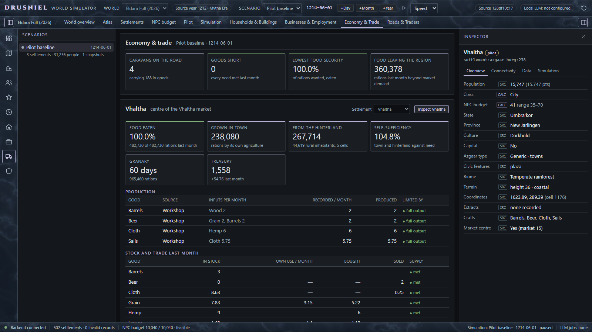
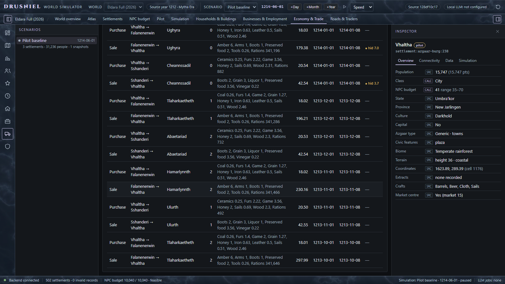
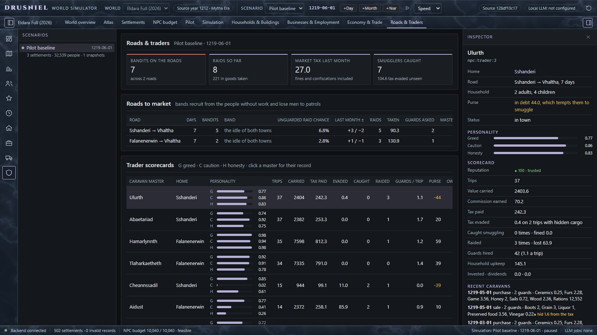
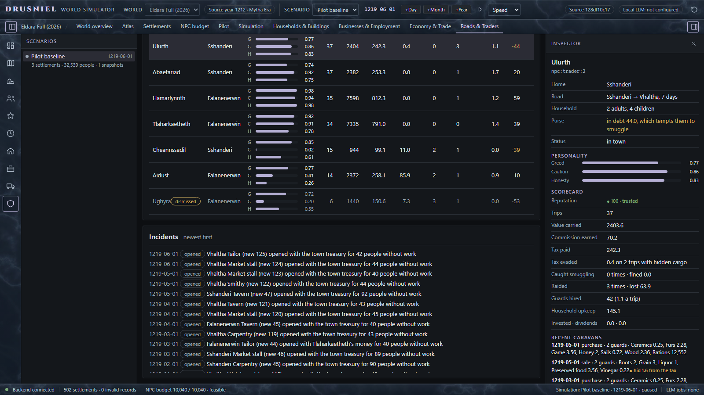
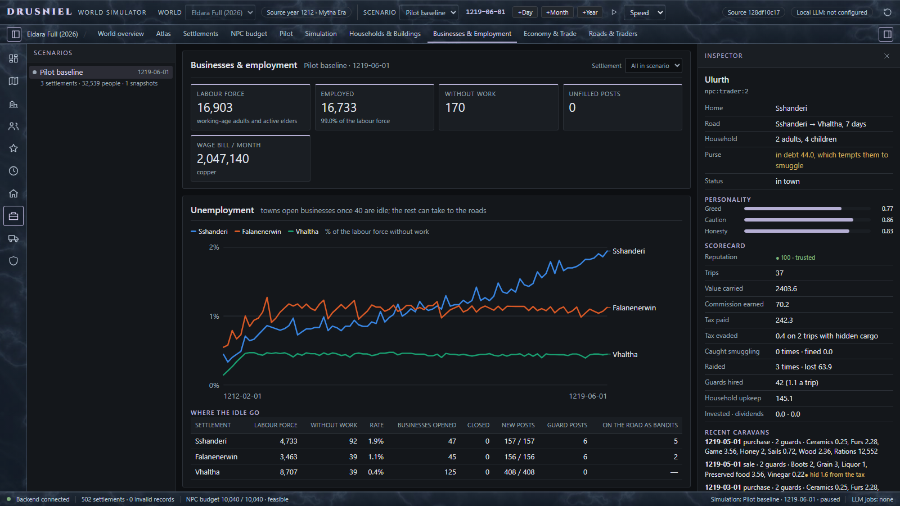

# 04 — Economy and trade

PR4 gives the pilot an economy built from what the Azgaar map records:
- what each burg produces and from what;
- what it buys;
- which market it trades in;
- the trade of that market's other members.

On top of that sit a food supply with a rural hinterland, stock in every settlement and
market, monthly market clearing with prices, and caravans that carry every sale and
purchase over the road network.

A second part puts **roads, bandits and caravan masters** on top of that:
- bandit bands that grow out of unemployment;
- raids, and caravan-guard companies;
- named traders whose personality decides how many guards they hire and whether they
  smuggle past the market tax. Each trader keeps a scorecard.

A third part:
- gives traders purses and households, so they live on their earnings, run into debt
  and invest;
- sends ports' cargo by sea, where pirates wait;
- has towns open businesses for their idle and close the ones nobody works.

State is now schema v4. v1–v3 scenarios and snapshots migrate on load.

## Sources

Read once at baseline (`simulation/economy/sources.py`), from the map's `burgs[].production`,
`deals`, `markets` and `goods`:

| Piece | From Azgaar |
|---|---|
| Production lines | each `production` entry: good, units, recipe. Entries for the same good merge, and the map's order is kept, so inputs come before their products (Hemp → Cloth → Sails) |
| Line source | a recipe makes it a **workshop**; an extracted good with a PR3 business (woodcutters, hunting lodge…) is **extraction**; one with none (Falanenerwin's Amber, Sshanderi's Grain) is credited to the **hinterland** |
| Own use | what the market sold the burg beyond its recipe inputs |
| Market | the burg's `market`, located at its centre burg |
| Outside trade | the market's deals with members outside the scope and with other markets |
| Prices and stock | the market's recorded price and stock per good |

Azgaar fills markets with rural output that no deal records. So whatever a market sold
beyond what it bought counts as outside supply, and whatever it bought beyond what it
sold counts as outside demand. With the scoped members trading as recorded, every good
balances. Without this the market had no wood at all, and every workshop downstream
stopped.

One Azgaar turn is read as one month of flow (`azgaar.turnDays`).

## Food

Food is a staple diet counted in **rations** (one per person per day). It is not an
Azgaar good, because Azgaar's food units are far too small to feed a town. Food comes
from three places:

- **The town's agriculture:** filled agriculture posts × 3.2 rations a day, as in PR3.
- **The hinterland:** populated land cells within 30 px whose nearest settlement on the
  whole map is this one. Each rural inhabitant sends 0.2 rations a day beyond their own
  needs. The rural population is taken from the map and not simulated.
- **The market:** granaries keep 60 days of need and buy or sell the difference.

Last month's food security (eaten ÷ wanted) scales next month's death rates by
`1 + 3 × shortfall`. The Food need now reports what was eaten and where it came from,
replacing PR3's local-only figure.

## Each month

After demography and society (`simulation/economy/step.py`):

1. **Caravans arrive:** purchases unload into the settlement, sales into the market's stock.
2. **Production:** each line runs at its staffing ratio and is limited by the inputs in
   stock. `limitedBy` records the cause: `staff`, or the missing input.
3. **Food and own use:** rations are grown and sent in, then everyone eats; own use
   scales with population. Anything wanted but not obtained, below 95%, is a
   **shortage**.
4. **The market clears** (`market.py`):
   - Members sell whatever they hold above 1.5 months of use (60 days for rations) and
     ask for what they lack.
   - Outside supply and demand follow price: `(price ÷ base) ^ 0.5`.
   - Scarce stock is shared pro rata; stock above 12 months of demand leaves the region.
   - The price moves halfway towards `base × (2 months of demand ÷ stock) ^ 0.6`, kept
     within 0.25–4 × the base price.
   - Sales and purchases change each member's treasury, which starts at the Azgaar
     burg's.
5. **Caravans depart:** one sale and one purchase caravan per member per month, taking
   road distance ÷ 20 miles a day. The market centre trades on the spot.

**Conservation:** every good is checked each month. Stock in settlements, markets and
caravans must change only by production, use, and outside trade; otherwise the step
fails.

## Pilot baseline

| | Falanenerwin | Sshanderi | Vhaltha |
|---|---:|---:|---:|
| Rural hinterland | 64,082 (7 cells) | 15,486 (1 cell) | 44,619 (5 cells) |
| Rations a day: town / hinterland / need | 4,941 / 12,816 / 6,256 | 5,606 / 3,097 / 8,560 | 7,936 / 8,924 / 15,747 |
| Food self-sufficiency | 284% | 102% | 107% |
| Production lines | Amber, Coal, Arms, Vinegar, Preserved food, Boots, Tools | Grain, Vinegar, Preserved food, Boots, Liquor | Barrels, Beer, Cloth, Sails |
| Caravan days to market | 7 | 7 | 0 (centre) |

All three trade in Azgaar market 15, centred on Vhaltha.

**Over ten years** (pilot, seed 1212):
- 480 caravans; no shortages after the first month.
- Every Azgaar good's price stays within 25% of its base price.
- Growth pushes Sshanderi and Vhaltha just below food self-sufficiency (94% and 99%).
  They buy Falanenerwin's surplus through the market.
- About 300,000 rations a month still leave the region. Food settles at a third of its
  base price because nothing outside the pilot buys it.
- A decade takes 1.4 s; the state is about 1.1 MB.

**Shocks** (tested, before roads were added):
- **Hemp cut off from the market:** Vhaltha's cloth stops (`limitedBy: Hemp`) and Hemp
  trades at more than three times its base price. Sails carry on from cloth bought in,
  which pushes up cloth prices across the market.
- **Hinterland and granaries removed:** food turns critical and deaths rise by more than
  30% over a year.

## Roads, bandits and traders

Trade still goes through the market centre. What changes is who carries it and what
happens on the way (`economy/roads.py`, `trips.py`, `bandits.py`, `escorts.py`).

**Roads.** Each settlement that trades by caravan has one road to its market centre.
- **Founding bands:** an Azgaar `brigands` marker within 25 px of either end founds a
  band of 24 under the marker's name, which never shrinks below 8. Eldara records two
  such gangs, neither near the pilot.
- **Growth:** a band recruits 2% a month of the people without work at both ends; the
  centre's idle are shared among its roads. Recruitment rises with hunger and with last
  month's loot.
- **Shrinking:** security workers at both ends patrol (0.2% of the band each, at most
  half the band a month), and 3% of the band drift away.
- **Raids:** the chance is `1 − exp(−0.002 × bandits × days ÷ (1 + 0.5 × guards))`. A
  raid takes up to 60% of the cargo, less as guards outnumber the band. Loot is fenced
  into the market a month later, so goods are never lost from the accounts.

**Caravan masters.** Each road starts with three. Names are generated from their home
culture's Azgaar name base, by a letter-pair Markov chain as Azgaar does. Greed,
caution and honesty are seeded per road.
- **Choosing a master:** a settlement's outbound sale and returning purchase are one
  trip. It goes to the free master with the fewest trips for their reputation.
- **Guards:** `round(caution × (2 + 0.4 × bandits) × (1 − greed ÷ 2))`, limited by the
  posts filled in the home town's caravan-guard companies. A guard costs 0.05 a day on
  the road, both ways.
- **Market tax:** rates come from Azgaar's taxed deals (Amber 16%; 8% where none is
  recorded). Tax goes to the centre's treasury.
- **Smuggling:** a master hides `(greed − honesty) × 1.5 − caution × perceived risk`
  of a sale, at most 80%, and halves that after each arrest. The gate catches them with
  chance `0.3 × centre safety × √hidden`. When caught, the hidden goods are confiscated
  and the master is fined three times the evaded tax. When not caught, they pocket the
  evaded tax.
- **Scorecard:** trips, value carried, commission (3%), tax paid and evaded, smuggling
  trips, arrests, fines, raids, losses, guards hired, and reputation. Reputation
  changes by +2 for a clean trip, −3 for a raid and −15 for an arrest. Below 15 the
  master is let go and replaced from a reserve of names on that road.

**Caravan-guard companies.** These are businesses in the security sector, 6 posts each.
Each month they are resized to the guards the traders asked for, and filled from the
labour pool like any other business. Every guard post is one less idle hand for the
bandits.

**Incidents.** Raids, arrests, dismissals, openings and closures go into the event
log, dated to the month they happened.

## Traders' money, sea lanes and business turnover

**Purses and households.** Every master has a household (1–2 adults, 0–4 children) and
a starting purse of 20–80.
- **Earnings:** commission and evaded tax go into the purse, and fines come out of it.
- **Upkeep:** each month the household's upkeep is spent in the home town:
  `0.35 × (adults + children ÷ 2)`, × 0.7–1.3 by greed.
- **Debt:** a purse below zero is debt, which adds up to 0.6 to the urge to smuggle,
  reached at a debt of 50. An honest master can be pushed into hiding cargo.
- **Investment:** a master with more than 60 funds a business in their home town. They
  own it and draw 0.05 a month per worker from the town.
- **Accounting:** the scorecard adds upkeep, dividends and money invested; the purse
  always equals what the scorecard explains (tested).

**Business turnover** (`economy/turnover.py`).
- **Openings:** when 40 or more people are out of work, a town opens up to two
  businesses a month in the sector furthest below its share for the town's class.
  These are generic kinds only; Azgaar-evidenced kinds stay where the map put them.
- **Funding:** the richest master with savings funds an opening; otherwise the town's
  treasury, if it stays above 50. An opening costs 8 per post.
- **Closures:** a business without Azgaar evidence that has had no worker for six months
  closes.
- **Result:** unemployment on the pilot now holds near 200 instead of climbing past
  1,000, and bandit bands stay near 10 instead of 40.
- **Sshanderi:** its masters earn little and its treasury is thin. It cannot fund
  openings, so its idle keep a small band on its road, and its masters drift into debt.

**Sea lanes and pirates.**
- **Choosing the sea:** connectivity now also builds a sea graph from Azgaar's
  `searoutes`. A port whose market centre is a port sails when the ship (60 miles a
  day) is quicker than the road.
- **Pirates:** an Azgaar `pirates` marker within 220 px of the lane founds a crew. It
  works like a bandit band, recruiting from the idle of both ports, and raids are
  reported as pirates on the sea lane.
- **On Eldara:** Qeqashuth → Chix sails in 7 days instead of riding 14, past the pirates
  sighted at (494, 760). The pilot has no ports, so the pilot has no sea lanes.

**Ten years on the pilot** (seed 1212):
- Bands grow with unemployment: 6 bandits after a year, about 40 after ten.
- About 30 raids, each road with one guard company.
- Smugglers are caught about 15 times. Two Sshanderi masters with honesty below 0.3
  were let go.
- The honest, cautious Hamarlynnth and Shachym reach reputation 100 without hiding
  anything.
- Goods run short in a handful of months, each after a raid; food is never short.
- A decade takes 2.7 s.

## Acceptance

| Requirement | Evidence |
|---|---|
| Production from Azgaar records | `test_baseline_economy_follows_azgaar_production_and_deals` |
| Inventories, consumption, prices over time | `test_a_decade_trades_with_rare_shortages_and_keeps_prices_near_azgaar`, plus the monthly conservation check |
| Caravans over the road network | `test_caravans_carry_purchases_after_their_travel_time` |
| Supply chains and shortages | `test_a_cut_supply_chain_stops_its_product_and_reroutes_the_next_one` |
| Shortages have consequences | `test_famine_raises_mortality_and_turns_food_critical` |
| Deterministic | `test_economy_reproduces_with_the_same_seed`; PR2's step-equivalence test now includes the economy |
| Migration of older saves | PR3 migration test, now through v3 |
| UI shows real results | Economy & Trade workspace (screenshots 12–14) |
| Bandits from the map and from unemployment | `test_roads_and_traders_start_from_the_map`, `test_a_brigands_marker_founds_a_band_that_never_dies_out` |
| Raids, guards and smuggling by personality; dismissals | `test_a_decade_of_bandits_guards_and_smugglers` |
| Saves verify after a reload; v3 saves gain roads | `test_state_round_trips_through_json_unchanged`, `test_v3_states_gain_roads_and_traders` |
| Scorecards and incidents in the UI | Roads & Traders workspace and the trader inspector (screenshots 15–16) |
| Openings hold unemployment; traders invest and own | `test_openings_hold_unemployment_and_traders_invest` |
| Purses account for every flow; debt drives smuggling | `test_a_traders_purse_accounts_for_every_flow`, `test_debt_pushes_an_honest_enough_trader_to_smuggle` |
| Idle businesses close, evidenced ones never | `test_unstaffed_businesses_without_evidence_close` |
| Pirates on an Azgaar sea lane | `test_pirates_haunt_a_sea_lane_founded_by_an_azgaar_sighting` |
| Unemployment views | Businesses & Employment, Unemployment section (screenshot 17) |

## API

| Endpoint | Purpose |
|---|---|
| `GET /api/scenarios/{id}/traders/{traderId}` | one master's personality, scorecard, road, and the caravans they led that are still on record |
| `GET /api/scenarios/{id}/economy?delivered=` | settlement economies, markets with price history, caravans on the road, and the newest delivered caravans (≤ 200). It omits the society payload, so the workspace polls about 60 KB instead of the 1 MB state. Includes `routes` and `traders` |

## UI

**Economy & Trade workspace:**
- Scenario tiles: caravans on the road, goods short, lowest food security, food leaving
  the region.
- Per settlement:
  - food tiles: eaten, grown, hinterland, self-sufficiency, granary days, treasury;
  - production lines with their inputs and what limited them;
  - stock and trade with shortage status.
- The market:
  - an indexed price chart (Azgaar price = 100). Click a row to chart it; up to six
    goods, each keeping its colour;
  - a goods table with price change, stock, demand, supply, and what left the region.
- Caravans on the road and recently arrived, with dates and cargo.

**Roads & Traders workspace:**
- Tiles: bandits on the roads, raids, market tax, smugglers caught.
- The roads table: band size, origin, unguarded raid chance, recruits and losses,
  guards asked for.
- Trader scorecards, with personality bars and reputation in words. Click a master to
  open their full scorecard in the inspector, with their recent caravans.
- The incident log.

The caravan tables gain the master, guards, and any raid or smuggling incident.

**Traders' money in the UI:**
- Scorecards show each master's purse (debt in warning ink) and the businesses they
  own.
- The trader inspector shows their household, purse, upkeep, investments and dividends,
  with links to the businesses they funded.
- The business inspector names who funded an opened business and how long it has sat
  idle.

**Unemployment** (Businesses & Employment):
- the unemployment rate over time for each settlement;
- a "Where the idle go" table: labour force, people without work and rate, businesses
  opened and closed, new posts filled, guard posts, and bandits on the town's road.

The population and price charts now share one `IndexedTrend` component.

## Not in PR4

- **Markets as places:** trade goes through the Azgaar market centre. There is no
  direct settlement-to-settlement trade and no caravan capacity.
- **Business economics:** businesses have no revenue or costs of their own. New kinds
  are chosen by sector share, not by demand for goods, and dividends are paid by the
  town.
- **Outside the scope:** the other market members are fixed Azgaar flows, and they do
  not eat rations. That is why the pilot's food surplus has no buyer.
- **No construction:** housing is still the baseline stock.
- **No scheduled shocks:** shocks are only possible by editing state, as the tests do.
  Interventions belong to a later PR.
