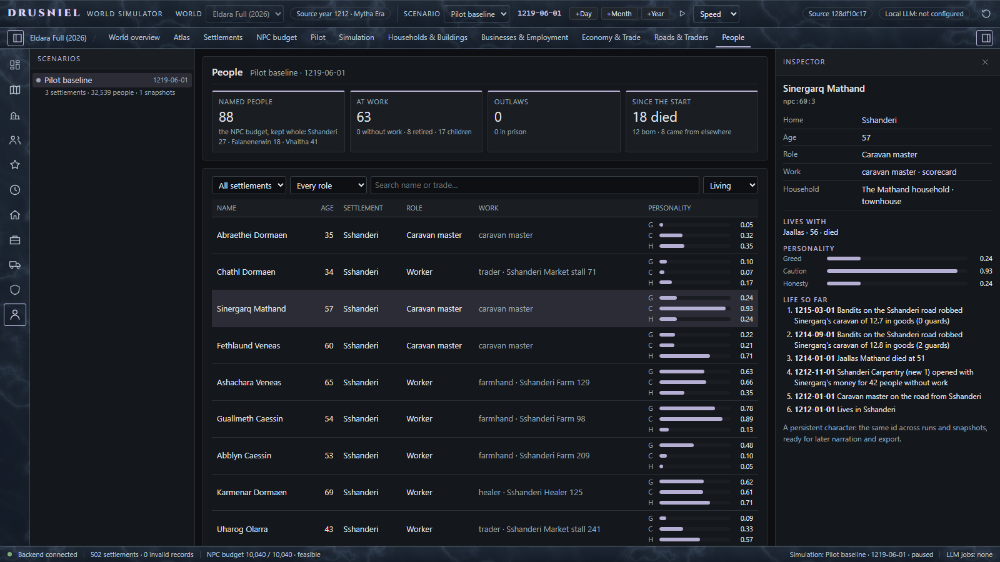

# 05 — Persistent people

PR5 turns the NPC budget from [01](01-azgaar-audit-and-npc-budget-2026-11-23.md) into
named, persistent characters. On the pilot that is 86: Falanenerwin 18, Sshanderi 27
and Vhaltha 41. Each person has:
- a stable id;
- a name from their culture's Azgaar name base;
- an age, a household and a personality;
- a place in the simulated economy.

They live through every month of the run, and each settlement always keeps exactly its
budget. They are a named sample of the aggregate population, which stays authoritative:
households, jobs and deaths are still counted in aggregate, and a person never holds a
post the aggregate does not have.

State is schema v5. v1–v4 scenarios and snapshots migrate on load.

## Who they are

`simulation/people/generate.py`, configured in `config/simulation.yaml` under `people`.

- **Names:** each settlement draws a pool of 60 given and 30 family names, at most 9
  letters, from its culture's Azgaar name base. It uses the letter-pair Markov chain the
  caravan masters use. Ids are `npc:<sourceId>:<n>`, matching the audit's settlement ids.
- **Households:**
  - Kinds are drawn from the settlement's own household groups (PR3): couples with
    children, single parents, multigenerational families, elders living alone and so on.
  - Each household gets a family name and a building type from the settlement's housing
    mix.
  - Children are 0–14, adults 15–59 and elders 60–80.
- **Caravan masters:** they come first. Each master from PR4 becomes a person with the
  same name and personality, aged 22–55, with a spouse when their household has two
  adults.
- **Work:** adults work with the settlement's employment rate, elders at a quarter of it.
  Workers are placed at real businesses in proportion to their filled posts, never more
  than a business has filled.
- **Personality:** greed, caution and honesty, as for the masters.

## Each month

Each month runs after the economy (`people/life.py`, `people/replace.py`):

1. **Death:** the settlement's death rate for the person's age band, scaled by famine.
   Outlaws face twice the risk.
2. **Ageing:** children come of age at 15 and look for work. At 60 a worker retires with
   a 75% chance, once.
3. **Work:**
   - A worker loses work if their business closes or lays off staff, and otherwise with a
     small chance that grows with the town's unemployment.
   - Someone out of work finds a post with a chance that falls as unemployment rises.
4. **Outlaws:** someone out of work for three months or more, with honesty ≤ 0.35 and
   greed ≥ 0.55, may join the band on their town's road; on a sea lane, they join the
   pirates.
   - Patrols catch outlaws at the rate they thin the band, and a caught outlaw spends a
     year in prison.
   - Outlaws also give up, or come home when the band breaks up.
5. **Caravan masters:**
   - A dismissed master loses the post and is never taken on again.
   - A new post goes to someone from the town: preferably someone out of work, then the
     most honest and cautious. The trade record takes that person's name and personality.
   - A master who dies is replaced the same way.
6. **Keeping the budget:** each death is replaced. Half the time it is a newborn in a
   household with an adult aged 18–45; otherwise a newcomer arrives.

Every change is written into the person's life story (the last 24 events). Deaths,
outlaws, arrests and new masters also go into the scenario event log.

**Each month, a check must pass or the step fails:**
- every settlement holds exactly its budget;
- every person belongs to a household;
- named workers never exceed a business's filled posts, and never work at a business
  that has closed;
- each caravan post is held by one living person;
- every role keeps its link (a master to their trade record, an outlaw to their road).

**Ten years on the pilot** (seed 1212):
- About 20 named people die. They are replaced by about 11 births and 8 newcomers, and
  the cast stays at 86 throughout.
- A decade with people takes 2.3 s, faster than before PR5, because businesses are now
  copied only when they change.

## Acceptance

| Requirement | Evidence |
|---|---|
| One persistent person per budget slot, with stable ids | `test_the_cast_matches_the_npc_budget_and_the_settlements` |
| People attach to households, businesses and trade records | the same test, plus the monthly check |
| They live through the simulation; the budget holds | `test_a_decade_keeps_the_budget_and_tells_life_stories` |
| Unemployment and personality make outlaws | `test_the_idle_and_dishonest_take_to_the_road` |
| Masters come from the town's own people | `test_a_new_master_is_taken_on_from_the_towns_people` |
| Snapshots verify; v4 saves gain a cast | `test_people_round_trip_and_v4_saves_gain_a_cast` |
| API and named workers on businesses | `test_people_endpoints` |
| UI | People workspace and person inspector (screenshot 18) |

## API

| Endpoint | Purpose |
|---|---|
| `GET /api/scenarios/{id}/people?settlement=&role=&q=&alive=&page=&pageSize=` | paged people with age, settlement and workplace. `meta` gives counts by role, deaths, births and arrivals, and each settlement's budget |
| `GET /api/scenarios/{id}/people/{personId}` | one person with their household members, road and life story, newest first |

The business endpoint now lists a business's named workers. The trader endpoint gives
the master's person id.

## UI

- **People workspace:**
  - tiles: named people against the budget, at work, outlaws and prisoners, deaths,
    births and newcomers;
  - a paged list filtered by settlement, role, name or trade, living or departed, with
    personality bars.
- **Person inspector:**
  - home, age, role and work, linked to the business or the master's scorecard;
  - household and the people they live with;
  - personality;
  - their life so far.
- **Business inspector:** lists its named workers.
- **Trader inspector:** links to the master's own life story.

> Updated by PR6 ([06](06-life-stories-and-history-2026-11-23.md)): named births and deaths now come from the towns'
> actual births and deaths, vacancies are filled by inhabitants coming into focus, and relationships, marriages,
> migration, reconstructed pasts and a permanent canonical history were added.

## Not in PR5

- **Kinship:** relationships beyond the household (parents, siblings in other homes,
  marriages formed during a run) are not modelled, and newborns name only one parent.
- **Moving:** people do not move between settlements, and newcomers come from outside
  the scope.
- **Choices:** personality affects only crime and the choice of masters. Knowledge,
  memories, opinions and goals are later work.
- **Narration:** no LLM text is generated. Life stories are deterministic events ready
  for the planned local-LLM biographies (PR6+).
