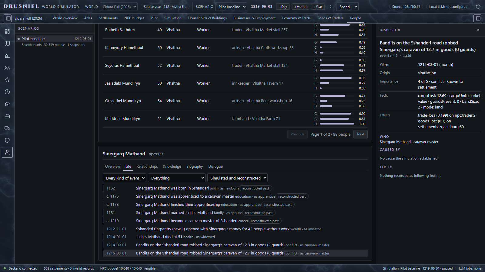
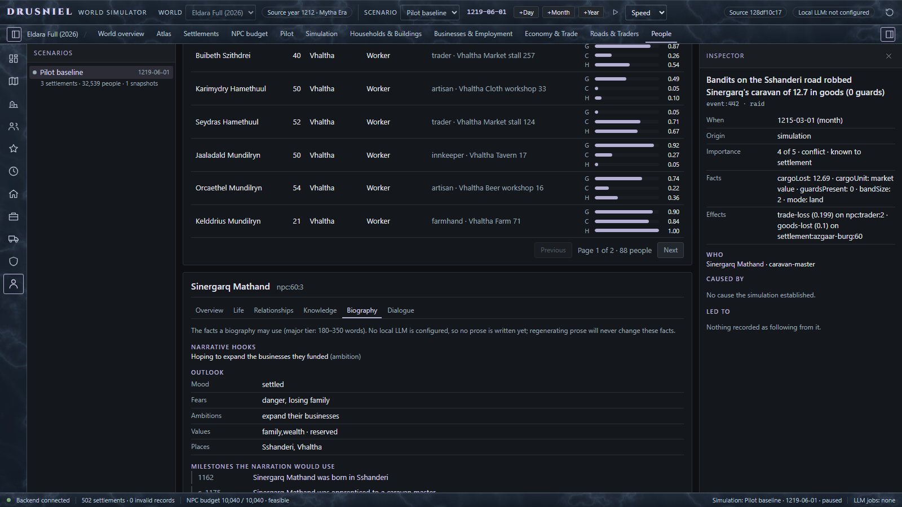

# 06 — Life stories, history and biography foundations

PR6 gives every persistent person a believable life shaped by their family, work, town and
the events around them, and records it so that later narration can only use what happened.
Two people who lived through the same raid share one canonical event and the same facts,
but have different roles in it and different personal stories.

State is schema v6. Older scenarios migrate on load, and any person on record without a
past gets one reconstructed then.

## Canonical history (6.1–6.2)

**Events.** Every incident is one canonical event (`simulation/history/contracts.py`):

| Field | Purpose |
|---|---|
| `id`, `seq` | stable id from the scenario's event counter (`event:<n>`) |
| `day`, `datePrecision` | effective simulation day, and whether it is known to the day, month, year or only approximately. Simulated events are monthly; reconstructed pasts are year or approximate |
| `kind`, `category` | machine-readable type, and one of birth, family, education, career, wealth, travel, social, crime, conflict, health, settlement, trade |
| `source` | `simulation`, `generated-prehistory` (a reconstructed past) or `inferred` (someone coming into focus) |
| `settlementId`, `locationId`, `routeId`, `businessId`, `caravanId`, `householdId`, `relatedEntities` | where it happened and what it involved |
| `participants` | named people and their roles (caravan master, guard, bandit, widowed, mother, mentor…) |
| `facts`, `effects` | actual quantities, and the state changes it caused (for example a trade loss of a given severity) |
| `causedBy` | earlier events the simulation established as causes |
| `importance`, `visibility`, `summary` | biographical weight from 1 to 5, who could learn of it, and a factual line |

Kind sets category, importance and visibility from `simulation.history.kinds`. Before
recording, economy incidents are linked to named people: the master behind a trader id,
named guards from the town's guard companies, and outlaws on the road.

**Causes.** Only mechanical links are made:
- a business closes, so its workers lose work;
- a worker who lost work later turns outlaw;
- an outlaw is caught;
- a smuggler is caught and later dismissed;
- a dismissal leads to a successor being taken on;
- someone who lost work moves away.

A food shortage raising the death rate is recorded as a fact of the time
(`duringFoodShortage`), never as a cause. No death claims a cause.

**Archive.** Each scenario has an append-only SQLite archive beside its bundle
(`history/archive.py`), indexed by person, entity, kind, category and day.
- **Restore:** cuts the archive back to the snapshot's event counter.
- **Branch:** copies only the events before its snapshot, so a branch never sees a
  sibling's future.
- **Crash:** if events were appended but the bundle was not saved, the next load cuts them
  away.

**Per person.**
- `timeline`: permanent references to every event of importance 3 or more they took part
  in. Marriages, deaths and moves never fall out after later events.
- `events`: the recent-events cache (24 entries), each stamped with its canonical event id.

The scenario log forwards `eventId`, `personId`, `traderId`, `businessId`, `routeId`,
`caravanId` and `settlementId`.

## Lives reconciled with the population

- **Deaths:** demography records each month's births and deaths per age band. A named
  death is drawn from that band's actual deaths, and never more than the band had.
- **Births:** a named child is born only to a named couple, within the town's actual
  births, and only while the town stays within 25% over its budget.
- **Vacancies:** an inhabitant already counted in the population comes into focus, as an
  event with source `inferred`. Nobody is invented from outside.
- **Migration:** towns whose unemployment is clearly above the scope's average send a share
  of their idle adults to the town with the lowest. Cohorts move with them, so totals stay
  exact, and named households follow the flows into dwellings of the new town.

## Relationships and origins (6.3)

**Relationships.** `people/relationships.py` records parent, spouse, sibling, mentor,
employer, friend and rival ties. Each has a start, an end, a trust value and its origin:
the event that formed it, or `generated` for the reconstructed past. Living in the same
household establishes nothing by itself.
- At the start, a couple are spouses only when two adults of opposite sex share a family
  household and their ages fit. A child gets a parent only when that parent was at least
  16 at the birth. Generation already keeps a spouse's age close to their partner's and
  children within the parents' ages.
- Workers are tied to their employer from a start date that fits their age, and young
  workers to an older colleague of the same trade as mentor.

**During a run:**
- **Marriages:** two unmarried adults of a town marry (more readily if they are friends)
  and move into a new home together.
- **Deaths:** a death names the widowed spouse, the children and the parents, and ends the
  ties.
- **Mentors:** a young worker hired where an older colleague practises the same trade
  starts an apprenticeship.
- **Friendships:** co-workers of a year or more may become friends.
- **Rivalries:** a dismissed master and their successor become rivals.

**Origins.** About 30% of adults were born in one of the six nearest settlements of the
same culture on the map. Birthplaces outside the scope keep their names in `cast.places`.

## Reconstructed pasts (6.5)

Everyone who enters the record already grown gets a past (`people/backstory.py`). That
means the people at a scenario's start and anyone who later comes into focus. It is built
only from what the record holds:
- birth and birthplace;
- upbringing, for people under 25;
- an apprenticeship, for trades that take one (from the mentor tie when there is one);
- the move to town, for people born elsewhere;
- the first post at their current workplace, from the employer tie;
- marriage, from the spouse tie;
- losing a parent, for adults over 30 without named parents;
- retirement, or a caravan post.

Each fact is labelled `generated-prehistory` with year or approximate precision. The
checks: nothing before birth or after entering the record; birthplaces are Azgaar
settlements; businesses exist; a person moves to town before working or marrying there.
The reconstructed ties then point at these events.

On the pilot, an adult averages 5 facts (2 to 9). Azgaar records no founding dates for
settlements, so pasts are not checked against settlement age.

## Personality, knowledge and outlook

- **Profile:** besides greed, caution and honesty, each person has a stable temperament
  (reserved, sociable or assertive) and two values from duty, family, wealth, faith and
  knowledge.
- **Experience** nudges the three traits by configured rules
  (`simulation.people.experience`):
  - a raided master or guard grows more cautious;
  - a caught outlaw more honest and cautious;
  - losing work makes people a little greedier.

  A master's trade record follows their person.
- **Knowledge** keeps four things apart:
  - **History:** what happened (the archive).
  - **Experience:** events a person took part in, derived from participants.
  - **Belief:** what a person was told or heard. Only this is stored, as second-hand
    entries with when, from whom, how (told or rumour) and confidence. People learn from
    household members or friends who were there, and as rumours carried by caravan
    masters between home and the market centre, where innkeepers pick them up. Each
    person keeps the newest 40.
  - **Conversation memory:** what a person learns in conversation. That belongs to
    dialogue, in a later PR.

  Local news of a person's own town is common knowledge, derived from visibility rather
  than stored.
- **Narrative hooks and outlook** are derived from circumstances, never stored, so they
  change when circumstances do (`people/hooks.py`).
  - **Hooks** (up to three): looking for work, a relative in prison or on a dangerous
    road, mourning, newly married, making a new life, learning a trade, owing money,
    wanting to recover losses, hoping to expand, worried about food.
  - **Outlook:** fears, ambitions, concerns and mood follow from the same facts.

## Biography context and UI (6.6)

**Context.** `GET /api/scenarios/{id}/people/{personId}/context` returns everything a
biography may use:
- the person's tier (basic, standard or major) and its targets;
- identity and culture, household, relationships, work and money, the town's
  circumstances;
- chronological milestones selected by importance;
- notable events in their town while they lived there;
- places they know, second-hand knowledge and whether they would tell it;
- personality, profile and outlook, and hooks;
- the narrator's restrictions: no invented relatives, children, businesses, wars, magic
  or journeys; respect date precision; claim no cause of death.

No local LLM is configured, so no prose is generated yet. When it is, prose can be
regenerated without touching the facts.

| Endpoint | Purpose |
|---|---|
| `GET /api/scenarios/{id}/people/{personId}/timeline?category=&source=&minImportance=&fromDay=&toDay=` | the person's events from the archive |
| `GET …/people/{personId}/relationships` · `/knowledge` · `/context` | ties, second-hand knowledge, biography context |
| `GET /api/scenarios/{id}/history/events/{eventId}` | one event with participant names, causes and consequences |

**People workspace.** Choosing a person opens a profile:
- **Overview:** origin, home, household, work, town and traits.
- **Life:** a timeline filterable by category, importance and origin. Reconstructed facts
  are marked, and clicking an event opens it in the inspector with its causes and what
  followed.
- **Relationships:** with their origins.
- **Knowledge:** first-hand events and second-hand entries.
- **Biography:** the context: hooks, outlook, milestones, town history and the narrator's
  rules.
- **Dialogue:** a placeholder until the next PR.

## Acceptance

| Requirement | Evidence |
|---|---|
| Every event references valid entities | `test_every_event_is_canonical_valid_and_numbered` (`history/validation.py`) |
| Important events stay accessible | `test_the_permanent_timeline_outlives_the_recent_cache` |
| Births and deaths reconcile with demographics | `test_named_births_and_deaths_are_drawn_from_the_towns_own` |
| Shared events recorded once, linked to many | `test_one_event_is_shared_by_everyone_involved` |
| No children before a valid age | births test, and the parent-age check in `check_ties` |
| The dead start nothing new | the participant checks in `check_events`, and the tie checks in `check_ties` |
| Relationships stay consistent | `test_relationships_are_explicit_and_stay_consistent`, monthly `check_ties` |
| Reconstructed pasts never contradict the map | `test_everyone_at_the_start_has_a_checked_past` |
| Snapshots and branches keep their own history | `test_restores_and_branches_keep_their_own_history`, `test_a_crash_between_archive_and_bundle_heals_on_load` |
| Identical inputs give identical histories | `test_identical_runs_record_identical_histories` |
| Context holds only what the person experienced, knows or may reference | `test_biography_context_holds_only_recorded_facts`, `test_news_travels_through_households_friends_and_roads` |
| Migration and moving households | `test_households_move_with_the_migration_flows` |
| Causes only where established | `test_causes_link_only_what_the_simulation_established` |

## Not in PR6

- LLM biographies and the Dialogue Lab: the context is ready, but nothing generates prose
  yet.
- Factions, politics, religion and magic: there are no such events to record yet. The
  taxonomy has room for them.
- Wealth for ordinary people: only caravan masters have purses, so there are no creditor
  or debtor ties.
- Siblings across households: only siblings born into the same reconstructed household,
  or to the same named couple, are linked.
