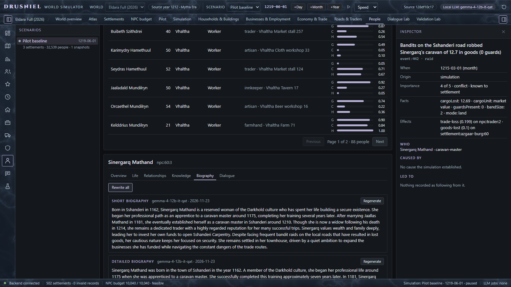
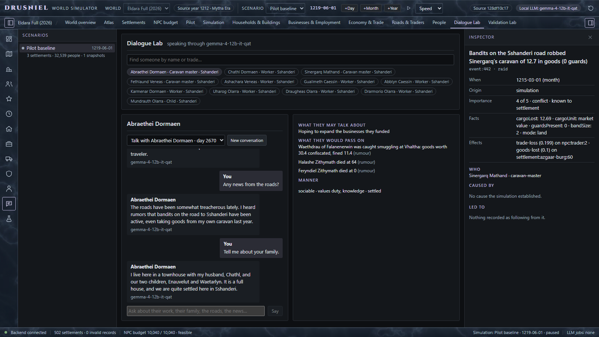

# 07 — Local-LLM narration and the Dialogue Lab

PR7 lets a local language model write biographies and speak for the named people.
Following the master plan, **the LLM only narrates**. Its input is the biography context
from [06](06-life-stories-and-history-2026-11-23.md), which holds recorded facts and the
narrator's restrictions. Its output is stored as prose or speech and checked, but never
flows back into the simulation. The one exception is deliberate: a first conversation
with someone is recorded in history as a player event.

## Providers

`config/llm.yaml` (overrides: `WS_LLM_BASE_URL`, `WS_LLM_MODEL`):

| Setting | Default |
|---|---|
| `provider` | `openai-compatible`: Ollama, LM Studio, llama.cpp or any local server with `/v1/chat/completions` |
| `baseUrl` | `http://127.0.0.1:11434/v1` (Ollama) |
| `model` | `null` = the first model the server lists |
| `temperature`, `seed` | 0.6, 7 (sent where supported, for repeatable prose) |
| `maxTokens` | per kind: short 220, detailed 650, style 220, self 320, reply 260 |
| `jobs.concurrency` | 1 (local models are slow) |
| `dialogue` | 12 earlier messages per turn; 20 remembered traveller statements |

The client uses the standard library, so there is no new dependency. It lists models
through `/v1/models`, falling back to Ollama's own `/api/tags` for versions before 0.2.

**No model, or no server.** The built-in **draft writer** takes over. It assembles plain
sentences only from the context: a baseline that cannot invent anything, always labelled
"draft writer, no model". The app bar shows which is in use (`Local LLM: <model>` or
`Local LLM: draft writer`). When no model is available, a hint says why: no server
answered, the server has no models (with the `ollama pull` command to run), or the
configured model is missing.

On this machine Ollama 0.1.33 runs inside WSL (upgrading it needs sudo there), with
`llama3` (8B) pulled. Three biographies take about 12 s and a reply 2–4 s on an RTX 4080. It
keeps to the restrictions well enough, but still embellishes: an invented childhood
fascination, "a long line of traders", unrecorded bandit talk. A stronger model is the fix.

**LM Studio** on Windows works the same way: start its local server and set
`WS_LLM_BASE_URL=http://127.0.0.1:1234/v1` (and `WS_LLM_MODEL` if several models are loaded).
Its new app, Bionic, is at `F:\Bionic`; its command-line tool is
`F:\Bionic\resources\app\.webpack-bionic\lms.exe`.

**Inkling 2 Mini** (26B mixture-of-experts, Q4_K_M, 17.5 GB) does not load on this machine
yet. Bionic's llama.cpp engine (CUDA 12, 2.80.1) asks for one compute buffer of about
8 GB for its looped layers, whatever the GPU share, context (4K) or batch size (128). With
the desktop holding 4.5 GB of the 16 GB card, that allocation fails. Try it again after an
engine update, or pick a model that fits in VRAM.

Two lessons from the first real runs:
- **Numbers:** the prompts tell the model to put scores and purses into words. Before,
  llama3 wrote "a reputation of 50.0".
- **Cut-off replies:** a reply cut off by the token limit (`finish_reason: length`) is ended
  at its last complete sentence.

## Biographies

Four kinds per person, built from their biography context:
- **short:** a third-person biography at the short end of their tier's word target;
- **detailed:** a chronological third-person biography at their tier's target (180–350
  words for a major character);
- **style:** how the person speaks;
- **self:** how they would introduce themselves.

**Prompt.** The system message holds the narrator's restrictions (no invented relatives,
children, businesses, wars, magic or journeys; respect date precision; no cause of death
unless recorded). The facts go in as compact JSON, including each one's source
(simulated or reconstructed) and precision. Knowledge the person would not tell is left
out.

**Jobs.** Generation runs as background jobs, one at a time; the status bar shows how
many are running and queued. `POST …/biographies` queues one person; a batch endpoint
queues a whole scenario or settlement and skips what is already written.

**Storage.** Prose is stored per scenario in `narration.sqlite`, with the model, date and
a hash of the life facts it was written from: identity without age, household,
relationships, work and milestones. When those move on, the prose is marked **stale**.
Age, mood and the town's monthly circumstances do not count. Regenerating replaces the
prose and never touches the facts.

**Fact check** (`narration/factcheck.py`). The check flags, and never edits:
- names the record does not know;
- children, a spouse, a war or magic the record does not support.

A claim word the person's own record uses (for example "a couple with children
household") is not flagged. Possessives count as the name, while contractions ("I'm") and
capitalised words that open a sentence or line are not treated as names. "As a child" is
not a claim about children. Warnings show under each text, so it can be judged and
regenerated.

## Dialogue Lab

A new workspace, also available as the Dialogue tab of every profile.

**Starting.** Pick a named person, start a conversation and talk. A briefing beside the
chat shows what they may talk about (their hooks), what they would pass on (second-hand
knowledge they would tell), how many things they keep to themselves, and their manner.

**Each turn** sends the model:
- the person's facts and restrictions, in character and on the current scenario date;
- the last 12 messages of the conversation;
- **conversation memory**: what the traveller said to this person before, in any
  conversation.

Knowledge the person would not tell is kept out of the prompt entirely. Replies are
fact-checked like prose.

**First meeting.** The first time the traveller speaks with someone, a canonical
`met-player` event is recorded (source `player`, precision `day`). It goes on their
permanent timeline, so later biographies can include it. Later conversations add
nothing to history.

**Errors.** If the model fails, the API answers `503 llm_unavailable` and the chat shows
why.

| Endpoint | Purpose |
|---|---|
| `GET /api/llm` | provider, model, mode, reachability, models, hint, job counts |
| `GET /api/llm/jobs?scenario=` | recent jobs |
| `GET · POST /api/scenarios/{id}/people/{personId}/biographies` | stored prose with stale flags · queue kinds |
| `POST /api/scenarios/{id}/biographies` | batch: `{kinds, settlementId?, onlyMissing}` |
| `GET · POST /api/scenarios/{id}/people/{personId}/conversations` | list · start |
| `GET /api/scenarios/{id}/conversations/{cid}` · `POST …/messages` | messages · say something |

## Also in this PR

Rumours carried along the roads now need importance 4 or more (raids, arrests, deaths).
Before, the many business openings in Vhaltha crowded out the real news.
`rumourMinImportance` sits in `simulation.people.knowledge`.

## Acceptance

| Requirement | Evidence |
|---|---|
| Model or draft writer chosen, with a hint | `test_status_reports_the_model_or_the_draft_writer` |
| Biographies run as jobs, from the context and restrictions | `test_biographies_are_written_in_the_background_from_the_context` |
| Regenerating never changes facts; stale when the record moves | `test_prose_goes_stale_when_the_life_record_moves_on` |
| Invented people, children, wars and magic are flagged | `test_the_fact_check_flags_invented_people_and_children` |
| The draft writer states only recorded facts | `test_the_draft_writer_only_states_recorded_facts` (the fact check passes on 30 people × 3 kinds) |
| Conversation memory; first meeting recorded once | `test_dialogue_remembers_and_records_a_first_meeting` |
| Secrets stay out; a failing model is reported | `test_secrets_stay_out_of_the_prompt_and_a_dead_model_is_reported` |
| UI | prose, chat and Dialogue Lab tests (`frontend/tests/narration.test.tsx`), screenshots 21–22 |

## Not in PR7

- **Streaming:** replies arrive whole.
- **Prose on branches:** a branch starts without written prose; it is regenerated there.
- **Memory:** conversation memory is the traveller's own statements. People do not yet
  form opinions of the traveller, and the simulation does not act on what they were told.
- **Promises and quest hooks:** a promise to the traveller, or a quest seed from a hook,
  are not recorded yet.
