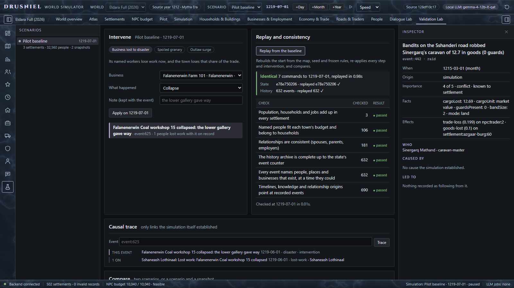
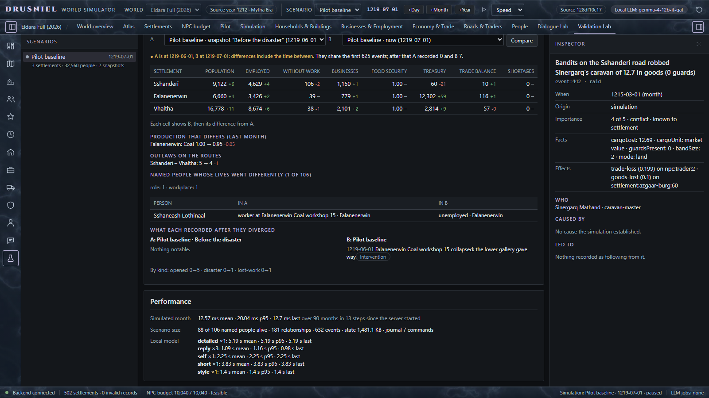

# 08 — Interventions, replay, comparison and validation

PR8 covers the master plan's phase "PR10 — Scenario comparison and advanced validation".
The plan's narration and Dialogue Lab phases shipped together as PR7, so the numbers have
moved by two. It adds a **Validation Lab** workspace and its API, with six parts:
- **Interventions:** inject an event into a scenario.
- **Replay:** rebuild the scenario from scratch and prove it comes out identical.
- **Causal trace:** follow an event's causes and consequences.
- **Consistency checks:** confirm that state and history agree.
- **Comparison:** compare two scenarios, or a scenario and a snapshot.
- **Performance:** measure how fast steps and model calls run.

## Interventions

An intervention is applied to a paused scenario at its current day. It becomes canonical
history with source `intervention` and is chronicled like a month's events: numbered,
linked, placed on timelines and spread as knowledge. So the town hears of it, and the
people involved remember it. Everything after that is the ordinary simulation.

| Kind | What it does at once | What follows |
|---|---|---|
| `disaster` (collapse, fire, flood) | Removes the business and lowers the town's capacity for its good, in proportion to the posts lost. Its named workers lose work, each with the disaster recorded as the cause. The owner loses the holding. | Lower output, more people out of work, then hardship, outlaws or moving away |
| `granary-loss` | Spoils a share of the town's food store | Lower food security, buying, and hunger if supply runs short |
| `bandit-surge` | Adds outlaws (pirates at sea) to one route | Raids, losses and guard demand |

**Capacity, not staffing.** An Azgaar production line is worked by every business that
makes its good: Sshanderi's 2 units of vinegar come from 43 small workshops. If one
burns down, the other 42 stay fully staffed, so output based on staffing alone would not
change. The town loses that business's share of the line, and of the inputs the line used.

Settings live in `simulation.interventions` (category, importance, visibility, cause
wording). They are frozen with the scenario's rules.

## Deterministic replay

Every change to a scenario is a command in its **journal**: advance N days, an
intervention, a player event, or a snapshot mark. Steps merge, because advancing in any
chunks gives the same result; a snapshot starts a new command.

**Replay** rebuilds the baseline from the map, the seed and the scenario's **frozen**
rules, re-applies the journal, and compares:
- the **state checksum**;
- a digest of **every history event**, in order.

Both must match exactly.

| Case | Journal |
|---|---|
| New scenario | Starts at creation |
| Restore | Cut at the snapshot's place in the journal |
| Branch | Inherits its parent's journal up to the snapshot; replays from the root's baseline |
| Made before PR8, migrated, or branched from such a scenario | None: reported as not replayable |

The pilot replays seven years with an intervention in about 1 s.

## Comparison

Compare **two scenarios**, or a **scenario and one of its snapshots** (before and after).
The comparison shows:
- **Settlements:** population, employment, businesses, food security, treasury and trade
  balance, each as B with its difference from A.
- **Production:** goods whose output differs.
- **Routes:** outlaws on each route.
- **People:** named people whose life differs (alive, role, settlement, workplace).
- **History:** how many events both share from the start (identical records in recording
  order), what each recorded after that by kind, and the notable events on each side.

Different dates are allowed, with a warning that the difference includes the time between.

## Causal trace

From any event, the trace walks back through its causes and forward through its
consequences, up to five steps each way, grouped by distance. It only follows links the
simulation itself recorded (doc 06), so a disaster leads to the jobs it cost, and a lost
job to the outlaw it made. Clicking an event re-centres the trace on it; clicking a
person opens them in the inspector.

## Consistency checks

| Check | What it verifies |
|---|---|
| Accounting | Population, households and jobs add up in every settlement |
| People | Named people fit each town's budget and belong to households |
| Relationships | Spouses, parents and employers are consistent |
| Archive | The archive holds exactly events 0 to n−1, where n is the state's event counter |
| History | Every event names people, places and businesses that exist, at a time they could take part |
| References | Timelines, second-hand knowledge and relationship origins point at recorded events |

## Performance

The Performance panel shows:
- **Steps:** milliseconds per simulated month (mean, p95, last), measured on every step
  since the server started. The pilot runs at about 10 ms a month.
- **Size:** people, relationships, events, the state's size and the journal's length.
- **Local model:** latency of each kind of call. With Gemma 4 12B: about 1 s per reply,
  4 s for a short biography and 5 s for a detailed one.

## Master plan workflow B: simulate a disaster

1. Snapshot the scenario ("Before the disaster").
2. In the Validation Lab, choose a business; they are listed by named workers, most first.
   Pick Collapse, add a note, and apply.
3. Advance a month. The trace shows the collapse and the job it cost.
4. Compare the snapshot with now. The histories share every event up to the snapshot;
   after it come the disaster and the lost work, the town's output of that good falls,
   and the worker's role changes.
5. Ask people about it in the Dialogue Lab:
   - **The worker** has the lost job, with its cause, among their milestones.
   - **A neighbour** has the collapse in their town's history.
   - **Someone in another town** knows nothing of it unless a caravan carried the rumour.

`test_affected_people_town_and_strangers_know_the_disaster_differently` checks the
last step.

## API

| Endpoint | Purpose |
|---|---|
| `GET /api/scenarios/{id}/interventions/targets` | Businesses (with named workers), settlements (with granary) and routes |
| `POST /api/scenarios/{id}/interventions` | `{kind, businessId, cause, note}` · `{kind, settlementId, share}` · `{kind, routeId, bandits}`; returns the events recorded |
| `POST /api/scenarios/{id}/replay` | Replays and compares state and history |
| `GET /api/scenarios/{id}/validation` | The consistency checks |
| `GET /api/scenarios/{id}/metrics` | Step timings, size and model latency |
| `GET /api/scenarios/{id}/history/events/{eventId}/trace?depth=` | Causes and consequences, with their distance |
| `GET /api/compare?a=&b=&aSnapshot=&bSnapshot=` | Comparison of two states |

## Also in this PR

- **Shared chronicle:** month closes and interventions use one helper
  (`history/chronicle.py`), so an injected event reaches people exactly as a simulated one
  does.
- **Frozen rules:** the baseline can be built under frozen rules (`baseline_state(rules=)`),
  which replay needs.
- **Status size:** scenario status reports `replayable` instead of returning the whole
  journal.
- **Source labels:** the Life tab labels `player` and `intervention` events.

## Acceptance

| Requirement | Evidence |
|---|---|
| A disaster runs through the simulation | `test_a_mine_collapse_runs_through_the_simulation` |
| Replay reproduces steps, interventions and restores | `test_replay_reproduces_steps_interventions_and_restores` |
| A branch compares with its parent and replays; a snapshot is a prefix of what followed | `test_a_branch_with_a_disaster_compares_against_its_parent_and_replays` |
| Trace, consistency checks and metrics | `test_trace_validation_and_metrics_after_a_collapse` |
| People know a disaster differently | `test_affected_people_town_and_strangers_know_the_disaster_differently` |
| Interventions are validated | `test_interventions_are_validated_over_the_api` |
| UI | `frontend/tests/lab.test.tsx`; screenshots 23–24 |

## Not in PR8

- **Scheduled interventions:** an intervention happens now, never at a future date.
- **Epidemics:** deaths would have to be reconciled with the named people, so there is
  no epidemic intervention yet.
- **Automated LLM evaluations:** stored prose is fact-checked (doc 07), but answers are not
  yet scored in batches against scripted questions.
- **Lasting timings:** step timings live in memory and reset when the server restarts.
